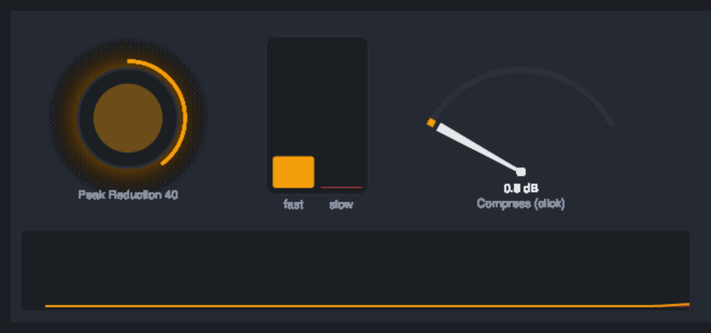

# Opto Compressor



## Introduction

An optical compressor does not have an attack and a release knob. Its gain is controlled by a light and a light-sensitive cell, and the cell has a mind of its own: it clamps down quickly on a new loud passage, keeps creeping a little deeper while the loudness lasts, and lets go in two stages: quickly after a short peak, slowly (seconds) after a long stretch of compression. That is why it levels vocals, bass and mixes so gently: it works on the overall level and leaves the short peaks and the natural decay alone.

The Opto Compressor models that gain element. You set **how hard** it works with **Peak Reduction**, the make-up with **Gain**, and the rest happens by itself.

The module is stereo, with an extra **Sidechain** input and a **Reduction** control output.

## How does it work?

```text
In -> make-up gain stage (valve + transformer colour) -> Mix -> Out
 |                        ^
 +-> detector -> photocell -> gain reduction
```

**The detector.** A light panel follows the level of the signal (the sidechain input if Sidechain is External): it lights up within about 1 ms and fades in about 30 ms. A high shelf in front of it, **HF Emphasis**, can make the detector hear the highs louder, so that bright sounds (sibilance, cymbals) compress more than the lows. Only the detector is filtered, not the audio. Peak Reduction turns the detector up by 0 to 40 dB: more gain in front of a fixed threshold, so a higher setting compresses quieter material.

**The compression curve.** The level above the threshold turns into a wanted amount of gain reduction with a soft knee:

- **Compress**: ratio about 3:1, a wide knee (14 dB), gentle.
- **Limit**: ratio about 10:1, a narrow knee (6 dB) and an attack twice as fast, for firmer control.

**The photocell.** The gain reduction is held by two parts that both chase the wanted amount, and the applied reduction is their mean:

- The **fast part** attacks in a few milliseconds (faster for a bigger jump in level: program-dependent attack) and releases in about 60 ms, a little longer when it holds more reduction.
- The **slow part** attacks with a time constant of about a second (2 s divided by 1 plus an eighth of the wanted reduction in dB) and releases with a time constant from 1 s up to 5.5 s, depending on how much it has charged. The more it holds, the slower it lets go: this is the photocell's memory. A short burst barely charges it; a long, hard stretch of compression charges it fully.

What you get: a short peak is attenuated by about half of what it would be in steady state and recovers within a fraction of a second; sustained loud material is compressed deeper over seconds and, when it ends, leaves a tail of several seconds in which the level recovers gently. The module's tests measure all of this: in the default setting, after 0.3 s of compression only about 13 % of the reduction is left after one second, after 20 s of compression about 39 %, and the slow tail has a time constant of about 3 s.

The time constants are in seconds, so the behaviour is the same at 44.1, 48 and 96 kHz.

**The make-up stage.** Gain is applied through a stage with a little valve and transformer colour: a smooth curve with a small bias adds an even (2nd) harmonic that grows with the level, and a low-frequency core saturation (only the bass below about 140 Hz feels it) adds odd harmonics when a large low-frequency swing passes. The more gain, the harder the stage works. The small-signal gain is exactly the Gain setting. The curve is evaluated with anti-aliasing, and it is bounded for any input.

**Link.** At 100 % both channels follow the louder one, so the stereo image does not shift. At 0 % they are independent. The photocell state is per channel.

**Mix** blends the compressed signal with the dry one (parallel compression). There is no latency, so the two stay in phase.

## How to use it?

- **Vocal leveler:** Compress, Peak Reduction 40 to 55, Gain to match the level, HF Emphasis 3 dB if sibilance jumps out.
- **Bass control:** Compress, Peak Reduction 50, Link 100 %, Gain +4 dB. The slow release keeps notes even without pumping.
- **Bus glue:** Compress, Peak Reduction 25, Mix 100 %. You should see 1 to 3 dB of reduction on the Gain Reduction meter.
- **Parallel density:** Limit, Peak Reduction 80, Mix 30 %.
- **Peak catching:** Limit, Peak Reduction 60: faster attack, higher ratio.
- **Ducking:** put a kick drum into the **Sidechain** input, set Sidechain to External, Limit mode, Peak Reduction 60.
- **De-essing by ear:** HF Emphasis 9 to 12 dB with moderate Peak Reduction: the sibilants trigger the compression and the body does not.
- **Use the Reduction output** to open a filter or light something when the signal is squashed: 0 is no reduction, 1 is 24 dB or more.

## The module's own UI

A lamp glows with the gain reduction. Beside it the photocell shows two bars: the fast stage and the slow stage (the charge), so you can see the slow one fill over seconds and linger after the fast one has let go. A needle on a spring shows the reduction in dB, and a strip scrolls the history of the reduction (bright) and the charge (faint). At silence the lamp breathes and the needle trembles, so the picture never looks dead.

- Drag the lamp up or down to turn Peak Reduction (the ring around it shows the setting).
- Click the dial to switch between Compress and Limit.

Tricks it demonstrates: easing the polled probes with a frame-rate independent exponential; a mass-on-a-spring needle (semi-implicit Euler with damping); ring buffers allocated once for the history; a layout expressed as fractions of the canvas width so it works in a narrow node; vertical drags mapped to a knob's range.

## Reference

### Inputs and outputs

| Jack | Type | Meaning |
| --- | --- | --- |
| In L | audio | Left input |
| In R | audio | Right input (in Auto mode, the left signal is used for both channels while nothing is patched here) |
| Sidechain | audio | The detector listens to this instead of the signal when Sidechain is External |
| Out L | audio | Left output |
| Out R | audio | Right output |
| Reduction | control | The gain reduction (the larger of the two channels), 0 to 1 where 1 is 24 dB or more |

### Controls

| Control | Range | Default | Meaning |
| --- | --- | --- | --- |
| Peak Reduction | 0 to 100 | 40 | How hard the detector is driven; the compression amount |
| Gain | -12 to +30 dB | +3 dB | Make-up gain, through the valve and transformer stage |
| Mode | Compress, Limit | Compress | Ratio and knee: about 3:1 soft / about 10:1 tight with a faster attack |
| HF Emphasis | 0 to 12 dB | 0 | High shelf (1.8 kHz) in the detector only |
| Mix | 0 to 100 % | 100 % | Dry / compressed blend |
| Link | 0 to 100 % | 100 % | Stereo link |
| Sidechain | Internal, External | Internal | Where the detector listens |
| Input | Auto, Stereo, Mono | Auto | Auto: the left input feeds both channels while the right one is unpatched (exactly 0 for 2048 samples); Stereo: both inputs; Mono: left to both |

### Probes

| Probe | Meaning |
| --- | --- |
| Gain Reduction | Current reduction in dB (the larger of the two channels) |
| Charge | The charge of the slow photocell stage in dB: how much the current compression will linger in the release |

### Photocell summary

| Quantity | Value |
| --- | --- |
| Fast attack | 12 ms at a 0 dB step, shorter for bigger steps (at least 1.5 ms); half that time in Limit |
| Fast release | about 60 ms (up to twice that with 24 dB of reduction) |
| Slow attack | about 2 s divided by (1 + wanted reduction / 8 dB) |
| Slow release | 1 s (empty) to 5.5 s (12 dB or more charged) |
| Share of the two parts | half and half |

### Notes

- The module has no latency.
- Cost: about 29,000 operations per 32-sample block by the checker's conservative count.
