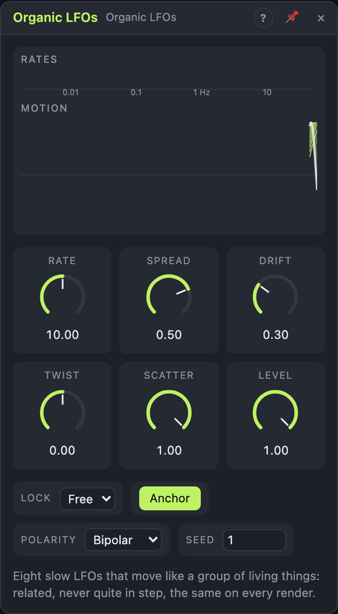

# Organic LFOs

## Introduction

Organic LFOs are **eight slow LFOs that move like a group of living
things**: related, but never quite in step. Think of a field of grass in the
wind, a flock of birds, or eight musicians breathing together without a
conductor.

One *Rate* sets the pace, *Spread* fans the eight speeds apart, and *Drift*
lets each one wander a little in speed and shape, so the pattern never lines
up exactly and never sounds mechanical. Yet nothing is left to chance: the
wandering comes from the *Seed*, so every render of your song moves exactly
the same way.

## How does it work?

**The fan.** LFO 1 runs at *Rate*. With *Spread* at +1 the others get
faster, up to LFO 8 at about 16 times the speed; at −1 they get slower; at 0
all eight share LFO 1's speed. Each LFO also gets a tiny seeded offset, so no
two of them settle into a simple, repeating relation.

**Drift** lets every LFO wander along a slow, smooth curve of its own: its
speed (at 100 %, between about 21 % slower and 27 % faster) and its shape. A
fast LFO wanders faster than a slow one; the wandering always takes a few of
its cycles. At 0 % everything is exact.

**Anchor** keeps LFO 1's speed exact (only its shape drifts), so it stays in
time with the song while the others float around it.

**Twist** changes the shape of all eight: at −1 soft, rounded plateaus
(almost a square), at 0 a sine, at +1 a fast rise to a narrow peak and a
long, lazy fall. Drift moves each LFO's twist a little around this.

**Scatter** sets how far apart the eight start after a *Reset* or a
transport start: at 0 % they all start together (and with Spread and Drift
at 0, all eight are identical), at 100 % they start anywhere in their cycle.

**Sum** mixes the eight into one complex contour, gently limited. **Max**
follows whichever LFO is highest at the moment: a restless upper outline,
mostly in the upper half, great in *Unipolar* for brightness or density.
*Level* scales every output.

### Free or locked

- **Free:** the LFOs run on their own. Their wandering is counted from the
  last Reset or transport start, so the same patch rendered from the same
  start moves the same way.
- **Bars:** *Rate* picks a note value for LFO 1 (64 bars … 1/4T). While the
  transport plays, everything is worked out from the song position: LFO 1
  sits at the same point at the same bar, the others move along their own
  paths, and jumping around the song (or rendering again) gives exactly the
  same movement. Drift shifts the phases instead of the speeds here. When
  the transport stops they run on at the current tempo. Turn *Spread* while
  locked and the fan re-forms around the song position, so set it rather
  than sweep it.

Changing the *Seed* (or the Lock) gives a different group; the outputs fade
over 50 ms so it doesn't click.

## How to use it?

- **Living pad:** eight outputs onto the cutoffs, pans or levels of eight
  voices or layers. Rate 0.05 Hz, Spread +0.4, Drift 40 %.
- **One complex contour:** *Sum* onto a filter or reverb mix: a curve that
  feels alive but never repeats within a song.
- **Breathing in time:** Lock Bars, Rate 4 bars, Anchor on, Drift 30 %:
  LFO 1 breathes with the bars, the others follow loosely.
- **Brightness that peaks:** *Max* in Unipolar onto a filter cutoff: every
  time one of the eight peaks, it opens.
- **Different per voice:** inside a Voice Cell, add *Voice In › Random* to
  *Twist* or *Rate* so each note gets its own movement.

<!-- generated:demos -->
## Demo patches

Five whole patches show what Organic LFOs does. In the standalone app open **File → Presets…** (⌘P) and pick *Organic LFOs* under *Demos by module*; on the website, **Run in Play** opens one in your browser. Loading one replaces the project and starts the transport.

| Patch | What it shows |
|---|---|
| **Organic LFOs: Living Pad** | Eight slow, related movements are spread over a pad: the filter, the oscillator shape and the reverb size each follow a different one, so the sound breathes without ever repeating exactly. Change Rate, Spread and Drift on the module to speed up or loosen the group. |
| **Organic LFOs: Breathing Chord** | Six of the eight outputs swell six notes of a chord in and out, so the harmony rearranges itself in a slow, natural way. Lower Scatter to make the voices move more alike, or turn Spread negative to reverse the order. |
| **Organic LFOs: Lively Pluck** | At a faster Rate with plenty of Drift, the same eight movements become a restless wobble: they open the filter, change the tone and add resonance to a plucked line, never twice the same way. Slow Rate and Drift down for a calmer feel. |
| **Organic LFOs: Bar-Locked Breath** | With Lock set to Bars the group repeats in step with the song, so the filter movement over a bass line and beat comes back exactly each time. Switch Lock back to Free and the same movement slips out of time. |
| **Organic LFOs: Wandering Voices** | Four held notes each wander across the stereo field, steered by different outputs, while Twist bends how the group is related. Change Twist and Spread to change how the voices follow each other. |
<!-- /generated -->

<!-- generated:presets -->
## Presets

The preset bar of the Organic LFOs view has 14 factory presets. Pick one to set the knobs, then change them to taste; your own presets sit next to them.

| Preset | What it does |
|---|---|
| **Living Group** | Eight related slow movers: a good default for evolving patches. |
| **Glacial** | Extremely slow drift for long-form changes. |
| **Gentle Breath** | Soft, breathing movement at reduced depth. |
| **Swarm** | Faster, busier group, like insects. |
| **Tight Family** | LFOs stay close together: subtle, related motion. |
| **Wide Spread** | Rates spread widely from slow to quick. |
| **Inverted Spread** | Spread reversed: the order of speeds flips. |
| **Twisted** | Twist skews the phases so the group chases itself. |
| **Counter Twist** | Twist the other way for opposite phase relations. |
| **Unipolar Drift** | Positive-only values, ideal for levels and mix knobs. |
| **Bar Locked** | Locked to the song for repeatable movement. |
| **Restless Drift** | Maximum drift: the group wanders and never repeats. |
| **Free Start** | Starts at random positions instead of anchored. |
| **Different Seed** | Another family of movements from a different seed. |
<!-- /generated -->

## Reference

### Knobs

| Knob | Range | Default |
|---|---|---|
| Rate | 0.002 – 20 Hz, or a note value with Lock = Bars | 0.2 Hz |
| Spread | −1 … +1 | +0.5 |
| Drift | 0 – 100 % | 30 % |
| Twist | −1 … +1 | 0 |
| Scatter | 0 – 100 % | 100 % |
| Level | 0 – 100 % | 100 % |

Every knob is a modulation destination.

### Settings

| Setting | Values | Default |
|---|---|---|
| Lock | Free, Bars | Free |
| Anchor | On, Off | On |
| Polarity | Bipolar, Unipolar | Bipolar |
| Seed | 0 – 999 | 1 |

### Inputs

| Input | Signal | What it does |
|---|---|---|
| Reset | trigger | restarts all eight at their scattered start phases (Free) |

### Outputs

| Output | Signal | What it does |
|---|---|---|
| Out 1 … Out 8 | control | the eight LFOs, slowest to fastest (Spread ≥ 0) |
| Sum | control | the eight mixed and soft-limited |
| Max | control | the highest of the eight |
