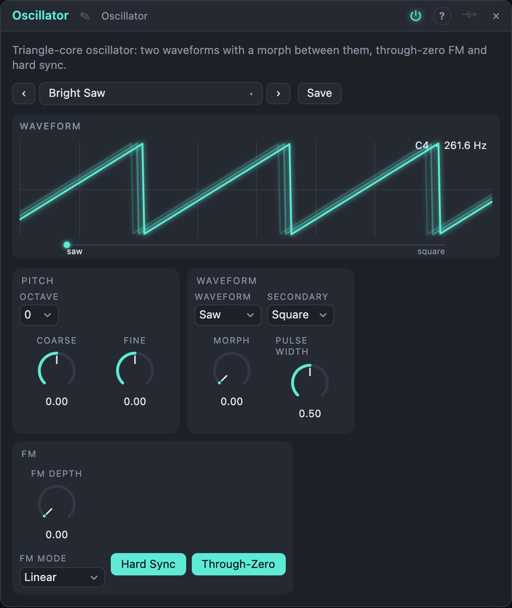

# Oscillator

## Introduction

The Oscillator is the sound source of most patches. It makes a steady tone
whose pitch follows the *Pitch* input. Pick a **Waveform** (sine, triangle,
saw or square) and, if you like, a **Secondary** waveform: the **Morph** knob
crossfades from one to the other. An FM section adds linear FM (through zero
or not) or exponential FM, and hard sync for bell-like, metallic and tearing sounds. Everything
comes out of one output, *Out*.

## How does it work?

At its core is a phase that runs from 0 to 1 once per cycle. All waveforms are
read from that same phase, so they are always in step. Saw and square are
band-limited (polyBLEP), so they don't alias in the high register.

**Waveform, Secondary and Morph.** *Out* plays the *Waveform* when *Morph* is
at 0 % (the default) and the *Secondary* waveform at 100 %. In between you hear
a crossfade of the two. Any pair works: sine to square, saw to triangle, or the
same waveform twice (then *Morph* does nothing).

**Pitch.** The frequency is C4 (261.6 Hz) × 2^pitch, where pitch is the sum of
*Octave*, *Coarse* (semitones), *Fine* (cents) and the *Pitch* input
(1 V/oct: +1.0 is one octave up, 0.0 is C4).

**FM.** The *FM* input changes the frequency linearly:
frequency × (1 + 4 × FM Depth × FM). With deep modulation the frequency can go
negative. With **Through-Zero** on (the default) the phase then runs backwards
instead of stopping, so the tone stays in tune even under heavy FM. With
*Through-Zero* off the frequency stops at 0 Hz: classic linear FM, grittier and
drifting off pitch as the depth rises.

**Exponential FM.** With *FM Mode* on *Exponential* the *FM* input moves the
pitch in octaves instead: frequency × 2^(4 × FM Depth × FM), so ±4 octaves at
full depth. The frequency never reaches 0 Hz (*Through-Zero* does nothing
here), and the average pitch rises with the depth, as on analog synths: good
for vibrato, sirens and growling, inharmonic tones.

**Hard sync.** With **Hard Sync** on (the default), each rising edge at *Sync*
(the signal crossing 0.5 upwards) resets the phase to the start of a cycle.
Turn it off to ignore the *Sync* input without unplugging it.

## How to use it?

- **Basic voice:** Voice In *Pitch* → Oscillator *Pitch*; *Out* → VCA → Voice
  Out. Pick the tone with *Waveform* (the default is a saw).
- **Morphing timbre:** set *Waveform* and *Secondary* to two different waves
  and patch a slow LFO or an envelope onto *Morph*.
- **Transpose:** use *Octave* for whole octaves and *Coarse* for intervals,
  e.g. +7 for a fifth on a second oscillator.
- **Detune:** two oscillators with *Fine* at −7 and +7 cents give a wide,
  chorused sound.
- **Pulse-width modulation:** set *Waveform* to Square and patch a slow
  Function onto *Pulse Width*.
- **FM:** patch a second oscillator (on a sine) into *FM* and raise *FM Depth*.
  Integer ratios between the two (*Coarse* 0, +12, +19) give harmonic tones;
  other ratios give bells and metal.
- **Hard sync:** patch a second oscillator's *Out* (on a square) into *Sync*.
  Set this oscillator higher and sweep its pitch for the classic sync lead.
- **Pitch bend and vibrato:** patch a bend or LFO signal into *Pitch*. For
  ±2 semitones set the cable amount to 2/12 ≈ 17 %.
- **Weight:** add a second Oscillator on a square one *Octave* lower, on the
  same *Pitch*, and mix it in under the first.

<!-- generated:presets -->
## Presets

The preset bar of the Oscillator view has 18 factory presets. Pick one to set the knobs, then change them to taste; your own presets sit next to them.

| Preset | What it does |
|---|---|
| **Bright Saw** | The classic sawtooth: a rich, bright starting point for any filter. |
| **Pure Sine** | A clean sine for sub bass, tones and as an FM carrier. |
| **Soft Triangle** | Mellow triangle with only odd, quiet harmonics. |
| **Hollow Square** | A 50 % square: woody, clarinet-like and hollow. |
| **Reedy Pulse** | A narrower pulse with a nasal, reed-like colour. |
| **Thin Pulse** | Very narrow pulse: thin and buzzy, great for chiptune leads. |
| **Sub Sine** | Two octaves down sine for deep, clean sub bass. |
| **Fat Bass Saw** | A saw an octave down, slightly flat: pair it with a second oscillator. |
| **Triangle To Saw** | Half-way between triangle and saw: a soft, round buzz; sweep Morph with an LFO. |
| **Sine To Square** | A sine with some square mixed in: round with a hollow edge; sweep Morph for a filter-like opening. |
| **Octave Lead** | A bright saw-to-square blend one octave up for cutting leads. |
| **Detuned Fifth** | Saw set a fifth up and slightly sharp: layer it with a root oscillator. |
| **Gentle FM** | A sine with the FM input open: patch a modulator in for bell tones. |
| **Strong FM** | Deep through-zero FM for metallic, clangorous timbres. |
| **Clamped FM** | Linear FM that stops at 0 Hz instead of running backwards: grittier, slightly out of tune under deep modulation. |
| **Exponential FM** | FM in octaves: the pitch swings up and down with the modulator, from vibrato to a snarling, inharmonic growl as the depth rises. |
| **Sync Sweep Base** | Saw for hard sync: patch a gate or a faster oscillator into Sync and sweep Coarse. |
| **Low Rumble** | Very low pulse: use as a drone, or slow rhythmic modulation. |
<!-- /generated -->

<!-- generated:demos -->
## Demo patches

Five whole patches show what Oscillator does. In the standalone app open **File → Presets…** (⌘P) and pick *Oscillator* under *Demos by module*; on the website they are in the [Oscillator entry of the Bleep Library](/library/detail/?kind=module&slug=oscillator#examples), where **Load in Play** opens one in your browser. Loading one replaces the project and starts the transport.

| Patch | What it shows |
|---|---|
| **[Oscillator: Morph Sweep](/library/detail/?kind=module&slug=oscillator#demo-1)** | A bass line on one Oscillator while a slow LFO moves Morph from the triangle (Waveform) to the square (Secondary), so the same note keeps changing colour. Set Morph by hand to freeze the blend, pick other waveforms, or move Pulse Width for a thinner square. |
| **[Oscillator: Hard Sync Sweep](/library/detail/?kind=module&slug=oscillator#demo-2)** | A lead oscillator is reset by the sequencer's gate on every note, while a slow LFO pushes its Coarse tuning upward: the classic tearing sync sweep. Turn Morph toward the square for a hollower bite, or lower the LFO amount for a calmer tone. |
| **[Oscillator: Through-Zero Bells](/library/detail/?kind=module&slug=oscillator#demo-3)** | A second Oscillator frequency-modulates the first through its FM input, and a decaying envelope on FM Depth makes each bell strike bright and then mellow. Change the modulator's Coarse for different bell families, or raise FM Depth for glassier tones. |
| **[Oscillator: Sub Octave Weight](/library/detail/?kind=module&slug=oscillator#demo-4)** | A pulse bass and a second Oscillator on a square one octave down are mixed under a drum loop, with Pulse Width moving slowly for a hollow, breathing bass. Mute the Sub channel on the mixer to hear how much weight it adds. |
| **[Oscillator: Three-Voice Pad](/library/detail/?kind=module&slug=oscillator#demo-5)** | Three Oscillators a few cents apart play slow chord roots, one pushed a fifth up, and a reverb spreads them wide. Change Fine on any oscillator for faster beating, or Morph for a brighter or softer pad. |
<!-- /generated -->

## Reference

### Knobs and settings

| Control | Range | Default |
|---|---|---|
| Octave | −3 … +3 | 0 |
| Coarse | −12 … +12 st | 0 st |
| Fine | −100 … +100 ct | 0 ct |
| Waveform | Sine, Triangle, Saw, Square | Saw |
| Secondary | Sine, Triangle, Saw, Square | Square |
| Morph | 0 – 100 % | 0 % |
| Pulse Width | 5 – 95 % | 50 % |
| FM Depth | 0 – 100 % | 0 % |
| FM Mode | Linear, Exponential | Linear |
| Hard Sync | on / off | on |
| Through-Zero | on / off | on |

- **Octave:** shifts the pitch by whole octaves. At 0 and with nothing at
  *Pitch*, the oscillator plays C4.
- **Coarse:** shifts the pitch in semitones. As a modulation destination it
  covers 24 semitones over the knob's full travel.
- **Fine:** shifts the pitch in cents (1/100 semitone), for detuning and tuning
  against other instruments.
- **Waveform:** the waveform at *Out* while *Morph* is at 0 %.
- **Secondary:** the waveform at *Out* when *Morph* is at 100 %.
- **Morph:** crossfades from *Waveform* (0 %) to *Secondary* (100 %).
  Modulating it gives an evolving timbre.
- **Pulse Width:** the duty cycle of the square, wherever the square is heard.
  50 % is a hollow square; narrow pulses sound thin and nasal. It doesn't
  affect the other waveforms.
- **FM Depth:** how strongly the *FM* input moves the frequency. At 100 % an
  FM signal of ±1 swings the frequency by ±4 times its base value (linear) or
  by ±4 octaves (exponential). With nothing at *FM* the knob does nothing.
- **FM Mode:** *Linear* (frequency × (1 + 4 × depth × FM), tuned FM tones) or
  *Exponential* (pitch in octaves, as on analog synths).
- **Hard Sync:** whether rising edges at *Sync* restart the cycle.
- **Through-Zero:** linear FM only: on, negative frequencies run the phase backwards (stays in
  tune); off, the frequency stops at 0 Hz.

Knobs (*Coarse*, *Fine*, *Morph*, *Pulse Width*, *FM Depth*) are modulation
destinations; *Octave*, the waveforms, *FM Mode* and the two switches can be set by a
cable from a Dial or a toggle.

### Inputs

| Input | Signal | What it does |
|---|---|---|
| Pitch | pitch, 1 V/oct | added to Octave, Coarse and Fine; 0.0 = C4 |
| FM | audio | linear or exponential frequency modulation (*FM Mode*), scaled by *FM Depth* |
| Sync | gate | with *Hard Sync* on, each rising edge restarts the cycle |

### Outputs

| Output | Signal | What it does |
|---|---|---|
| Out | audio | *Waveform* crossfaded toward *Secondary* by *Morph*, −1 … +1 |

Boards saved before the Oscillator had *Waveform*, *Secondary* and *Morph*
load with the same sound: the old *Shape* position becomes the matching pair
of waveforms and *Morph*. A cable from one of the old waveform outputs (*Sine*,
*Triangle*, *Saw*, *Square*) moves to *Out* with that waveform selected; a
cable from the old *Sub* output is removed.
