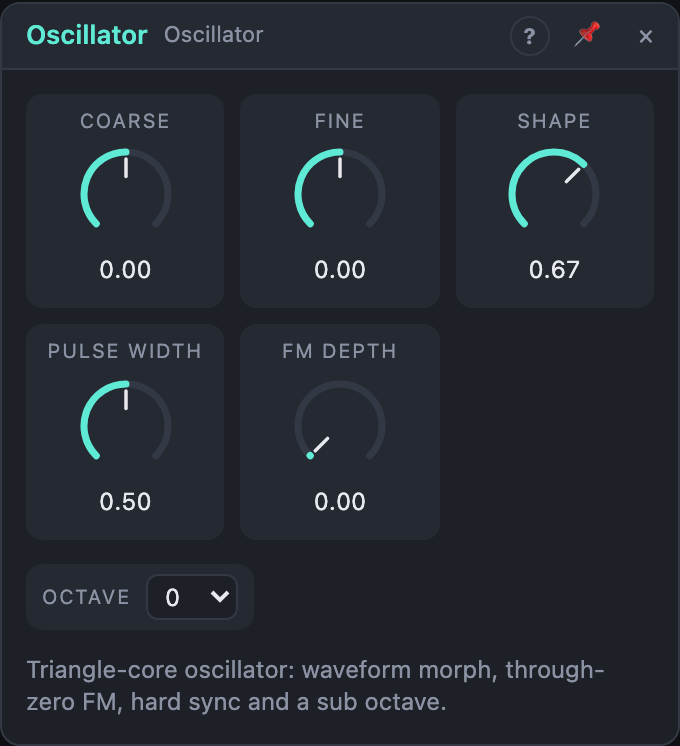

# Oscillator

## Introduction

The Oscillator is the sound source of most patches. It makes a steady tone
whose pitch follows the *Pitch* input. One knob sweeps its waveform from a pure
sine to a buzzing square. It also has through-zero FM for bell-like and metallic
tones, hard sync for tearing leads, and a sub-octave output for weight.

## How does it work?

At its core is a phase that runs from 0 to 1 once per cycle. All waveforms are
read from that same phase, so they are always in step:

- **Sine**, **Triangle**, **Saw** and **Square**, each on its own output. Saw
  and square are band-limited (polyBLEP), so they don't alias in the high
  register.
- **Out** morphs through the four with the **Shape** knob:
  sine → triangle → saw → square. Between two points you hear a crossfade of
  the two neighbours.
- **Sub** is a square wave one octave below. It flips every time the core
  completes a cycle.

**Pitch.** The frequency is C4 (261.6 Hz) × 2^pitch, where pitch is the sum of
*Octave*, *Coarse* (semitones), *Fine* (cents) and the *Pitch* input
(1 V/oct: +1.0 is one octave up, 0.0 is C4).

**Through-zero FM.** The *FM* input changes the frequency linearly:
frequency × (1 + 4 × FM Depth × FM). With deep modulation the frequency can go
negative. The phase then runs backwards instead of stopping, so the tone stays
in tune even under heavy FM.

**Hard sync.** Each rising edge at *Sync* (the signal crossing 0.5 upwards)
resets the phase to the start of a cycle.

## How to use it?

- **Basic voice:** Voice In *Pitch* → Oscillator *Pitch*; *Out* → VCA → Voice
  Out. Pick the tone with *Shape* (the default, 67 %, is a saw).
- **Transpose:** use *Octave* for whole octaves and *Coarse* for intervals,
  e.g. +7 for a fifth on a second oscillator.
- **Detune:** two oscillators with *Fine* at −7 and +7 cents give a wide,
  chorused sound.
- **Pulse-width modulation:** set *Shape* to 100 % (square) and patch a slow
  Function onto *Pulse Width*.
- **FM:** patch a second oscillator's *Sine* into *FM* and raise *FM Depth*.
  Integer ratios between the two (*Coarse* 0, +12, +19) give harmonic tones;
  other ratios give bells and metal.
- **Hard sync:** patch a second oscillator's *Square* into *Sync*. Set this
  oscillator higher and sweep its pitch for the classic sync lead.
- **Pitch bend and vibrato:** patch a bend or LFO signal into *Pitch*. For
  ±2 semitones set the cable amount to 2/12 ≈ 17 %.
- **Weight:** mix *Sub* in under *Out* for bass.

<!-- generated:presets -->
## Presets

The preset bar of the Oscillator view has 15 factory presets. Pick one to set the knobs, then change them to taste; your own presets sit next to them.

| Preset | What it does |
|---|---|
| **Bright Saw** | The classic sawtooth: a rich, bright starting point for any filter. |
| **Pure Sine** | A clean sine for sub bass, tones and as an FM carrier. |
| **Soft Triangle** | Mellow triangle with only odd, quiet harmonics. |
| **Hollow Square** | A 50 % square: woody, clarinet-like and hollow. |
| **Reedy Pulse** | A narrower pulse with a nasal, reed-like colour. |
| **Thin Pulse** | Very narrow pulse: thin and buzzy, great for chiptune leads. |
| **Sub Sine** | Two octaves down sine for deep, clean sub bass. |
| **Fat Bass Saw** | A saw an octave down, slightly flat: pair it with a second oscillator. |
| **Sine To Saw** | Half-way between triangle and saw: a soft, round buzz; sweep Shape with an LFO. |
| **Octave Lead** | A bright saw-to-square blend one octave up for cutting leads. |
| **Detuned Fifth** | Saw set a fifth up and slightly sharp: layer it with a root oscillator. |
| **Gentle FM** | A sine with the FM input open: patch a modulator in for bell tones. |
| **Strong FM** | Deep through-zero FM for metallic, clangorous timbres. |
| **Sync Sweep Base** | Saw for hard sync: patch a gate or a faster oscillator into Sync and sweep Coarse. |
| **Low Rumble** | Very low pulse: use as a drone, or slow rhythmic modulation. |
<!-- /generated -->

<!-- generated:demos -->
## Demo patches

Five whole patches show what Oscillator does. In the standalone app open **File → Presets…** (⌘P) and pick *Oscillator* under *Demos by module*; on the website, **Run in Play** opens one in your browser. Loading one replaces the project and starts the transport.

| Patch | What it shows |
|---|---|
| **Oscillator: Shape Sweep** | A bass line on one Oscillator while a slow LFO turns Shape from triangle through saw toward square, so the same note keeps changing colour. Set Shape by hand to freeze a waveform, or move Pulse Width for a thinner square. |
| **Oscillator: Hard Sync Sweep** | A lead oscillator is reset by the sequencer's gate on every note, while a slow LFO pushes its Coarse tuning upward: the classic tearing sync sweep. Turn Shape toward the saw for more bite, or lower the LFO amount for a calmer tone. |
| **Oscillator: Through-Zero Bells** | A second Oscillator frequency-modulates the first through its FM input, and a decaying envelope on FM Depth makes each bell strike bright and then mellow. Change the modulator's Coarse for different bell families, or raise FM Depth for glassier tones. |
| **Oscillator: Sub Octave Weight** | The main output and the Sub output (one octave down) are mixed under a drum loop, with Pulse Width moving slowly for a hollow, breathing bass. Mute the Sub channel on the mixer to hear how much weight it adds. |
| **Oscillator: Three-Voice Pad** | Three Oscillators a few cents apart play slow chord roots, one pushed a fifth up, and a reverb spreads them wide. Change Fine on any oscillator for faster beating, or Shape for a brighter or softer pad. |
<!-- /generated -->

## Reference

### Knobs and settings

| Control | Range | Default |
|---|---|---|
| Octave | −3 … +3 | 0 |
| Coarse | −12 … +12 st | 0 st |
| Fine | −100 … +100 ct | 0 ct |
| Shape | 0 – 100 % | 67 % (saw) |
| Pulse Width | 5 – 95 % | 50 % |
| FM Depth | 0 – 100 % | 0 % |

- **Octave:** shifts the pitch by whole octaves. At 0 and with nothing at
  *Pitch*, the oscillator plays C4.
- **Coarse:** shifts the pitch in semitones. As a modulation destination it
  covers 24 semitones over the knob's full travel.
- **Fine:** shifts the pitch in cents (1/100 semitone), for detuning and tuning
  against other instruments.
- **Shape:** the waveform at *Out*: 0 % sine, 33 % triangle, 67 % saw, 100 %
  square, with smooth morphs between. Modulating it gives an evolving timbre.
- **Pulse Width:** the duty cycle of the square, at *Square* and at the square
  end of *Out*. 50 % is a hollow square; narrow pulses sound thin and nasal.
  It doesn't affect the other waveforms or *Sub*.
- **FM Depth:** how strongly the *FM* input moves the frequency. At 100 % an
  FM signal of ±1 swings the frequency by ±4 times its base value, so it passes
  through zero. With nothing at *FM* the knob does nothing.

Knobs (all except *Octave*) are modulation destinations.

### Inputs

| Input | Signal | What it does |
|---|---|---|
| Pitch | pitch, 1 V/oct | added to Octave, Coarse and Fine; 0.0 = C4 |
| FM | audio | linear, through-zero frequency modulation, scaled by *FM Depth* |
| Sync | gate | each rising edge restarts the cycle (hard sync) |

### Outputs

| Output | Signal | What it does |
|---|---|---|
| Out | audio | the waveform chosen by *Shape* |
| Sine | audio | sine |
| Triangle | audio | triangle |
| Saw | audio | rising saw, band-limited |
| Square | audio | pulse with the set *Pulse Width*, band-limited |
| Sub | audio | square one octave below |

All outputs run between −1 and +1.
