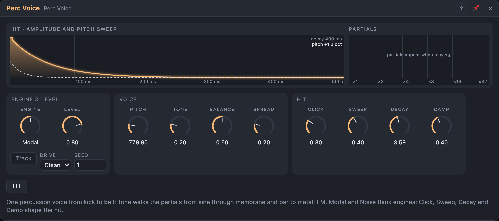

# Perc Voice

## Introduction

Perc Voice is one percussion voice that covers kicks, toms, hand drums, bells,
metal and noisy hits from a single model. *Pitch* sets the fundamental, *Tone*
walks the spectrum from a pure sine through drum-membrane and bar partials to
inharmonic clang, and *Click*, *Decay* and *Sweep* shape the hit. Three
engines give three families of sound behind the same knobs, so a sequencer or
an LFO can morph a kick into a bell.

Put it in a Voice Cell for a polyphonic, pitched percussion instrument.

## How does it work?

Every hit is made of up to **eight partials**. *Tone* picks their frequency
ratios:

| Tone | Partials |
|---|---|
| 0 % | a pure sine |
| 0 – 33 % | the drum-membrane partials fade in |
| 33 % | membrane: 1, 1.59, 2.14, 2.30, 2.65, … |
| 67 % | free bar: 1, 2.76, 5.40, 8.93, … |
| 100 % | metal: an inharmonic set drawn from *Seed* |

Between these points the partials glide smoothly. Each partial rings with its
own decay: *Decay* is the time the fundamental takes to fall by 60 dB, and
*Damp* makes the higher partials die faster.

The **engine** decides how the partials sound:

- **FM:** the partials are sine modulators driving one sine carrier at the
  fundamental. *Morph* is the modulation index (0 – 8). The index decays
  twice as fast as the body, so the attack is bright and the tail purer:
  classic FM toms, kicks and bells.
- **Modal:** the partials are eight struck resonators. *Morph* balances them:
  at 0 % the fundamental dominates (drums), at 100 % the upper partials
  (glassy bells). A second hit adds to the ringing like a real body, so rolls
  build up naturally.
- **Noise Bank:** noise rings through eight band-pass filters at the partial
  frequencies. *Morph* is their width: narrow sounds almost pitched (steel
  drums, wood), wide sounds noisy (snares, shakers). With *Tone* at 100 % it
  makes cymbals and gongs.

Every hit starts with a **click** (a short burst of filtered noise and a quick
upward pitch blip) and a **pitch sweep** that falls from up to three octaves
above to the set pitch.

**Accent** is the hit's strength: a strong hit is louder, has more click, a
deeper sweep and, in FM, a higher index. Soft hits are duller as well as
quieter, like a real drum.

Retriggering never clicks: a new hit starts on a second internal voice while
the previous one fades out in 3 ms (in *Modal* the body is struck again
instead). *Choke* fades everything out in 5 ms.

## How to use it?

- **Kick:** *Modal* or *FM*, Pitch around 50 Hz, Tone 0 – 15 %, Sweep 40 –
  70 %, Decay 300 – 600 ms.
- **Tom or hand drum:** Tone around 30 %, Pitch 80 – 300 Hz, a little Sweep.
- **Bell or glass:** *Modal*, Tone 60 – 100 %, Morph high, Damp low, long
  Decay.
- **Snare, shaker, cymbal:** *Noise Bank*, Morph high; Tone 100 % for metal.
- **In a Voice Cell:** *Voice In › Trigger* → *Trig*, *Pitch* → *Pitch*,
  *Velocity* → *Accent*, *Out L/R* → *Voice Out*, and *Active* → *Voice Out ›
  Active*. Each voice is freed when its hit has died away.
- **Open/closed pairs:** patch the trigger of a closed hat into the *Choke* of
  an open one.
- **Hit button:** plays the voice at accent 70 %, for trying sounds without
  patching.

The *Pitch* input adds octaves to the *Pitch* knob (1 V/oct). It is read at
each hit unless *Track* is on.

<!-- generated:demos -->
## Demo patches

Five whole patches show what Perc Voice does. In the standalone app open **File → Presets…** (⌘P) and pick *Perc Voice* under *Demos by module*; on the website, **Run in Play** opens one in your browser. Loading one replaces the project and starts the transport.

| Patch | What it shows |
|---|---|
| **Perc Voice: FM Kit** | Three Perc Voices make a whole kit: an FM kick with a long Sweep, a snappy mid voice with plenty of Click, and a hat from the Noise Bank engine. Change a voice's Tone or Decay to move between boom, tom and metal. |
| **Perc Voice: Tuned Toms** | With Track on, the sequencer's pitch tunes the Modal engine, so a membrane voice plays a melodic line like a set of tuned toms. Decay and Damp set how much the notes ring into each other; Sweep gives each hit its dive. |
| **Perc Voice: Metal Bells** | Tone near the top of its range and the FM engine turn the voice into a long, inharmonic bell; a slow sparse line plays it, with a second quieter bell an octave higher. Try Morph and Spread for different bell colours. |
| **Perc Voice: Noise Bank Shakers** | Two Noise Bank voices play off-beat shakers and a rim-like tick, with random accents so no two bars are alike. Pitch sets the colour of the bank, Decay the length of the shake, and Damp how fast the highs die. |
| **Perc Voice: Tone Sweep** | One voice plays the same rhythm while a slow LFO walks Tone from pure sine through membrane and bar to metal, then back: a single hit becomes a kick, a tom, a wood block and a clang over time. Switch Engine to hear the same sweep three ways. |
<!-- /generated -->

<!-- generated:presets -->
## Presets

The preset bar of the Perc Voice view has 15 factory presets. Pick one to set the knobs, then change them to taste; your own presets sit next to them.

| Preset | What it does |
|---|---|
| **Deep Kick** | Round sine kick with a downward pitch sweep. |
| **Punchy Kick** | Short, clicky kick with a touch of drive. |
| **Long Sub Boom** | Sub-heavy long kick: a decaying sine boom. |
| **Tight Tom** | Membrane tom, mid-pitched. |
| **Low Floor Tom** | Deep floor tom with longer ring. |
| **Snare Body** | Bright snare-like hit with noisy body. |
| **Rim Click** | Sharp, very short wooden click. |
| **Clap Noise** | Noisy burst for claps and snaps. |
| **Closed Hat** | Short metallic tick. |
| **Open Hat** | Longer metallic shimmer. |
| **Wood Block** | Dry, pitched wooden knock. |
| **Bar Marimba** | Pitched bar sound that follows the Pitch input. |
| **Cowbell** | Metallic FM clang. |
| **Bell Ring** | Long inharmonic bell: play it from the Pitch input. |
| **Zap Tom** | Extreme pitch sweep for sci-fi zaps. |
<!-- /generated -->

## Reference

### Knobs and settings

| Control | Range | Default |
|---|---|---|
| Pitch | 20 Hz – 4 kHz | 55 Hz |
| Tone | 0 – 100 % | 20 % |
| Morph | 0 – 100 % | 50 % |
| Click | 0 – 100 % | 30 % |
| Decay | 10 ms – 8 s | 400 ms |
| Damp | 0 – 100 % | 40 % |
| Sweep | 0 – 100 % | 40 % |
| Spread | 0 – 100 % | 20 % |
| Level | 0 – 100 % | 80 % |
| Engine | FM, Modal, Noise Bank | Modal |
| Track | Off, On | Off |
| Drive | Clean, Warm, Hot | Clean |
| Seed | 0 – 999 | 1 |

- **Pitch:** the fundamental.
- **Tone:** the partial ratios, from sine to metal (see above).
- **Morph:** per engine: FM index, partial balance (Modal) or band width
  (Noise Bank). Its name changes with the engine.
- **Click:** the attack transient: a 1 – 6 ms noise burst at 2 – 8 kHz (higher
  with Tone) plus a +2 octave pitch blip during the first 2 ms. In *Modal* and
  *Noise Bank* it also excites the body.
- **Decay:** the time the fundamental takes to fall by 60 dB.
- **Damp:** how much faster the upper partials decay. At 100 % a partial an
  octave up decays 8× faster.
- **Sweep:** the pitch drop at the start: up to +3 octaves, falling back in
  about Decay / 8.
- **Spread:** the stereo image. *Modal* and *Noise Bank*: odd partials lean
  left, even partials right (the fundamental stays centred). *FM*: the two
  sides are detuned by up to ±8 cents.
- **Level:** the output level.
- **Engine:** FM, Modal or Noise Bank. A dropdown a cable can drive, so it can be sequenced;
  it is read at each hit, and a sounding hit finishes with its own engine.
- **Track:** off: the *Pitch* input is read at each hit; on: it is followed
  live.
- **Drive:** soft saturation of the hit: *Warm* or *Hot*. It is applied
  relative to the hit's accent, so soft hits are as warm as loud ones.
- **Seed:** the metal partials and the noise. The same seed plays the same
  sounds; the noise sequence restarts when the transport starts.

Every knob is a modulation destination: patch a cable onto it to move it.
Knob changes apply to a sounding hit at once and smoothly.

### Inputs

| Input | Signal | What it does |
|---|---|---|
| Trig | trigger | plays a hit |
| Accent | control, 0 – 1 | hit strength, read at each hit; unpatched counts as 70 % |
| Pitch | pitch | added to *Pitch* in octaves (1 V/oct); read at each hit unless *Track* is on |
| Choke | trigger | fades the sound out in 5 ms |

### Outputs

| Output | Signal | What it does |
|---|---|---|
| Out L, Out R | audio | the voice |
| Env | control, 0 – 1 | the amplitude envelope of the fundamental, for ducking |
| Active | gate | high from a hit until the sound has fallen below −80 dB or was choked |
