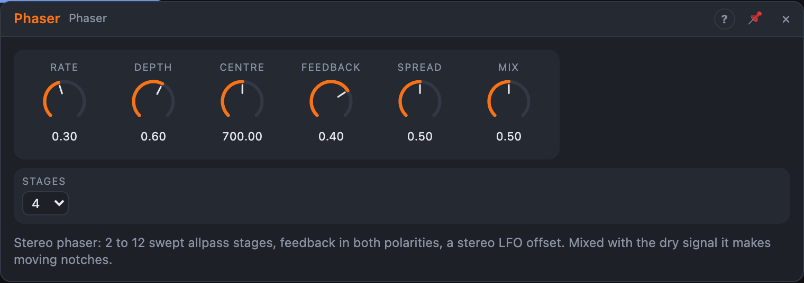

# Phaser

## Introduction

The Phaser makes the slow, swooshing sweep of the 70s: notches that travel up and down through the spectrum. It's best on sustained sounds with a lot of harmonics, like pads, strings, electric piano and guitar, and on drums and noise, where the sweep is easy to hear.

## How does it work?

The sound goes through a chain of *allpass* filters. An allpass changes only the phase of a signal, not its level, and by a different amount at different frequencies. Mixed with the unprocessed sound, a frequency where the chain has turned the phase by 180° is cancelled: a **notch**. Every two stages make one notch. An LFO moves the frequency of the allpass filters, so the notches sweep.

- **Rate** is the LFO speed, 0.02 to 10 Hz.
- **Depth** is how far the notches sweep, up to three octaves up and down from the centre.
- **Centre** is the middle of the sweep, 80 Hz to 6 kHz. Low values sound dark and thick, high values thin and airy.
- **Feedback** feeds the chain's output back to its input. More feedback makes the notches deeper and the peaks between them sharper and resonant, a more vocal, whistling sweep. Negative feedback gives a hollower sound. It's softly limited, so it can't run away.
- **Stages** is how many allpass stages there are: 2 to 12. Two stages give one notch (subtle), four the classic sound, eight or twelve a busy, complex sweep.
- **Spread** moves the right channel's LFO away from the left, up to half a cycle, so the sweep rotates across the stereo field.
- **Mix** blends dry and wet. At 50 % the notches are deepest. At 100 % you hear only the allpass chain, which has no notches, only changes in phase (and, with feedback, resonant peaks).

With only *In L* patched, the signal feeds both sides.

## How to use it?

- **Classic phaser:** Rate 0.3 Hz, Depth 60 %, Centre 700 Hz, Feedback 40 %, 4 stages, Mix 50 %.
- **Resonant whistle:** Feedback 85 %, 8 stages, Depth 80 %.
- **Slow, wide pad movement:** Rate 0.05 Hz, Depth 90 %, Spread 100 %, 6 stages.
- **Envelope phaser:** Rate 0, an envelope follower or ADSR onto *Centre*, for a vocal "wah"-like response.
- **Rhythmic sweep:** a clocked LFO onto *Centre*, with Rate at 0.02 Hz so the internal LFO barely moves.

To make the sweep a more sudden swoosh, put a [Compressor](compressor.md) before it, so the level is constant while notches travel.
