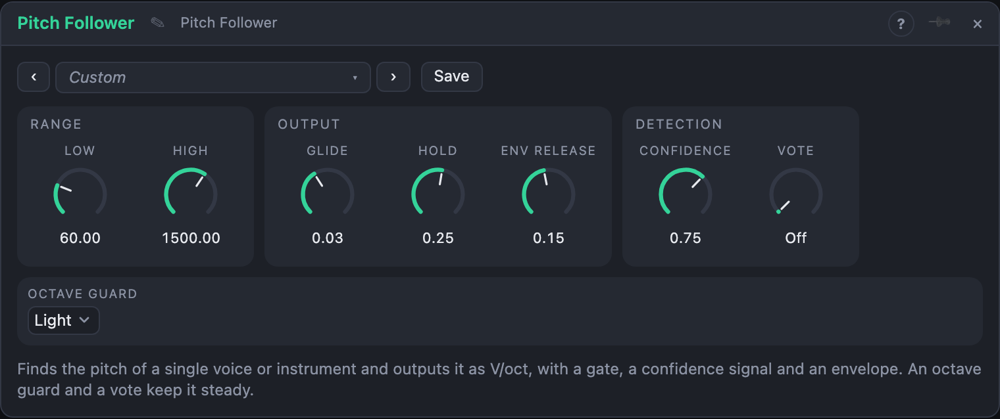

# Pitch Follower

## Introduction

The Pitch Follower listens to **one voice or instrument at a time** and tells the
rest of the board which note it plays. Its *Pitch* output is a V/oct signal, so it
can drive an oscillator, a quantizer or a filter's cutoff; *Gate* says whether
there is a note at all, *Confidence* how sure the module is, and *Env* follows how
loud the sound is.

It is for **single notes**. Chords and dense mixes have no single pitch, and the
output will wander. For loudness alone use the *Envelope Follower*; to just look at
the pitch and see how far off it is, use the *Tuner*.

## How does it work?

The module looks for the **period** of the sound: how long it takes for the wave
to repeat. It compares the signal with copies of itself shifted by every period
that could be right and takes the first shift for which the two match well. The
method is the standard difference-function search from the pitch-detection
literature, written for this module (nothing is copied from anywhere). A new
result arrives every few milliseconds.

How well the shifted copy matches is the **confidence**. A clean sung vowel scores
above 90 %, a breathy sound 60 %, noise 20 %. Only results above the *Confidence*
setting count as a note.

- **Low** and **High** say which pitches to look for. The lower *Low* is, the
  longer the stretch of sound the module needs to see, so the slower it answers
  and the more it costs. Set them around the range of the instrument: raising
  *Low* from 60 to 150 Hz halves the delay.
- **Glide** slides the output between notes. Short values give steps, long values
  a portamento. A new note after a pause starts at its own pitch without gliding
  from the last one.
- **Hold** keeps the *Gate* open for a while after the pitch is lost, so a note
  survives a gap or a breath. The *Pitch* output holds its last value for as long as no
  new note is heard, so a synth that is still sounding does not fall to 0 V.
- **Octave Guard** fights the most common mistake of any pitch tracker: jumping an
  octave (or a twelfth) because of a strong overtone. With the guard on, a jump of
  more than half an octave is only believed once it has been heard steadily for
  30 ms (Light) or 80 ms (Firm). A real octave leap arrives after that short
  delay; a one-frame mistake never does.
- **Vote** takes the median of the last 3, 5, 7 or 9 results: single outliers
  vanish and the pitch becomes steadier, at the price of a little delay.
- **Env Release** is how fast the *Env* output falls (it rises in 2 ms).

## How to use it?

- **Voice to synth:** *Pitch* into an oscillator's pitch input and *Gate* into
  an envelope. Hum a line and the synth plays it. Use *Smooth Glide* for a smooth
  result and *Fast and Twitchy* to hear every wobble.
- **Harmony:** *Pitch* into a *Quantizer* so the synth always lands on the scale,
  or add a fifth with an *Attenuverter*.
- **Filter that follows the note:** *Pitch* into the cutoff of a filter, so
  that high notes are brighter.
- **Gate by confidence:** *Confidence* into a VCA's gain: only clear tones pass.
- **No gate, only pitch:** if a sound has no pauses leave *Hold* long, so the
  gate stays open all the time.
- **Octave trouble?** Set *Octave Guard* to *Firm* and *Vote* to 5, or narrow
  *Low* and *High* around the instrument.

<!-- generated:demos -->
## Demo patches

Five whole patches show what Pitch Follower does. In the standalone app open **File → Presets…** (⌘P) and pick *Pitch Follower* under *Demos by module*; on the website, **Run in Play** opens one in your browser. Loading one replaces the project and starts the transport.

| Patch | What it shows |
|---|---|
| **Pitch Follower: Voice to Synth Bridge** | A bright plucked melody is followed note by note, and two soft synth voices play it for you an octave and a fifth lower, each note opened by the follower's Gate. Try Smooth Glide-like values on Glide to slide between the notes, or raise Confidence to hear the bridge hesitate. |
| **Pitch Follower: Brightness Follows Note** | A melody that leaps across two octaves is followed, and its Pitch opens the filter on a held two-note drone: low notes make the drone dark, high notes make it shine. Change the filter's Keytrack to make the effect stronger or gentler. |
| **Pitch Follower: Only Clear Tones Pass** | A source alternates every bar between a clear melody and bursts of noise. The follower's Confidence drops for the noise, so the chime voice it drives plays the tune and falls silent in between. Lower the Confidence knob to let the noise start false notes. |
| **Pitch Follower: Guard and Vote** | A jumpy melody on a sound with a loud second harmonic is the hard case for any pitch tracker. Octave Guard Firm and a Vote of 5 keep the follower on the right note, and a Quantizer tidies it onto the scale for a plucked voice. Set Guard to Off and Vote to Off and listen for octave slips. |
| **Pitch Follower: Portamento and Env** | A slow, legato melody is followed with a long Glide, so the synth slides from note to note like a portamento voice. The Env output opens a filter and the delay mix with each note's loudness. Shorten Glide for steps, or lengthen Env Release for a longer tail. |
<!-- /generated -->

<!-- generated:presets -->
## Presets

The preset bar of the Pitch Follower view has 12 factory presets. Pick one to set the knobs, then change them to taste; your own presets sit next to them.

| Preset | What it does |
|---|---|
| **Voice** | All-round setting for a singing or speaking voice. |
| **Bass** | Low range for a bass; the firm guard ignores octave mix-ups on heavy low notes. |
| **Guitar** | Plucked strings: a vote of three evens out the first wobbly cycles. |
| **Flute and Whistle** | High and pure sounds with a quick response. |
| **Fast and Twitchy** | No stabilisers and almost no glide: every little movement reaches the output. |
| **Smooth Glide** | Notes slide into each other, a portamento from any voice. |
| **Rock Steady** | A firm guard and a vote of nine: slow to believe, then very stable. |
| **Long Hold** | The gate stays open for a second and a half after the sound stops. |
| **Strict Confidence** | Only clean, clearly pitched sound counts. For dirty input. |
| **Loose Tracker** | Follows rough and breathy sounds, at the price of the odd wrong note. |
| **Pad Follower** | Slow envelope and gate for driving pads and drones from a voice. |
| **Deep Range** | Sub-bass territory; the longest analysis window, so the slowest to answer. |
<!-- /generated -->

## Reference

### Knobs

| Knob | Range | Default |
|---|---|---|
| Low | 30 – 500 Hz | 60 Hz |
| High | 200 – 5000 Hz | 1500 Hz |
| Glide | 0 – 2 s | 30 ms |
| Hold | 0 – 2 s | 250 ms |
| Confidence | 30 – 98 % | 75 % |
| Vote | Off, 3, 5, 7, 9 | Off |
| Env Release | 5 ms – 2 s | 150 ms |

Every knob is a modulation destination.

### Settings

| Setting | Values | Default |
|---|---|---|
| Octave Guard | Off, Light, Firm | Light |

### Inputs

| Input | Signal | What it does |
|---|---|---|
| In | audio | the sound to follow, one note at a time |

### Outputs

| Output | Signal | What it does |
|---|---|---|
| Pitch | pitch | the pitch in V/oct, 0 V = middle C; holds while nothing is heard |
| Gate | gate | high while a note is heard, plus the Hold time |
| Confidence | control | 0…1, how clear the pitch is |
| Env | control | the loudness of the input, fast attack, release from *Env Release* |

## Origin

The pitch search is the published difference-function method for monophonic pitch detection (a normalised squared-difference search with an absolute threshold and a parabolic refinement). It was written for this module from the description; no source code was ported.
