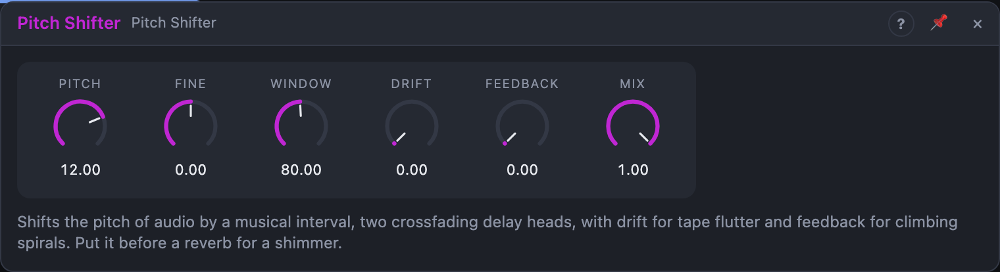

# Pitch Shifter

## Introduction

The Pitch Shifter moves a sound up or down by a musical interval and keeps its rhythm: a vocal an octave up, a pad a fifth down, a guitar doubled at +12 and −12. Unlike the [Freq Shifter](freq-shifter.md), which adds a fixed number of hertz and breaks harmony, the Pitch Shifter multiplies every frequency by the same ratio, so chords stay chords.

Put it in front of a [Verb](reverb.md) and feed the reverb back into it, and every echo climbs another octave: a **shimmer**. The factory cell *Shimmer Verb* is built that way.

## How does it work?

The signal is written into a short delay line. Two read heads sweep through it. A head that moves *against* the writing point reads faster than real time, so it plays higher; one that moves with it reads slower, so lower. A head can only sweep so far, so each one fades out as it nears the end of the *window* and jumps back, while the other, half a window behind, fades in. The two fades are sine-shaped, so one head is always loud.

This is the simple, cheap way to shift pitch. It has a character: the jump of the heads leaves a faint **flutter** at the sweep rate (a few Hz to tens of Hz at big intervals), and the sound is a little "grainy", most on sustained tones. Inside a reverb, that is not heard; on a dry vocal it is a voice. A phase-vocoder shifter is cleaner, but it adds a lot of delay and CPU.

- **Pitch** is the interval in semitones, −24 to +24. Modulating it with an envelope or LFO gives dive bombs and vibrato. **Fine** adds ±100 cents for detuned doubling (+7 and −7 cents on two shifters in parallel is a classic widener).
- **Window** is the length of the delay the heads sweep through, 20 to 340 ms. Short windows follow fast notes and give a tight, buzzy character; long windows are smoother and stretch into an echo. Around 60–100 ms suits most material; 150 ms or more for pads. The shifter's latency is about half a window.
- **Drift** makes the heads wander randomly, slowly: tape-like flutter and a wide, chorused sound. It also works at 0 semitones.
- **Feedback** sends the shifted sound back into the input, softly limited. With +12 semitones every repeat is an octave higher than the one before (a rising spiral), with −12 they fall.
- **Mix** blends the dry input with the shifted sound. At 100 % you hear only the shifted signal.

The left and right sides are separate shifters (with different drift), so the stereo image stays. With only *In L* patched, the signal feeds both sides.

## How to use it?

- **Shimmer:** Pitch +12, Window 100 ms, Mix 100 %, into a Verb, and the Verb's output back to the shifter's input through a Utility at 30–40 %. Or use the *Shimmer Verb* preset.
- **Octave down:** Pitch −12, Mix 50 %, for a sub-octave under a bass or a lead.
- **Harmoniser:** two Pitch Shifters in parallel, +4 and +7 semitones, Mix 40 %, for a major triad on a single note.
- **Wide doubling:** Pitch 0, Fine +12 cents, Drift 30 %, Mix 50 %.
- **Dive bomb:** an envelope onto Pitch, down 24 semitones, Mix 100 %.
- **Spiral:** Pitch +7, Feedback 60 %, Mix 50 %, into a delay: each repeat is a fifth higher.

## Origin

The pitch-shifting algorithm (two crossfading delay-line heads, and the Fun parameter, here called Drift) is from **PitchShifter (DaisySP)** by Electrosmith, [github.com/electro-smith/DaisySP](https://github.com/electro-smith/DaisySP), MIT licence. Bleep's version is rewritten for stereo and our delay line, with a smoothed window size, fine tuning, feedback with a soft clip and a seeded random generator, so offline renders repeat. The original licence text is in this module's `LICENSE` file.

<!-- generated:presets -->
## Presets

The preset bar of the Pitch Shifter view has 14 factory presets. Pick one to set the knobs, then change them to taste; your own presets sit next to them.

| Preset | What it does |
|---|---|
| **Octave Up** | Straight octave up. |
| **Octave Down** | Straight octave down. |
| **Octave Blend** | Octave up under the dry signal for sparkle. |
| **Fifth Up** | Adds a perfect fifth for power-chord thickness. |
| **Sub Octave** | Dry plus an octave below for weight. |
| **Detune Double** | A slightly sharp copy: classic detune thickening. |
| **Wide Detune** | Flat detune with a little drift. |
| **Tape Flutter** | Wobbling pitch like worn tape. |
| **Shimmer Spiral** | Climbing octaves: put it before a reverb. |
| **Dark Descent** | Falling spiral that sinks into the dark. |
| **Minor Third Echo** | Feedback stacks minor thirds into a diminished haze. |
| **Chipmunk** | An octave and a fifth up: cartoon voice. |
| **Monster** | Dark, slow, huge voice. |
| **Granular Window** | Tiny window: choppy, grainy artefacts. |
<!-- /generated -->

<!-- generated:demos -->
## Demo patches

Five whole patches show what Pitch Shifter does. In the standalone app open **File → Presets…** (⌘P) and pick *Pitch Shifter* under *Demos by module*; on the website, **Run in Play** opens one in your browser. Loading one replaces the project and starts the transport.

| Patch | What it shows |
|---|---|
| **Pitch Shifter: Octave Shimmer** | A pluck melody goes up an octave into a Pitch Shifter with Feedback and then a big reverb: each tail climbs in octaves into a glassy shimmer. Lower Feedback for a single octave halo or try +7 for a fifth. |
| **Pitch Shifter: Octave Down Weight** | A bass riff is blended with a copy an octave lower, doubling its depth at half Mix. Try -5 or -7 for a thick parallel line or raise Window for smoother, less grainy low notes. |
| **Pitch Shifter: Parallel Fifth** | The Shifter adds a line a fifth above the melody at half Mix, so every note is paired with a power-chord partner. Change Pitch to +4 for a major third, +3 for a minor third or -5 for a fourth below. |
| **Pitch Shifter: Fine Detune Doubler** | With Pitch at zero and just 12 cents of Fine plus a little Drift, a held pad is doubled by a slightly out-of-tune, wavering copy, which thickens it like an ensemble. Increase Drift for tape-like flutter or Fine for a wider detune. |
| **Pitch Shifter: Climbing Spiral** | Sparse notes enter a Pitch Shifter set a few semitones up with high Feedback: each echo is shifted again and spirals upward until it fades. Make Pitch negative and the spiral falls instead; add Drift for flutter. |
<!-- /generated -->
