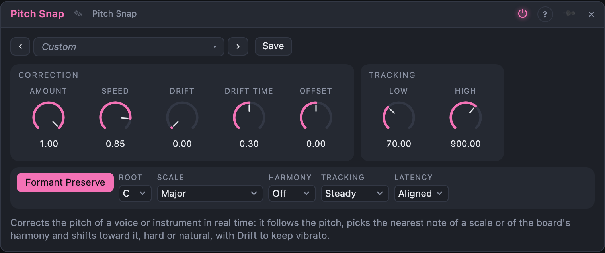

# Pitch Snap

## Introduction

Pitch Snap is a **pitch corrector** for a voice or any single-note instrument. It
finds the pitch of what comes in, picks the nearest note of a scale and moves the
sound toward it: all the way and at once for the stepped sound of a hard retune,
slowly and partly for an almost invisible nudge.

Two things set it apart. **Drift** corrects the *average* pitch of a note and lets the
fast movement around it, the vibrato, through, so a singer stays a singer. And the
**Target** output tells the rest of the patch which note it is aiming at, so a synth
can play along with the corrected voice.

It works on **one note at a time**. Chords and noise are not changed: wherever it
cannot hear a pitch the sound passes through, delayed to match.

## How does it work?

A pitch tracker (the one shared by the *Pitch Follower* and the *Tuner*) measures how
long one cycle of the sound lasts. The shifting itself cuts the sound into short grains,
two cycles long, and lays them down again one *new* cycle apart. A grain is repeated if the new pitch is
higher and skipped if it is lower; the grains are always taken a whole number of cycles apart, so they fit together
without a seam.

- **Amount** is how much of the error is corrected: at 100 % every note ends on the scale
  note, at 50 % it ends half-way there, at 0 % nothing changes.
- **Speed** is how fast the correction takes hold. At 100 % it is instant (the stepped
  sound); the lower it is, the slower the pitch slides toward the note. Below about 40 %
  it takes a few hundred milliseconds, which sounds natural.
- **Drift** lets the pitch wander around the note. At 0 % every wobble is flattened.
  At 100 % only the *average* pitch over **Drift Time** is pulled onto the note, so vibrato and
  scoops survive. Because the average needs time to settle, a note can leave its
  target for a short while after the attack.
- **Offset** (knob and jack: 1 V = 12 semitones) moves the target after the correction:
  +12 sings an octave above, +7 a fifth. Combined with *Target* it makes a harmony voice.
- **Formant Preserve** keeps the character of the voice: with it on, grains are copied as
  they are, so a vowel stays a vowel while the pitch moves. Off, the grains are resampled, as in a plain
  pitch shifter: raise the pitch and the voice becomes smaller.
- **Root** and **Scale** choose the notes. **Harmony** takes them from a *Harmony Master*
  on a bus instead, with **Target** choosing between the scale, the chord tones or chord tones
  first.
- **Low** and **High** say which pitches to look for. A lower *Low* means a longer analysis
  window: slower and more delay. **Tracking** decides how stable the detection is: *Fast* has no
  stabilisers, *Steady* has a light octave guard and a vote of three, *Rock Solid* a firm guard and a vote of five.
- **Latency**: *Aligned* delays the sound by the time the detection needs, so a correction lands on exactly the
  sound it was measured on and even a quick vibrato is flattened properly (20–30 ms at the default range, about 12 ms with *Low* at 150 Hz).
  *Quick* uses the freshest sound and is about half as late, but a fast vibrato is only partly corrected.

Outputs: **Out** is the corrected sound, **Target** the note it aims at in V/oct (held while
nothing is heard), **Pitch** the detected input pitch and **Shift** the applied shift in octaves.

## How to use it?

- **Hard retune:** *Hard Snap* with Scale *Chromatic*. Everything is on a semitone.
- **Natural correction:** a Scale for the song, *Speed* near 50 % and some *Drift*.
- **Keep the vibrato:** *Drift* at 100 % and *Drift Time* about 350 ms.
- **Harmony voices:** two Pitch Snaps in parallel with *Offset* +4 and +7 (or the two
  *Target* chord tones from a *Harmony Master* bus).
- **Play along:** *Target* into an oscillator: a synth that plays the notes the voice is corrected to.
- **A stepped sound for a synth line:** a sawtooth into *In*, *Hard Snap* in *Minor Pentatonic*.
- **Monitoring:** *Quick Monitor* for a short delay while singing.

<!-- generated:demos -->
## Demo patches

Five whole patches show what Pitch Snap does. In the standalone app open **File → Presets…** (⌘P) and pick *Pitch Snap* under *Demos by module*; on the website, **Run in Play** opens one in your browser. Loading one replaces the project and starts the transport.

| Patch | What it shows |
|---|---|
| **Pitch Snap: Hard Retune** | A wobbly saw line with notes that do not belong to the key goes into a Pitch Snap set to hard correction in A minor pentatonic: every note jumps onto the scale with the stepped, robotic sound of a hard retune. Set Amount to 0 to hear the raw out-of-tune line, then bring it back up, or lower Speed for a softer glide. |
| **Pitch Snap: Drift Keeps the Vibrato** | A slow line with a 5.5 Hz vibrato and a drunken detune is pulled onto C major by a Pitch Snap with Drift at 100 %, so the average pitch is corrected while the vibrato stays alive. Set Drift to 0 and the vibrato is flattened into a steady tone; try a lower Drift Time for a quicker grip. |
| **Pitch Snap: Three-Voice Harmony** | One sloppy lead feeds three Pitch Snaps in parallel: the lead itself, one a fifth above (+7 Offset) and one an octave below (-12), each tuned to C major pentatonic and panned apart. Change an Offset to +4 for a major third or +12 for a bright octave double. |
| **Pitch Snap: Bass Plays Along** | A Harmony Master runs an i-VI-III-VII progression on Bus A; a drunken lead is snapped to the chord tones and the Target output drives a bass oscillator, so the bass always plays the exact note the lead is corrected to. Change the Target setting to Chord + Scale to let passing notes through, or the Harmony Master's key to move everything. |
| **Pitch Snap: Stepped Offset with Formant** | A formant oscillator sings a steady line while a slow sequencer feeds the Offset jack, transposing the corrected voice in steps of 0, +5, +7 and +3 semitones with its vowel kept in place by Formant Preserve. Switch Formant off and the vowel slides with the pitch like a plain pitch shifter. |
<!-- /generated -->

<!-- generated:presets -->
## Presets

The preset bar of the Pitch Snap view has 16 factory presets. Pick one to set the knobs, then change them to taste; your own presets sit next to them.

| Preset | What it does |
|---|---|
| **Hard Snap** | Every note jumps straight to the nearest semitone: the classic stepped sound. |
| **Natural Major** | A gentle pull toward the C major scale that still sounds sung. |
| **Gentle Nudge** | Half the error is corrected, slowly: a tired voice gets a little help. |
| **Keep the Vibrato** | The average pitch lands on the note while the vibrato around it survives. |
| **Drifty Slide** | Slow retune with plenty of drift: notes wander in from the side. |
| **Pentatonic Lock** | Whatever you sing ends up on an A minor pentatonic note. |
| **Blues Voice** | Pulls toward the E blues scale, with the speed of a bent note. |
| **Whole Tone Dream** | Hard retune onto a whole-tone scale: floating, unresolved. |
| **Octave Up** | Snaps, then sings an octave higher with the vowel left where it was. |
| **Fifth Above** | A harmony voice a fifth above the corrected note. |
| **Octave Down** | A second voice an octave below, which keeps the vowel. |
| **Chipmunk** | Formant Preserve off: raising the pitch drags the vowel up too. |
| **Follow the Band** | Takes its notes from a Harmony Master on bus A: chord tones first, then the scale. |
| **Chord Tones Only** | Only the notes of the current chord are allowed. |
| **Bass Corrector** | Low range and a firm tracker for a bass. |
| **Quick Monitor** | As little delay as it can: for monitoring a voice while singing. |
<!-- /generated -->

## Reference

### Knobs

| Knob | Range | Default |
|---|---|---|
| Amount | 0 – 100 % | 100 % |
| Speed | 0 – 100 % | 85 % |
| Drift | 0 – 100 % | 0 % |
| Drift Time | 50 ms – 1 s | 300 ms |
| Offset | −24 – +24 st | 0 st |
| Low | 30 – 400 Hz | 70 Hz |
| High | 200 – 2000 Hz | 900 Hz |

### Settings

| Setting | Values | Default |
|---|---|---|
| Formant Preserve | on / off | on |
| Root | C … B | C |
| Scale | Chromatic, Major, Natural Minor, Harmonic Minor, Melodic Minor, Dorian, Phrygian, Lydian, Mixolydian, Locrian, Phrygian Dominant, Major Pentatonic, Minor Pentatonic, Blues, Whole Tone, Diminished, Hirajoshi | Major |
| Harmony | Off, Bus A, Bus B, Bus C, Bus D | Off |
| Target (with a bus) | Scale, Chord, Chord + Scale | Scale |
| Tracking | Fast, Steady, Rock Solid | Steady |
| Latency | Aligned, Quick | Aligned |

### Inputs

| Input | Signal | What it does |
|---|---|---|
| In | audio | the voice or instrument to correct |
| Offset | pitch | added to the target note, 1 V = 12 semitones |

### Outputs

| Output | Signal | What it does |
|---|---|---|
| Out | audio | the corrected sound |
| Target | pitch | the note it is aiming at, in V/oct, held while unvoiced |
| Pitch | pitch | the detected pitch of the input, V/oct |
| Shift | control | the applied shift, in octaves (semitones / 12) |

## Origin

Pitch tracking is shared with the Pitch Follower. The shifting is pitch-synchronous overlap-add, a classic published technique for changing the pitch of voiced sound without changing its timing. It was written for this module; no source code was ported.
