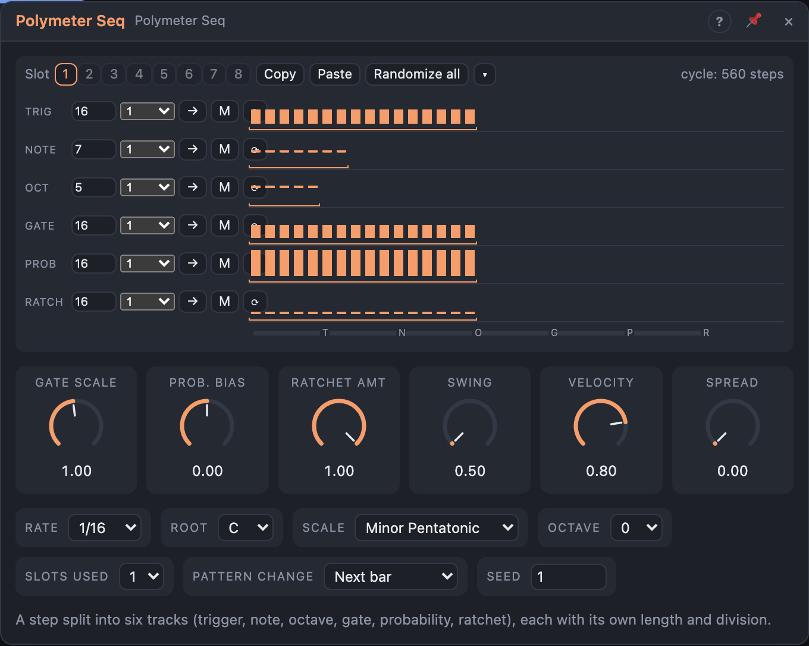

# Polymeter Seq

## Introduction

The Polymeter Seq takes what a step usually holds — *does it play, which
note, which octave, how long, how likely, how many repeats* — and gives each
its own **track**: *Trigger*, *Note*, *Octave*, *Gate*, *Probability* and
*Ratchet*. Every track has its own **length**, **loop window**, **clock
division** and **direction**, so they drift against each other. A 16-step
rhythm over a 7-step melody and a 5-step octave pattern takes 560 steps to
repeat — and it still lands on the song's grid and renders the same every
time.

Patch *Notes* into a Voice Cell and press play: a new module plays exactly
that drifting line.

## How does it work?

**Base ticks.** With nothing in *Clock*, ticks follow the transport at *Rate*;
with a trigger in *Clock*, each trigger is one tick. Each track runs at its
**division** of the tick: ×2, ×3, ×4 step two to four times per tick, /2 …
/16 every 2 to 16 ticks. Its position is worked out from the tick count, so
after a loop jump, or starting in the middle of the song, every track is
exactly where it would have been.

**Loops and directions.** A track plays the steps between its loop start and
end: forward, backward, back and forth (ends not repeated) or at random
(seeded).

**Hits.** A note happens when the **Trigger** track steps onto an *On* or
*Accent* step and the **Probability** step wins the dice (plus *Prob.
Bias*). The other tracks are read at that moment:

- **Note** holds a **scale degree** (0 = the root, 1 = the next note of the
  scale, −1 the one below …), so changing *Scale* keeps the melody's shape
  and every note stays in key.
- **Octave** shifts by −3 … +3 octaves.
- **Gate** is the share of the hit the note lasts (times *Gate Scale*), or
  **Tie**: the note holds into the next hit. Above 100 % notes overlap, and a
  Voice Cell in *Legato* mode glides.
- **Ratchet** splits the hit into 1–8 quick repeats, evenly spaced,
  accelerating or decelerating; each repeat is 8 % softer.

*Accent* steps play 20 % louder than *Velocity*. *Spread* adds seeded human
feel: a little velocity variation and a slight delay.

A track's skipped values are simply never heard: a Note track at ×2 under a
Trigger track at 1 plays every other note. That's part of the fun.

**Mute** makes a track give its neutral value (Trigger: always on; Note,
Octave: 0; Gate: 50 %; Probability: 100 %; Ratchet: 1).

**Bar and Track Ends.** *Bar* fires when every unmuted track is back at its
loop start on the same tick — the full cycle, shown at the top of the view.
*Track Ends* fires whenever any track wraps.

**Pattern slots.** Up to 8 slots, each a complete set of six tracks. Choose
one with the slot buttons, or patch the *Pattern* input (0 … 1 across
*Slots used*). *Pattern Change* decides when a new slot takes over:
immediately, at the next track end, at the next full cycle or at the next
bar. The tick count isn't reset, so the new slot comes in in time.

**Hold** stops every track from advancing while it's high.

No note is left hanging: stop, Reset, slot changes, edits and releasing
Hold all end the sounding note.

## How to use it?

- **A generative line:** *Notes* into a Voice Cell. Change the Note track's
  length to 5 or 9 and hear the phrase change.
- **Editing:** each row is a track. *Trigger*: click cycles Off → On → Accent,
  drag paints. *Note*, *Octave*, *Gate*, *Probability*, *Ratchet*: drag up and
  down (Note shows the note name on hover). Shift-click a Gate step for Tie,
  a Ratchet step for its shape (» accelerate, « decelerate). Double-click
  resets a step. Drag the bracket under a row to set the loop window.
- **Row controls:** length, division, direction (→ ← ↔ ?), **M** mute and
  **⟳** randomize that track. **Randomize all** rewrites every track; **▾**
  sets the trigger density, the degree range, step-wise melodies and the
  ratchet chance.
- **Slots:** build variations in slots 2–8 (Copy / Paste), set *Slots used*
  and sequence them with a slow ramp into *Pattern*.
- **Thinning out:** a slow LFO on *Prob. Bias* thins the line and fills it up.
- **Chaining:** *Track Ends* into a Random's trigger gives a new value every
  time any track wraps; *Bar* marks the whole cycle.

## Demo patches

Five whole patches show what Polymeter Seq does. In the standalone app open **File → Presets…** (⌘P) and pick *Polymeter Seq* under *Demos by module*; loading one replaces the project and starts the transport.

| Patch | What it shows |
|---|---|
| **Polymeter Seq: Pentatonic Cycles** | Trigger, note, octave, gate and probability tracks of 16, 5, 7, 12 and 9 steps loop against each other. |
| **Polymeter Seq: Acid Odd Lengths** | A Phrygian Dominant bass line from odd-length tracks with ties, ratchets and *Ratchet Amt*, over a beat. |
| **Polymeter Seq: Division Dance** | Each track runs at its own division (×2, 1, /2, /3) with a ping-pong gate track, playing a marimba. |
| **Polymeter Seq: Pattern Slots** | *Slots used* 3 and a slow LFO on the Pattern input change the tune every few bars (*Pattern Change* Next bar). |
| **Polymeter Seq: Glass Shower** | Sparse probability bursts with ratchets and a slow LFO on *Prob. Bias*, over a quiet drone. |

## Reference

### Knobs

| Knob | Range | Default |
|---|---|---|
| Gate Scale | 10 – 200 % | 100 % |
| Prob. Bias | −100 … +100 % | 0 % |
| Ratchet Amt | 0 – 100 % | 100 % |
| Swing | 50 – 75 % | 50 % |
| Velocity | 0 – 100 % | 80 % |
| Spread | 0 – 100 % | 0 % |

- **Gate Scale:** multiplies every gate; above 100 % notes overlap.
- **Prob. Bias:** added to every probability; −100 % silences, +100 % plays every trigger.
- **Ratchet Amt:** scales the Ratchet track; 0 % plays single hits.
- **Swing:** delays every second tick.
- **Velocity:** the base velocity; accents add 20 %.
- **Spread:** seeded velocity variation (±25 %) and timing delay (up to 5 % of a tick).

Every knob is a modulation destination.

### Settings

| Setting | Values | Default |
|---|---|---|
| Rate | 1/1 … 1/32, dotted (.) and triplet (T) | 1/16 |
| Root | C … B | C |
| Scale | the Step Sequencer's scales | Minor Pentatonic |
| Octave | −3 … +3 | 0 |
| Slots used | 1 – 8 | 1 |
| Pattern Change | Immediate, Next track end, Next full cycle, Next bar | Next bar |
| Seed | 0 – 999 | 1 |

### Inputs

| Input | Signal | What it does |
|---|---|---|
| Clock | trigger | each pulse is one base tick; unpatched, the transport drives the ticks |
| Reset | trigger | every track starts again at its loop start |
| Transpose | pitch | added before quantizing (1 V/oct) |
| Pattern | control, 0 – 1 | chooses the slot among *Slots used* |
| Hold | gate | while high, no track advances |

### Outputs

| Output | Signal | What it does |
|---|---|---|
| Notes | notes | one note per hit (and ratchet repeat) |
| Pitch | pitch | the current note's pitch, held between notes |
| Gate | gate | high for each hit's gate |
| Velocity | control, 0 – 1 | the current hit's velocity |
| Trigger | trigger | a pulse at every hit, repeats included |
| Bar | trigger | a pulse when every track is back at its loop start together |
| Track Ends | trigger | a pulse whenever any track wraps |
