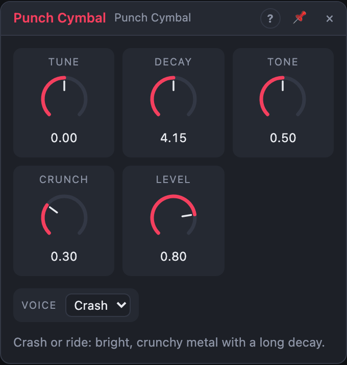

# Punch Cymbal

## Introduction

A crash or a ride cymbal: bright, slightly crunchy metal with a long
decay.

It belongs to the **Punch** drums: tight, hard voices built from swept sine
waves, noise and crunchy metal.

## How does it work?

*Crash* mixes six square waves with plenty of noise, high-passed, with
an extra burst of energy at the start that settles into a wash lasting
*Decay*. *Ride* uses a different set of square waves, less noise, and a
band-passed bell tone on top, for a ping you can play in patterns; it
rings 1.5 × *Decay*. *Tone* moves the high-pass, *Crunch* adds grit as in
Punch Hats.

**Playing it.** A rising edge at *Trig* plays the voice. *Velocity*, when
patched, is read at that moment: 100 % is full volume, 50 % half volume.
Unpatched, every hit is at full velocity. Velocity changes only the loudness,
never the sound, so soft hits keep their character. Hitting again while the
voice still sounds restarts it.

## How to use it?

- **Crash on the one:** *Voice* Crash on the first beat of a section.
- **Ride pattern:** *Voice* Ride, quarter or eighth notes, varied velocity.
- **Reverse-style swell:** patch a rising envelope onto *Level*.

## Reference

### Knobs and settings

| Control | Range | Default |
|---|---|---|
| Voice | Crash, Ride | Crash |
| Tune | −12 … +12 st | 0 st |
| Decay | 300 ms – 8 s | 2 s |
| Tone | 0 – 100 % | 50 % |
| Crunch | 0 – 100 % | 30 % |
| Level | 0 – 100 % | 80 % |

- **Voice:** which cymbal plays. A setting, not a knob.
- **Tune:** shifts the whole voice up or down, in semitones.
- **Decay:** how long the cymbal lasts (the ride rings 1.5 × as long).
- **Tone:** the high-pass: full … thin.
- **Crunch:** bit and sample-rate reduction: clean … gritty.
- **Level:** the output volume.

*Tune*, *Decay*, *Tone*, *Crunch* and *Level* are modulation destinations.

### Inputs

| Input | Signal | What it does |
|---|---|---|
| Trig | trigger | a rising edge plays the voice (gates work too) |
| Velocity | control, 0 … 1 | the loudness of each hit, read at the trigger; unpatched = 100 % |

### Outputs

| Output | Signal | What it does |
|---|---|---|
| Out | audio | the drum |
