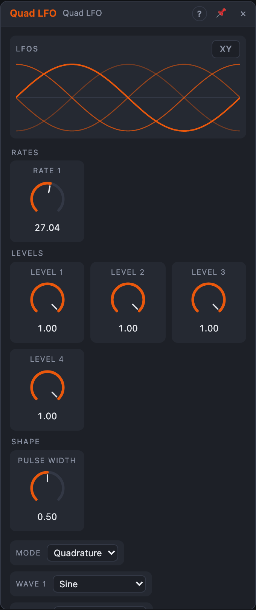

# Quad LFO

## Introduction

Quad LFO is **four LFOs in one module**, with one *Mode* that decides how they
belong together: four free speeds, one speed in four quarter-steps
(quadrature), one speed with an adjustable phase spread, or one speed divided
into slower and faster related speeds.

It's the quickest way to circular stereo movement, rotating pans, four voices
that move together but not in unison, or interlocking polyrhythms. Each of
the four picks its own wave and depth, and everything can lock to the song's
bars.

## How does it work?

**Waves.** Each LFO has its own *Wave*: Sine, Triangle, Saw Up, Saw Down,
Square (with the shared *Pulse Width*), Random Step and Random Smooth: the
same waves as the *LFO* module. Random values come from *Seed* and differ per
channel, and every render repeats them.

**Modes.**

- **Free:** four LFOs, four *Rate* knobs.
- **Quadrature:** one speed (*Rate 1*), the four a quarter cycle apart: 0°,
  90°, 180°, 270°. Two sines a quarter apart draw a circle: patch Out 1 and
  Out 2 to the X and Y of anything (or to two pans).
- **Phase:** like Quadrature, but *Spread* sets the distance between
  neighbours (0–360°). At 0° all four move together; at 120° three of them
  share the cycle evenly; at 180° 1 and 3 match, as do 2 and 4.
- **Divide:** one speed, and each LFO runs at its *Divide* setting of it:
  ×4, ×3, ×2, ÷1 … ÷8, ÷12, ÷16. With ÷1 ÷2 ÷3 ÷4 they meet again every 12
  cycles of LFO 1, and they really do meet: the four restart together
  whenever their pattern repeats.

Switching Mode keeps LFO 1 where it is; the others glide to their new place
over 5 ms, so a switch never clicks.

**Level** sets each LFO's depth; a negative level turns it upside down.
*Polarity* chooses −1 … +1 or 0 … 1; in Unipolar, a negative level gives the
inverted wave (1 − v) instead of going below 0. *Sum* is the average of the
four.

**Cycle 1 … 4** fire once per cycle of each LFO, where its wave starts. In
Quadrature and Phase they come from LFO 1's cycle, so turning or modulating
*Spread* moves the pulses but never adds extra ones.

### Timing

- **Free rates:** each Rate in Hz (0.01–50 Hz), modulated per sample.
- **Sync on:** the Rate knobs pick note values instead (16 bars … 1/32T,
  straight, dotted and triplet; modulation steps through them). While the
  transport plays, every LFO is locked to the song position: always at the
  same point at the same bar, after loop jumps too, and renders repeat. With
  the transport stopped they run on at the current tempo.
- **Clock:** patch a clock and LFO 1 runs one cycle per *Clock Ratio*
  pulses, measured from the clock (averaging four pulses) and restarted on
  every *Clock Ratio*-th pulse so it stays in step. The other LFOs follow LFO 1
  in the shared modes and Divide; in Free mode only LFO 1 follows the clock.
  After a pause the measurement starts over. Clock wins over Sync.

**Reset** restarts all four (at their offsets in Quadrature and Phase). With
Sync on and the transport playing, Reset moves the grid instead: the next
sample counts as the start of the cycle, until the transport starts again.
A **transport start** resets everything.

**Hold** freezes all four while it's high and lets them continue where they
were. While locked to the song, the outputs freeze and on release jump back
to the song position, smoothed over 5 ms.

## How to use it?

- **Circular panning:** Quadrature, Sine on 1 and 2, Out 1 and Out 2 onto two
  pans (or a mixer's X/Y). Switch the view to **XY** to see the circle.
- **Four voices, one breath:** Phase mode, Spread 90°, the four outputs onto
  four filter cutoffs in a Voice Cell's neighbours: the same movement,
  passed along.
- **Polyrhythmic modulation:** Divide, Sync on, Rate 1 at 1 bar, Divide ÷1
  ÷2 ÷3 ÷4: four movements that line up every twelve bars, on the same bar
  every time.
- **Random per voice:** Free, Random Smooth on all four, slightly different
  rates: four unrelated, gentle wanderings from one seed.
- **Gating on the beat:** a sequencer's clock into *Clock*, Clock Ratio 4,
  Square on LFO 1: a chop that follows the clock, even a swung or manual one.

<!-- generated:demos -->
## Demo patches

Five whole patches show what Quad LFO does. In the standalone app open **File → Presets…** (⌘P) and pick *Quad LFO* under *Demos by module*; on the website, **Run in Play** opens one in your browser. Loading one replaces the project and starts the transport.

| Patch | What it shows |
|---|---|
| **Quad LFO: Quadrature Chord** | In Quadrature mode the four LFOs are a quarter-turn apart, so four notes of a chord swell one after another in a rotating pattern. Change Rate to turn it faster, or switch Mode to Free to let each LFO run at its own speed. |
| **Quad LFO: Divided Movements** | Locked to the tempo in Divide mode, the four LFOs run at whole fractions of one rate: the fastest shapes the tone, slower ones open the filter over two, four and eight times as long. Change a Divide setting or switch Sync off to unlock it. |
| **Quad LFO: Stereo Filter Sweep** | Phase mode keeps all four LFOs at the same rate but staggered by Spread. Here two of them sweep a separate filter for each channel, so the pad's brightness moves from left to right. Widen or narrow Spread, or change Rate 1 for a faster sweep. |
| **Quad LFO: Free Texture** | In Free mode the four LFOs run at unrelated rates with different waves (sine, smooth random, triangle and stepped random); their Sum output moves the filter while the others change tone and resonance, an endlessly shifting texture. Change a Rate or Wave to steer it. |
| **Quad LFO: Clocked and Held** | The LFOs follow a clock from the sequencer rather than a free rate, and a second, sparser gate patched to Hold freezes them for a moment. The result is a filter movement that stops and resumes in time with the notes. Change Clock Ratio for a faster or slower cycle. |
<!-- /generated -->

<!-- generated:presets -->
## Presets

The preset bar of the Quad LFO view has 15 factory presets. Pick one to set the knobs, then change them to taste; your own presets sit next to them.

| Preset | What it does |
|---|---|
| **Quadrature Sine** | Four sines 90 degrees apart: circular motion for panning or filters. |
| **Slow Drift** | Four unrelated very slow sines: gentle, never-repeating drift. |
| **Vibrato Pair** | Two close vibrato rates: use out1 and out2 on left and right pitch. |
| **Wide Phase Spread** | One rate, four phases 120 degrees apart: wide stereo movement. |
| **Triangle Cascade** | Closely staggered triangles for a rolling sweep across four targets. |
| **Polyrhythm Divide** | Square waves divided from one rate: interlocking pulse patterns. |
| **Synced Quarters** | Clock-locked divisions from fast to very slow, all in tempo. |
| **Double Time Rise** | Tempo-synced rising ramps at related speeds. |
| **Tremolo Square** | Hard on/off amplitude chop: patch out1 into a VCA. |
| **Soft Tremolo** | Smooth classic tremolo depth for an amp. |
| **Sample and Hold Steps** | Four random step streams at different speeds. |
| **Random Glide** | Smooth random wandering on four outputs: organic pad motion. |
| **Saw Pulse Mix** | Four different shapes at harmonic rates: use the sum for a complex contour. |
| **Fast Audio-ish Wobble** | Very fast quadrature triangles for rough FM-style modulation. |
| **Inverted Counter-Motion** | Opposed levels and phases: one rises while the other falls. |
<!-- /generated -->

## Reference

### Knobs

| Knob | Range | Default |
|---|---|---|
| Rate 1 | 0.01 – 50 Hz, or a note value with Sync | 1 Hz |
| Rate 2, 3, 4 (Free mode) | 0.01 – 50 Hz, or a note value with Sync | 1.5, 2, 3 Hz |
| Level 1 … 4 | −100 … +100 % | 100 % |
| Spread (Phase mode) | 0 – 360° | 90° |
| Pulse Width | 5 – 95 % | 50 % |

Every knob is a modulation destination.

### Settings

| Setting | Values | Default |
|---|---|---|
| Mode | Free, Quadrature, Phase, Divide | Quadrature |
| Wave 1 … 4 | Sine, Triangle, Saw Up, Saw Down, Square, Random Step, Random Smooth | Sine |
| Divide 1 … 4 (Divide mode) | ×4, ×3, ×2, ÷1 … ÷8, ÷12, ÷16 | ÷1, ÷2, ÷3, ÷4 |
| Sync | Off, On | Off |
| Clock Ratio | 1, 2, 3, 4, 6, 8, 12, 16, 24, 32 pulses per cycle | 4 |
| Polarity | Bipolar, Unipolar | Bipolar |
| Seed | 0 – 999 | 1 |

### Inputs

| Input | Signal | What it does |
|---|---|---|
| Reset | trigger | restarts all four (or moves the grid while synced) |
| Clock | trigger | LFO 1 runs one cycle per *Clock Ratio* pulses |
| Hold | gate | freezes the four while high |

### Outputs

| Output | Signal | What it does |
|---|---|---|
| Out 1 … Out 4 | control | the four LFOs |
| Sum | control | their average |
| Cycle 1 … Cycle 4 | trigger | each LFO's cycle start |
