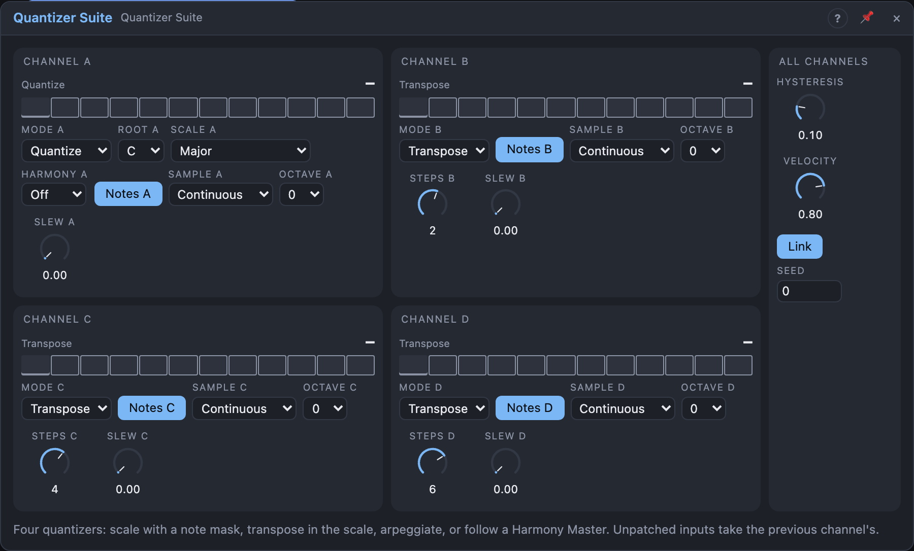

# Quantizer Suite

## Introduction

Four quantizers in one module. Each channel snaps a pitch to a scale, and can
also **transpose** it in scale steps, **arpeggiate** a chord on it, or
**follow** the board's Harmony Master. Unpatched inputs take the previous
channel's signal, so one melody into *In A* gives a four-voice diatonic
harmony on *Out A … D* without another cable.

## How does it work?

**Allowed notes.** Each channel quantizes to its *Root* and *Scale*, minus the
notes you switch off on its keyboard in the view (the mask). With *Link* on,
channels B – D use channel A's Root, Scale and Harmony. Halfway between two
notes the lower wins; *Hysteresis* keeps a note until the input is clearly in
the next one's range.

**Modes** (per channel):

- **Quantize:** the nearest allowed note.
- **Transpose:** the nearest allowed note, moved by *Steps* allowed notes.
  +2 in C major turns C into E and A into the C above. The defaults (A 0,
  B +2, C +4, D +6) turn one melody into seventh chords moving with it.
- **Arp:** at each *Trig* a chord is built on the input's note from scale steps
  (*Chord*: Triad, Seventh, …) over *Span* octaves, and the channel plays its
  next tone in *Order* (Up, Down, Up-Down, Converge, Random). *Steps* shifts
  the starting tone. With no trigger patched on this or an earlier channel, it
  steps in 1/16 notes with the song.
- **Follow:** needs *Harmony* on a bus with a Harmony Master (otherwise it
  quantizes and says "no harmony"). *Target* chooses what it lands on:
  *Scale* (the Harmony Master's scale), *Chord* (the nearest chord tone, then
  *Steps* chord tones up or down), *Chord + Scale* (scale notes, but a chord
  tone within a semitone wins), or *Root* (the chord's root in the nearest
  octave: a bass line from any contour). A continuous channel changes on the
  chord change itself.

**Sample.** *Continuous* follows the input. *Trigger* reads it on each pulse
at *Trig* and holds it (a pulse on the same note plays it again). *Track &
Hold* follows while *Trig* is high and holds while it is low. Unpatched Trigs
take the previous channel's, so one clock on *Trig A* samples all four.

**Octave** shifts the result, **Slew** glides to each new note in the same
time however far it jumps.

**Notes.** Each channel with *Notes* on plays its note on note channel 1 – 4
(A – D) at *Velocity*; a new note starts before the old one ends (legato).

## How to use it?

- **Instant harmony:** a sequence into *In A*, *Notes* into a Voice Cell.
- **Pentatonic only:** click notes off on the keyboard.
- **An arpeggiator:** channel A Mode *Arp*, a clock into *Trig A*.
- **A bass that follows the chords:** Mode *Follow*, Target *Root*, any
  melody or LFO into the input.
- **Harmoniser:** Mode *Follow*, Target *Chord*, Steps 1 and 2 on B and C.

<!-- generated:demos -->
## Demo patches

Five whole patches show what Quantizer Suite does. In the standalone app open **File → Presets…** (⌘P) and pick *Quantizer Suite* under *Demos by module*; on the website, **Run in Play** opens one in your browser. Loading one replaces the project and starts the transport.

| Patch | What it shows |
|---|---|
| **Quantizer Suite: Pentatonic Mask** | A stepped Random would wander through every note; the Quantizer Suite's note mask keeps only the five pentatonic notes of D major, so any value lands somewhere beautiful. Channel B quantizes the same notes an octave down for a bass. Click notes on and off on the keyboard in the view. |
| **Quantizer Suite: Four-voice Harmony** | One E Dorian melody goes into In A only; the unpatched inputs inherit it, and channels B, C and D transpose it by 2, 4 and 7 scale steps, so a single line turns into a moving four-part chord. Change the Steps knobs to reshape the harmony. |
| **Quantizer Suite: Arp Machine** | Channels A and B in Arp mode build a seventh chord and a random triad on each slow root and play them as sixteenth-note arpeggios, one up and down over two octaves, one shuffled an octave higher. Try another Order or Chord, or Span 3. |
| **Quantizer Suite: Chord Followers** | Four channels follow a Harmony Master on bus A. A random contour is snapped to the nearest chord tone for a lead, a second channel adds the chord tone two steps above, and a third in Root mode makes a bass line from the same contour. Change a channel's Target to Scale or Chord + Scale. |
| **Quantizer Suite: Gliding Lines** | A smooth random curve is quantized to F Lydian and held by Track & Hold, with Slew gliding between the notes; channel B follows a fifth up (Steps +4) with a longer slew. Two singing lines that slide from note to note. Raise a Slew knob for slower glides. |
<!-- /generated -->

## Reference

### Knobs

| Knob | Range | Default |
|---|---|---|
| Steps A … D | −14 … +14 | 0, +2, +4, +6 |
| Slew A … D | 0 – 2 s | 0 |
| Hysteresis | 0 – 50 % of a semitone | 10 % |
| Velocity | 1 – 100 % | 80 % |

Every knob is a modulation destination. *Steps* means scale steps (Transpose,
Follow · Scale), chord tones (Follow · Chord) or the arpeggio's start (Arp).

### Settings (per channel)

| Setting | Values | Default |
|---|---|---|
| Mode | Quantize, Transpose, Arp, Follow | A Quantize, B – D Transpose |
| Root | C … B | C |
| Scale | the 17 scales | Major |
| Harmony | Off, Bus A – D | Off |
| Sample | Continuous, Trigger, Track & Hold | Continuous |
| Octave | −3 … +3 | 0 |
| Chord | Triad, Seventh, Sus2, Sus4, Fifth, Ninth, Octave | Triad |
| Order | Up, Down, Up-Down, Converge, Random | Up |
| Span | 1 – 4 octaves | 1 |
| Target | Scale, Chord, Chord + Scale, Root | Chord |
| Notes | on / off | on |

Shared: **Link** (on), **Seed** (0 – 999, for the Random order).

### Inputs

| Input | Signal | What it does |
|---|---|---|
| In A … In D | pitch | the pitch to quantize; unpatched B – D take the previous channel's |
| Trig A … Trig D | trigger | sampling and arpeggio clock; unpatched B – D take the previous channel's |
| Reset | trigger | every arpeggio starts again at its first tone |

### Outputs

| Output | Signal | What it does |
|---|---|---|
| Out A … Out D | pitch | the channel's note, after Slew |
| Change A … Change D | trigger | a pulse when the note changes (and at each Trigger sample) |
| Notes | notes | all four channels on note channels 1 – 4 |
