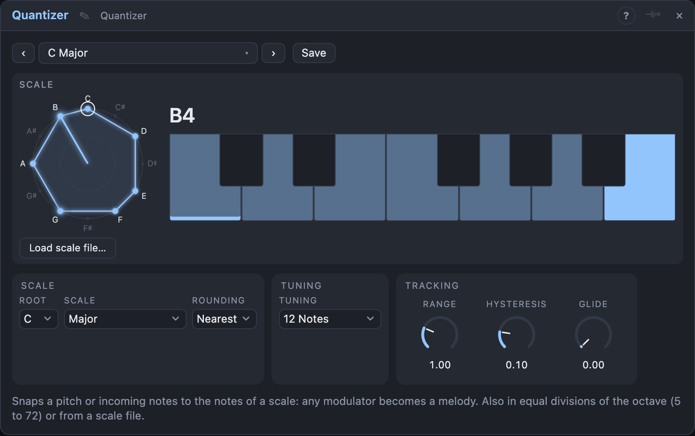

# Quantizer

## Introduction

The Quantizer snaps a pitch to the nearest note of a scale. Feed it an LFO,
a random voltage or an envelope, and an oscillator plays a melody that always
fits the key. A trigger on every note change lets the melody play envelopes
too.

## How does it work?

The signal goes through these steps:

1. **Range:** *In* is scaled, so a full-scale LFO (−1 … +1) spans ±*Range*
   octaves.
2. **Transpose** is added. Because this happens before quantizing, the result
   stays in the scale.
3. **Clock** (optional): when patched, the value is only taken on each clock
   pulse and held until the next.
4. **Quantize** to the scale chosen by *Root* and *Scale*. *Rounding* picks the
   nearest note, the one below, or the one above.
5. **Shift** is added after quantizing: a chromatic transposition that may
   leave the scale.
6. **Glide** smooths the jumps between notes.

*Hysteresis* stops flicker: the input has to move a bit past the halfway
point between two notes before the output changes.

*Notes In* is a second way in. Patch notes (a keyboard, a sequencer, an
arpeggiator) and each note is snapped to the scale and sent out of *Notes*:
*Transpose* is added before quantizing, *Shift* after, and *Root*, *Scale* and
*Rounding* apply. *Range*, *Clock*, *Hysteresis* and *Glide* belong to the pitch
path and are ignored for notes. The note-off ends the note that was sent, so a
scale change while a key is held cannot leave a note hanging. Velocity,
controllers, bend and the other messages pass through unchanged.

*Trigger* fires and *Gate* drops for one millisecond each time the note
changes, so an envelope or *CV to Notes* can start a new note.

To build your own scale, click keys on the keyboard. Clicking a key while
another scale is selected copies that scale and switches *Scale* to
**Custom**, so any scale is a starting point.

## How to use it?

- **Melodies from an LFO:** a slow LFO into *In*, *Out* into an oscillator's
  *Pitch*. Try *Minor Pentatonic*: no wrong notes.
- **Random melodies:** Random into *In*, a clock into *Clock*, *Trigger* into an
  ADSR's gate.
- **Key changes:** a sequencer or another quantizer into *Root In* sets the
  key; everything stays in the new scale.
- **Arpeggios:** a sawtooth LFO into *In* plays the scale upwards.
- **Portamento:** raise *Glide* for slides between notes.

<!-- generated:presets -->
## Presets

The preset bar of the Quantizer view has 15 factory presets. Pick one to set the knobs, then change them to taste; your own presets sit next to them.

| Preset | What it does |
|---|---|
| **C Major** | Snaps any pitch to C major: the safe, bright default. |
| **Natural Minor** | A natural minor: melancholic and familiar. |
| **Minor Pentatonic** | Five notes that can't clash: great for random melodies. |
| **Major Pentatonic** | Open and folky: nothing sounds wrong. |
| **Dorian Walk** | Minor with a lifted sixth: cool, jazzy lines. |
| **Lydian Float** | A major scale with a raised fourth: dreamy and airy. |
| **Phrygian Dark** | Flat second gives a tense, Spanish-tinged colour. |
| **Harmonic Minor** | Dramatic minor with a leading tone. |
| **Blues** | Blue notes for gritty, soulful lines. |
| **Whole Tone Dream** | Six equal steps: ambiguous, floating melodies. |
| **Hirajoshi** | A five-note scale with an east-Asian flavour. |
| **Gliding Major** | A little slide between notes for a singing feel. |
| **Wide Range** | Stretches the input over three octaves with a steadier hold. |
| **Round Down** | Always rounds down to the scale note below. |
| **Round Up Chromatic** | Chromatic, rounding up: plain semitone steps with no hold. |
<!-- /generated -->

<!-- generated:demos -->
## Demo patches

Five whole patches show what Quantizer does. In the standalone app open **File → Presets…** (⌘P) and pick *Quantizer* under *Demos by module*; on the website, **Run in Play** opens one in your browser. Loading one replaces the project and starts the transport.

| Patch | What it shows |
|---|---|
| **Quantizer: Triangle Climb** | A slow triangle LFO is a smooth, continuous voltage; the Quantizer turns it into stairs of pentatonic notes and fires a trigger on every new one, so the voice climbs and falls by itself. Widen Range for more octaves, or pick another Scale. |
| **Quantizer: Dorian Wanderer** | A stepped Random sends any value it likes; the Quantizer is clocked by a sequencer and, on each tick, snaps it into D Dorian, so the wandering always sounds like a tune. Try a different Scale (Whole Tone, Blues) or a smaller Range. |
| **Quantizer: Chromatic Run to Hirajoshi** | The sequencer plays an ordinary chromatic run, every semitone, and the Quantizer squeezes it into the five-note Hirajoshi scale, so repeated notes appear where the notes were pushed together. Switch Scale to Chromatic for the original run, or Rounding to Up. |
| **Quantizer: Glide Between Notes** | A sine LFO sweeps a legato voice; the Quantizer picks scale notes but Glide turns each jump into a slide, like a fretless line stepping through a scale. Set Glide to zero for hard steps, or Rounding to Down to favour the lower note. |
| **Quantizer: Shift Echo** | One sequencer line is quantized to the blues scale; a square LFO adds a step to the Transpose input every other bar, lifting the whole line to a new key area that is still in the scale. Change the LFO Sync or the amount of the Transpose cable. |
<!-- /generated -->

## Reference

### Knobs and settings

| Control | Range | Default |
|---|---|---|
| Range | 0 … 4 octaves | 1 octave |
| Hysteresis | 0 … 50 % of a semitone | 10 % |
| Glide | 0 … 2 s | 0 s |
| Root | C … B | C |
| Scale | the Step Sequencer's 17 scales, plus Custom | Major |
| Rounding | Nearest, Down, Up | Nearest |

- **Range:** how many octaves a full-scale input covers in each direction.
  It applies to *In* only.
- **Hysteresis:** how far past the midpoint between two notes the input must
  move before the note changes. 0 is plain quantizing.
- **Glide:** a smoothing time on *Out*. *Trigger* still fires at the change.
- **Root**, **Scale:** the key. *Custom* uses the keys set in the keyboard.
- **Rounding:** *Nearest* rounds to the closest scale note (an exact tie goes
  down), *Down* to the one at or below, *Up* to the one at or above.

### Inputs

| Input | Signal | What it does |
|---|---|---|
| In | pitch | The signal to quantize, 1 V/oct (0 = C4) |
| Clock | trigger | Optional: the output changes only on a clock |
| Transpose | pitch | Added before quantizing (stays in the scale) |
| Shift | pitch | Added after quantizing (chromatic) |
| Root In | pitch | Optional: overrides *Root* with this note's pitch class |
| Notes In | notes | Optional: notes to quantize, sent out of *Notes* |

### Outputs

| Output | Signal | What it does |
|---|---|---|
| Out | pitch | The quantized pitch, plus *Shift*, after *Glide* |
| Trigger | trigger | A pulse at each note change |
| Gate | gate | Low for 1 ms at each note change, high otherwise |
| Notes | notes | The notes from *Notes In*, snapped to the scale |
