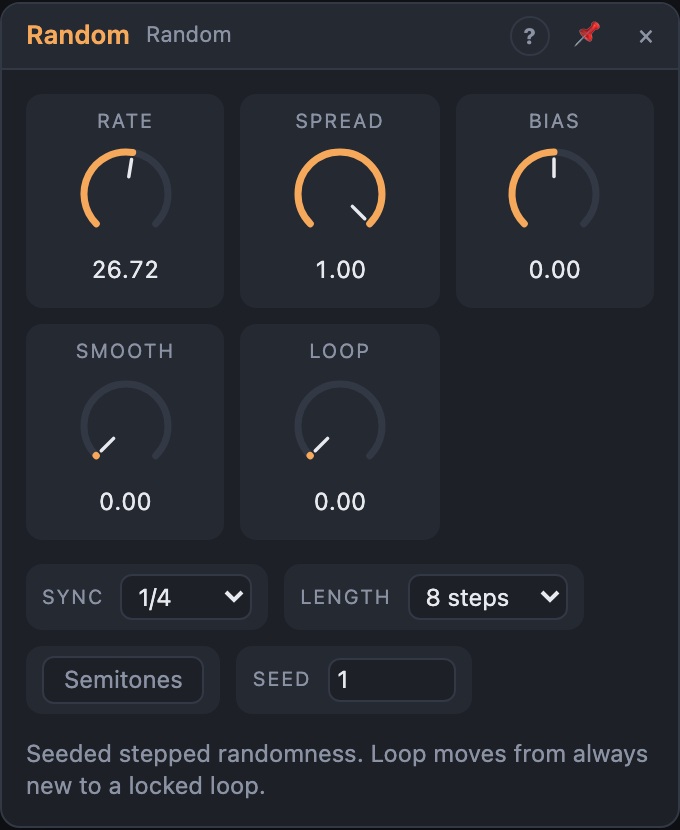

# Random

## Introduction

Random produces a new random value on every step: the classic stepped
"sample and hold" modulation. What makes it musical is its **memory**. The
*Loop* knob moves it from always new values, through a pattern that slowly
changes, to a fixed loop that repeats exactly. Every value comes from a seed,
so a patch sounds the same every time you play it back.

## How does it work?

**Steps.** Random moves to its next value on each step. Where the steps come
from, in order of priority:

1. **Clock input patched:** every rising edge at *Clock* is a step.
2. **Sync set to a note value:** one step per note value at Live's tempo.
   While the transport plays, the steps are locked to the song position.
3. **Sync on Free:** steps run at *Rate*, in Hz.

Each new step fires a pulse at *Trig*.

**Memory.** The values sit in a loop of *Length* slots. Each time the loop
comes round, every slot gets a new value with a probability of 1 − *Loop*,
and otherwise keeps the old one:

- *Loop* 0 %: every step is new. Pure randomness.
- *Loop* 50 %: about half of the values change each pass. A pattern that
  evolves.
- *Loop* 100 %: nothing changes. A locked sequence of *Length* steps.

The values are a function of the seed and the step number, not of what came
before. With *Sync* on and the transport running, the step number comes from
the song position, so a section always plays the same values, even if you
start playback in the middle. Starting the transport restarts the sequence.

**Shaping.** Each raw value is scaled to Bias ± Spread and clipped to −1 … +1.
*Semitones* rounds it to steps of 1/12 (one semitone at 1 V/oct). *Smooth*
glides from one value to the next instead of jumping.

## How to use it?

- **Random modulation:** patch *Out* onto a filter's cutoff or an
  oscillator's shape. Set the depth with the cable's amount.
- **Melodies:** turn on *Semitones*, lower *Spread* (e.g. 25 % = ±3
  semitones), patch *Out* into an Oscillator's *Pitch* and *Trig* into an
  ADSR's gate. Keep the cable amount at 100 % so the notes stay on semitones.
  Raise *Loop* until you like the phrase, then set it to 100 % to keep it.
- **Find a different phrase:** change *Seed*. Each seed is its own sequence.
- **Play in time with something else:** patch a clock or a gate into *Clock*,
  e.g. a Function's *EOC* or a sequencer's gate.
- **Wandering, smooth modulation:** raise *Smooth* for drifting values instead
  of steps. At 100 % the value glides over most of a step.
- **Only positive values:** set *Bias* to +0.5 and *Spread* to 50 % for 0 … 1.

<!-- generated:presets -->
## Presets

The preset bar of the Random view has 14 factory presets. Pick one to set the knobs, then change them to taste; your own presets sit next to them.

| Preset | What it does |
|---|---|
| **Quarter Steps** | Eight random levels per quarter-note step, mostly repeating. |
| **Locked Loop** | A fixed eight-step pattern that repeats exactly. |
| **Always New** | Never repeats: every step is fresh. |
| **Melody Generator** | Locked steps snapped to semitones: patch to pitch. |
| **Dark Walk** | Mostly low values with the occasional jump. |
| **Bright Sparks** | High-leaning fast steps for sparkly accents. |
| **Smooth Wander** | Free-running steps blended into a gliding random curve. |
| **Slow Drift** | Very slow random wander for subtle movement. |
| **Three Step Cycle** | A 3-step loop against 4/4 for polymetric feel. |
| **Five Against Four** | Five-step quantized loop that drifts across the bar. |
| **Narrow Wobble** | Small random variations: gentle humanizing. |
| **Long Pattern** | A long locked sequence of 32 steps. |
| **Slow Bar Changes** | One new value per bar for chord or key changes. |
| **Fast Glitch** | Rapid random steps for glitchy mod. |
<!-- /generated -->

<!-- generated:demos -->
## Demo patches

Five whole patches show what Random does. In the standalone app open **File → Presets…** (⌘P) and pick *Random* under *Demos by module*; on the website, **Run in Play** opens one in your browser. Loading one replaces the project and starts the transport.

| Patch | What it shows |
|---|---|
| **Random: Wandering Melody** | Every eighth note the Random module picks a new value; with Semitones on they land on exact notes, so a steady rhythm plays a never-repeating tune. Raise Spread for a wider range, move Bias up or down to place it higher or lower, or change Seed for a new tune. |
| **Random: Locked Loop** | Loop at its top setting repeats an eight-step random pattern exactly, here moving a bass line's filter in time with the drums. Turn Loop down and the pattern slowly mutates, down to fully new values every step; change Length to repeat after more or fewer steps. |
| **Random: Smooth Drift** | With Smooth turned up the random steps glide into one another, making a slow, irregular drift that moves a pad's brightness and tone. Lower Smooth to bring back the steps, or raise Rate to make the drift busier. |
| **Random: Tom Roll** | The Random module's trigger output fires a tom at irregular moments while its stepped output retunes it each time, a loose, tuned roll over a steady kick. Raise Rate for a busier roll or pull Spread in for a narrower range of pitches. |
| **Random: Raised Bells** | A high Bias and a narrow Spread keep the random notes in a bright upper range, like a music box wandering over a held drone. Set Bias to zero and widen Spread to bring the bells down across the whole range. |
<!-- /generated -->

## Reference

### Knobs and settings

| Control | Range | Default |
|---|---|---|
| Rate | 0.05 – 50 Hz | 2 Hz |
| Spread | 0 – 100 % | 100 % |
| Bias | −1 … +1 | 0 |
| Smooth | 0 – 100 % | 0 % |
| Loop | 0 – 100 % | 0 % |
| Sync | Free, 1/32, 1/16, 1/8, 1/4, 1/2, 1 bar, 2 bars, 4 bars, 8 bars | 1/4 |
| Length | 2, 3, 4, 5, 6, 8, 12, 16, 32 steps | 8 steps |
| Semitones | on / off | off |
| Seed | 0 – 999 | 1 |

- **Rate:** steps per second. Only used when *Sync* is *Free* and *Clock* is
  not patched.
- **Spread:** the width of the range. At 100 % values cover −1 … +1 (around
  *Bias*); at 0 % every value equals *Bias*.
- **Bias:** the centre of the range. Values beyond ±1 are clipped, so a high
  bias with a wide spread makes values stick to the top.
- **Smooth:** glide between values, as a share of the step length. 0 % jumps;
  higher values slide. The glide follows the step length, so it works the
  same at any rate or tempo.
- **Loop:** the chance that a slot keeps its value when the loop comes round.
  0 % always new, 100 % locked.
- **Sync:** *Free* steps at *Rate*. A note value sets one step per note at
  Live's tempo (4/4 assumed). Ignored while *Clock* is patched.
- **Length:** the number of slots in the loop. It sets how long a locked
  pattern is before it repeats.
- **Semitones:** rounds each value to the nearest 1/12, i.e. to semitones for
  pitch inputs. The rounding happens before *Smooth*, so gliding still slides
  between the notes.
- **Seed:** picks the sequence. The same seed always gives the same values.

*Rate*, *Spread*, *Bias*, *Smooth* and *Loop* are modulation destinations.

### Inputs

| Input | Signal | What it does |
|---|---|---|
| Clock | gate | when patched, every rising edge advances one step; overrides *Rate* and *Sync* |

### Outputs

| Output | Signal | What it does |
|---|---|---|
| Out | control, −1 … +1 | the current value |
| Trig | trigger | one pulse on every new step |
