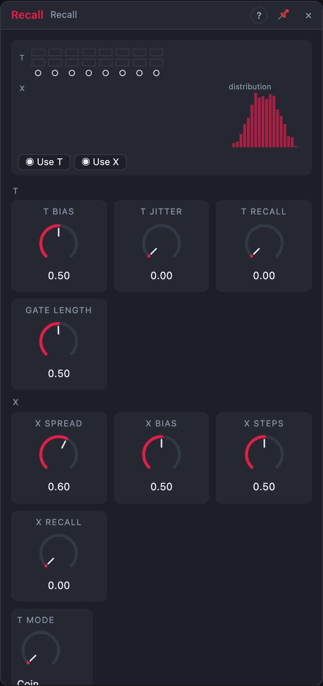

# Recall

## Introduction

Recall generates random rhythms and melodies in two sections that share one
clock. **T** makes random gates: coin tosses between two outputs, random
divisions and ratchets, or drum-like patterns weighted by the bar. **X** makes
three random voltages whose distribution you shape and whose steps go from
smooth glides to notes of a scale. Each section has a **Recall** knob that
makes it repeat its own recent past: from always new, through variations on
what just happened, to a locked loop you can capture into the board.

## How does it work?

**Clock.** Each tick comes from *Clock* if patched, else from the song position
when *Sync* is on a note value and the transport plays, else from *Rate* (or
the synced length while the transport is stopped). *Clock* out fires on every
tick. *Reset* makes the next tick tick 0: the loops start again at their first
slot, and the memory stays.

**T section.** On every tick the section takes a decision from four random
numbers. *T Mode* turns it into gates:

- **Coin:** exactly one of T1 and T2 fires; *T Bias* is the chance of T1.
- **Chance:** T1 and T2 fire independently, each with the chance *T Bias*.
- **Ratchet:** each output picks a rate: ÷4, ÷3, ÷2 (fires on the first tick of
  its group), ×1, or ×2, ×3, ×4 (two to four evenly spaced pulses in one tick).
  *T Bias* left of the middle prefers divisions, right of it multiplications.
- **Drums:** T1 is a kick, strong on beats 1 and 3 of a 16-tick bar; T2 a snare,
  strong on 2 and 4. At *T Bias* 50 % you get a plain backbeat with occasional
  ghost notes; more fills in, less thins out.

*T Jitter* delays each gate by up to half a tick (never early). *Gate Length*
sets the gate length as a share of a tick (of a sub-pulse when ratcheting).

**X section.** On each X event (every tick, every T1 or T2 gate, or each pulse
at *X Clock*, chosen with *X Source*) the section draws three values:

- **X Spread** is the width: 0 % is a constant; up to 50 % a bell around the
  middle; up to 85 % it widens to even; above that values are pushed to the
  edges.
- **X Bias** pulls values down (left) or up (right).
- **X Steps:** below 45 % the outputs glide to each new value (at 0 % over the
  whole time to the next one, a smooth random curve); 45 – 55 % plain steps;
  above 55 % the values snap to *Scale* from *Root*. From 70 % on, scale notes
  drop out (for seven-note scales the 2nd, 6th, 4th, 7th, 3rd and 5th degree)
  until at 100 % only the root is left, in octaves.
- **X Range:** −1 … +1, 0 … 1 or −2 … +2 (±2 octaves into a pitch input).
- **X Mode Sorted** sorts the three so X1 ≤ X2 ≤ X3: low, middle, high.

**Recall.** Each section remembers its last *Loop* decisions. With *Recall* at
0 % every decision is new; at 50 % about half of them repeat the decision from
one loop ago, so the pattern keeps its shape while it changes; at 100 % the
loop is locked: exactly what was playing when the knob reached the top. The
memory holds the raw random numbers, not the gates and voltages, so *Bias*,
*Spread*, *Steps*, *Scale* and *T Mode* still reshape a locked loop: lock a
melody, then change the scale, and it keeps its contour.

**Capture.** *Capture T* and *Capture X* store a section's loop in the board and
switch on **Use** for it: the section then plays the stored loop on every tick,
whatever the Recall knob, the seed or the song position. *Use T* / *Use X* in
the view switch back to the live memory and forth again.

**Repeatable.** New decisions come from *Seed* and the tick number. On a
transport start or a loop jump the memory is rebuilt by replaying the ticks
before it, so a render from the same position always sounds the same.

## How to use it?

- **Two drum voices:** *T Mode* Drums, T1 to a kick, T2 to a snare, *Clock* out
  to a hi-hat.
- **A melody that stays itself:** *X Steps* 65 %, X1 into an oscillator's pitch,
  T1 into its envelope, *X Source* T1. Raise *X Recall* until you like the
  phrase, then *Capture X*.
- **Chords:** *X Mode* Sorted, *X Steps* 60 %, X1 … X3 into three oscillators.
- **Smooth random modulation:** *X Steps* 0 %, *X Spread* 40 % into a filter.
- **Human timing:** *T Jitter* 15 %.
- **Rolls:** *T Mode* Ratchet, *T Bias* 75 %.

<!-- generated:demos -->
## Demo patches

Five whole patches show what Recall does. In the standalone app open **File → Presets…** (⌘P) and pick *Recall* under *Demos by module*; on the website, **Run in Play** opens one in your browser. Loading one replaces the project and starts the transport.

| Patch | What it shows |
|---|---|
| **Recall: Coin-Flip Drums** | Every clock step Recall flips a coin for two gates: T1 plays the kick, T2 the snare, and the Clock output drives steady hats. T Bias leans the coin towards or away from firing, T Jitter adds extra randomness; try raising T Recall to repeat the recent past. |
| **Recall: Ratchet Bass Line** | T Mode Ratchet turns the random gates into bursts of quick repeats, and each burst plays a bass note chosen by X from F Phrygian dominant. Lower X Spread for a narrower line, or move X Bias to put the bass higher or lower. |
| **Recall: Settling Loop** | A slow sawtooth LFO raises both Recall knobs from 0 to 100 % over 16 bars: the melody starts out new on every step, gradually repeats itself more and more, and ends up as a locked loop before the cycle begins again. Move T Recall or X Recall yourself to freeze or free it at any time. |
| **Recall: Sorted Triad Rising** | X Mode Sorted puts the three random voltages in ascending order, so X1, X2 and X3 always form a stack from low to high, and three voices play them as a changing chord. Switch X Mode to Independent and the voices cross over; change Scale for a different colour. |
| **Recall: Free-Running Bells** | Sync is set to Free at 1.6 Hz, so Recall ticks on its own clock rather than the song's, and each random T1 gate rings a bell whose pitch is read from X on its own X clock. Change Rate to speed the shimmer up or slow it down. |
<!-- /generated -->

## Reference

### Knobs and settings

| Control | Range | Default |
|---|---|---|
| T Bias | 0 – 100 % | 50 % |
| T Jitter | 0 – 100 % | 0 % |
| T Recall | 0 – 100 % | 0 % |
| Gate Length | 1 – 100 % of a tick | 50 % |
| X Spread | 0 – 100 % | 60 % |
| X Bias | 0 – 100 % | 50 % |
| X Steps | 0 – 100 % | 50 % |
| X Recall | 0 – 100 % | 0 % |
| Rate | 0.1 – 40 Hz | 4 Hz |
| Sync | Free, 2 bars, 1/1 … 1/32T | 1/16 |
| T Mode | Coin, Chance, Ratchet, Drums | Coin |
| T Loop | 1 – 16 ticks | 8 |
| X Source | Tick, T1, T2, External | Tick |
| X Mode | Independent, Sorted | Independent |
| X Range | Bipolar, Unipolar, Wide | Bipolar |
| X Loop | 1 – 16 draws | 8 |
| Root | C … B | C |
| Scale | the Step Sequencer's scales | Major |
| Seed | 0 – 999 | 1 |
| Sync To | Auto, Clock, Transport | Auto |

- **Sync To:** what steps the module. *Auto*: the clock pulses while *Clock* is patched, otherwise the transport. *Clock*: only the pulses step it. *Transport*: the song position steps it, and a patched *Clock* is ignored. It applies to *Clock*; *X Clock* keeps its own job as the external X source.

*X Source External* with nothing at *X Clock* draws on every tick.

The knobs and the two loop lengths are modulation destinations; *T Mode* is a dropdown a cable can drive.

### Inputs

| Input | Signal | What it does |
|---|---|---|
| Clock | trigger | each pulse is a tick; overrides *Rate* and *Sync* |
| Reset | trigger | the next tick is tick 0 |
| X Clock | trigger | with *X Source* External, each pulse draws new X values |

### Outputs

| Output | Signal | What it does |
|---|---|---|
| T1, T2 | gate | the random gates |
| Clock | trigger | every tick, never jittered |
| X1, X2, X3 | control (or pitch) | the random voltages |
| X Trig | trigger | a pulse whenever X values are drawn |
