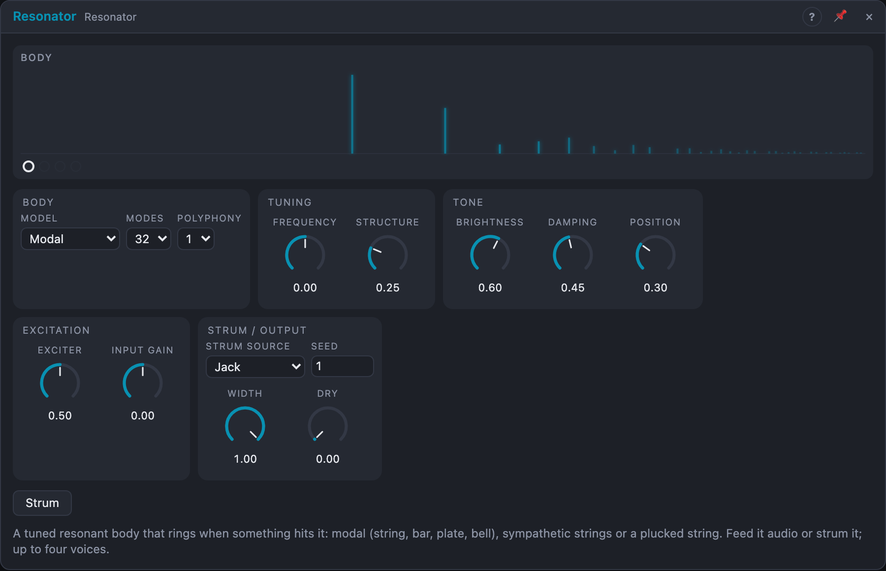

# Resonator

## Introduction

The Resonator is a tuned body that rings when something hits it. Feed it any
audio (a drum loop, noise bursts, a voice, a sequenced click) and it answers
with pitched, physical-sounding tone: a struck bar, a plate, a bell, a plucked
string, or a set of strings ringing in sympathy.

Without input it is an instrument of its own: every trigger at *Strum* fires a
small internal exciter. Up to four voices take turns on the strums, so chords
and overlapping notes ring out naturally, and the *Odd* and *Even* outputs give
a wide stereo image from a mono source.

## How does it work?

Three **models** of the body:

- **Modal:** a bank of 16, 32 or 64 ringing partials. *Structure* sets their
  ratios: harmonic string (0 %), stiff string (25 %), free bar (50 %),
  membrane/plate (75 %) and a bell-like inharmonic set drawn from *Seed*
  (100 %), gliding smoothly in between.
- **Sympathetic:** eight strings with no excitation of their own. They pick up
  whatever matches their tuning in the input, like the sympathetic strings of
  a sitar. *Structure* chooses the tuning of the set: octaves, fifths, major,
  minor, sus, add9, detuned unisons, inharmonic.
- **String:** one plucked string (a waveguide), tuned exactly. *Structure* is
  its stiffness, from a soft nylon string to a metal bar.

In every model *Damping* sets how long the fundamental rings, *Brightness*
how much high content there is and how fast it dies, and *Position* where the
body is struck and heard (50 % is the middle, which cancels the even
partials).

**Voices and strums.** With *Polyphony* 1 there is one voice: *Strum* fires
the exciter and takes the current *Pitch*. With 2 or 4, each strum moves on to
the next voice. That voice gets the input and follows *Pitch*; the earlier
ones ring out at the pitch they were strummed at. A strum on a voice that is
still ringing adds to it, like hitting a string again.

The **internal exciter** is a 3 ms burst of noise with a click, darker or
brighter with *Brightness*, at the level of *Exciter*.

With **Strum Source › Input onsets**, the Resonator listens to its input and
strums on every hit it hears. A drum loop played into a four-voice Resonator
then spreads its hits over the voices, and each hit takes the current
*Pitch*.

A body fed with a loud input in tune with its partials can build up far above
the input level, so both outputs pass a soft limiter.

## How to use it?

- **Tuned percussion from a drum loop:** drum loop → *In*, Model *Modal*,
  Structure 50 – 100 %. Sequence *Pitch*, or use *Input onsets* with
  Polyphony 4 for overlapping notes.
- **Plucked instrument:** a sequencer's gate → *Strum*, its pitch → *Pitch*,
  Model *String*. Raise *Damping* for short plucks, *Brightness* for twang.
- **Sympathetic shimmer:** any melodic sound → *In*, Model *Sympathetic*,
  Structure at the tuning you like, *Dry* up to hear the source too.
- **Stereo:** *Odd* → left, *Even* → right. *Width* 0 % makes both the same.
- **In a Voice Cell:** keep *Polyphony* at 1 and let the cell provide the
  voices: *Voice In › Trigger* → *Strum*, *Pitch* → *Pitch*.
- **Strum button:** fires the exciter, for trying sounds without patching.

<!-- generated:demos -->
## Demo patches

Five whole patches show what Resonator does. In the standalone app open **File → Presets…** (⌘P) and pick *Resonator* under *Demos by module*; on the website, **Run in Play** opens one in your browser. Loading one replaces the project and starts the transport.

| Patch | What it shows |
|---|---|
| **Resonator: Bell Strikes** | A sequencer strums the Modal model with its own internal exciter and pitches it, so each note rings like a struck bell or bar. Move Structure to change the metal, and Damping to shorten the ring. |
| **Resonator: Sympathetic Drone** | A plucked melody is fed into sympathetic strings tuned to a fixed root, so the drone strings glow along with whatever notes match them. Change Frequency to retune the drone, or Damping for a shorter shimmer. |
| **Resonator: Plucked Strings** | The String model plays a bouncy bass-and-treble pattern, four voices deep so older notes keep ringing under new ones. Try Position for a hollower or brighter pluck, and Brightness for nylon versus steel. |
| **Resonator: Drum Body** | A drum beat excites a Modal resonator that is tuned low, so every kick and hat rings the same plate-like body. Turn Dry up to bring the raw drums back, or sweep Frequency to retune the whole kit. |
| **Resonator: Morphing Plate** | A slow LFO sweeps Structure through string, bar and plate territory while the same strummed notes play, so the instrument seems to change material as it rings. Patch the LFO into Brightness too, or change its speed. |
<!-- /generated -->

<!-- generated:presets -->
## Presets

The preset bar of the Resonator view has 14 factory presets. Pick one to set the knobs, then change them to taste; your own presets sit next to them.

| Preset | What it does |
|---|---|
| **Glass Bar** | A struck bar: bell-like tuned percussion. |
| **Hollow String** | A plucked string with a round body. |
| **Bright Harp** | Four plucked strings: arpeggios turn harp-like. |
| **Tuned Plate** | A metallic plate ring. |
| **Bell Tower** | Low, long bell with many partials. |
| **Sympathetic Drone** | Strings that ring along with a melody fed in. |
| **Sitar Shimmer** | Buzzing sympathetic strings. |
| **Drum Tuner** | Short tuned ring for drum loops. |
| **Damped Marimba** | Short, woody mallet tone. |
| **Kalimba Pluck** | Fast-decaying plucks. |
| **Eternal String** | A very long-ringing string. |
| **Wide Chord Body** | Four voices spread wide for chord-like clouds. |
| **Octave Metal** | High, clangy metal, bright and inharmonic. |
| **Onset Strummer** | Plays the string on every hit in the input; no strum cable needed. |
<!-- /generated -->

## Reference

### Knobs and settings

| Control | Range | Default |
|---|---|---|
| Frequency | −48 … +48 semitones around C4 | 0 (C4) |
| Structure | 0 – 100 % | 25 % |
| Brightness | 0 – 100 % | 60 % |
| Damping | 0 – 100 % | 45 % |
| Position | 0 – 100 % | 30 % |
| Input Gain | −24 … +24 dB | 0 dB |
| Exciter | 0 – 100 % | 50 % |
| Width | 0 – 100 % | 100 % |
| Dry | 0 – 100 % | 0 % |
| Model | Modal, Sympathetic, String | Modal |
| Polyphony | 1, 2, 4 | 1 |
| Modes | 16, 32, 64 (Modal) | 32 |
| Strum Source | Jack, Input onsets | Jack |
| Seed | 0 – 999 | 1 |

- **Frequency:** the fundamental; *Pitch* adds to it. Modulation moves it in
  semitones.
- **Structure:** the partial ratios (Modal), the tuning of the set
  (Sympathetic) or the stiffness (String). Its name follows the model.
- **Brightness:** the high-frequency content: tilts the partials and makes the
  high ones decay faster; also colours the exciter.
- **Damping:** how long the fundamental rings: 0 % = 30 s, 50 % ≈ 1.2 s,
  100 % ≈ 50 ms.
- **Position:** where the body is excited and heard. 0 % and 100 % are the
  ends; 50 % is the middle and cancels the even partials.
- **Input Gain:** the level of *In* into the body.
- **Exciter:** the level of the internal exciter on each strum. 0 % switches
  it off.
- **Width:** 0 % gives both outputs the mono sum; 100 % fully separates odd
  and even.
- **Dry:** the input (after *Input Gain*) mixed into both outputs.
- **Model:** Modal, Sympathetic or String (see above). Switching fades the
  sound out and in again.
- **Polyphony:** how many voices take turns on the strums.
- **Modes:** the number of partials of the Modal body: more sounds richer and
  costs more.
- **Strum Source:** *Jack* strums only from the *Strum* input; *Input onsets*
  also strums on every hit detected in *In*.
- **Seed:** the bell partials (Modal, Structure 100 %), the inharmonic tuning
  (Sympathetic) and the exciter's noise.

Every knob is a modulation destination: patch a cable onto it to move it.

### Inputs

| Input | Signal | What it does |
|---|---|---|
| In | audio | the excitation; feeds the most recently strummed voice |
| Strum | trigger | starts the next voice, takes *Pitch* for it and fires the exciter |
| Pitch | pitch | 1 V/oct, 0 V = C4, added to *Frequency*; the newest voice follows it |

### Outputs

| Output | Signal | What it does |
|---|---|---|
| Odd | audio | odd partials / odd strings / the first pickup: the left channel |
| Even | audio | even partials / even strings / the second pickup: the right channel |
| Mix | audio | Odd + Even, mono |
