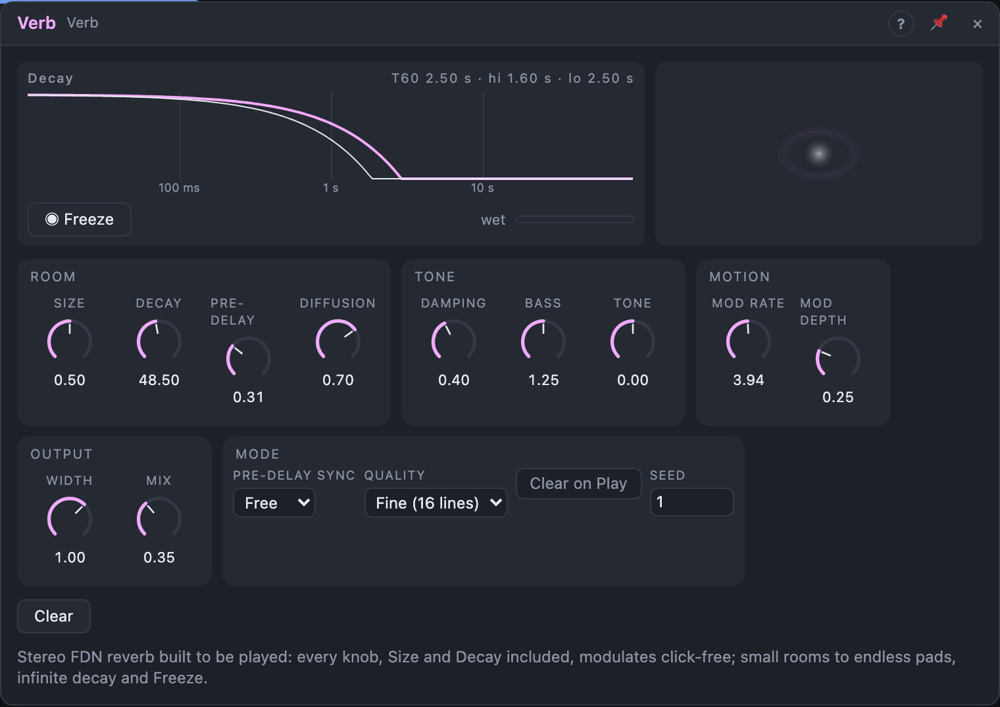

# Verb

## Introduction

Verb is a stereo reverb built to be **played**, not just set. Every knob,
including *Size* and *Decay*, can be modulated, even at audio rate, without
zipper noise or clicks. It goes from small rooms through halls to endless,
slowly drifting pads, and **Freeze** holds whatever is in the reverb for as
long as you like. Patch an envelope onto *Size* for swelling spaces, an LFO
onto *Decay* for breathing tails, or a sequencer onto *Freeze* for rhythmic
holds.

## How does it work?

The sound first passes a **pre-delay**, then four *diffusers* per channel
(allpass filters that smear the onset into a dense wash), then the *tank*: a
feedback delay network of 16 delay lines (8 in *Eco* quality) whose outputs
are mixed and fed back into each other. Every line loses a little level and
a little treble on each pass, which sets how long and how dark the tail is.
Slow internal modulation of the line lengths keeps the tail from ringing
metallically.

- **Size** scales every delay in the tank, from a small booth (≈ 3 m) to a
  huge space (≈ 60 m). Moving it bends the tail in pitch like tape speeding
  up or slowing down, never a click; very fast modulation turns into a
  shimmer.
- **Decay** is the time the tail takes to fall by 60 dB (T60), 0.1 s to
  60 s. Above that the knob enters the *infinite* zone: between 92 % and
  96 % the decay stretches towards endless, and from 96 % up the tail never
  fades (the view says *Infinite*). New sound keeps piling up there, so a
  soft limiter steps in whenever the tank gets loud.
- **Damping** makes the highs die faster than the mids (at 100 % the treble
  decays ten times faster). **Bass** stretches (up to 2×) or shortens (down
  to ½) the lows.
- **Diffusion**: low values keep the early echoes audible; high values give
  a smooth wash.
- **Mod Rate** and **Mod Depth**: speed and amount of the internal movement.
  0 % depth is static (and can ring); 100 % is a seasick chorus.
- **Tone** tilts the reverb around 800 Hz, ±6 dB: dark ↔ bright.
- **Width** sets the stereo width of the reverb: 0 % mono, 100 % as the tank
  makes it, 150 % wider.
- **Mix** blends dry and wet with equal power. *Wet L/R* always carry the
  reverb alone.

**Freeze** (the gate input, or the latching *Freeze* button in the view):
within 20 ms the input to the tank fades out and the tail stops decaying.
The modulation keeps running, so the held sound shimmers instead of
freezing solid. *Size* and *Mod Depth* still act on it; *Decay*, *Damping*
and *Bass* return when you release. The dry path is untouched, so you can
play over a frozen pad.

**Clear** (trigger input or button) fades the reverb out over 10 ms,
empties it and fades back in. **Clear on Play** empties it when the
transport starts, so two renders of the same section are identical.
Otherwise a tail from before keeps ringing, as on a hardware reverb. The
internal modulation restarts from **Seed** on every transport start, so it
repeats too. Changing *Quality* or *Seed* also goes through a short fade.

**Pre-delay Sync** sets the pre-delay to a note value at the song tempo
(1/64 to 1/2, straight, dotted or triplet, at most 1 s); the *Pre-delay*
knob is hidden then.

The view shows the decay of the lows, mids and highs from the current
(modulated) settings on a log time axis, with the pre-delay as a gap, a
Freeze button that lights while frozen (from the button or the gate), and a
meter of the wet level.

## How to use it?

- **Send effect:** *Mix* 100 %, feed it from a send or a mixer's aux, take
  *Out* (or *Wet*) back in.
- **Insert:** *Mix* 20–40 % directly after a voice or a drum bus.
- **Swelling space:** an ADSR onto *Size* (and a little onto *Decay*).
- **Breathing tail:** a slow LFO onto *Decay* or *Damping*.
- **Endless pad:** *Decay* at the top (Infinite), *Mix* 100 %, play chords
  in, then lower *Decay* to let it go. Or *Freeze* with a gate from a
  sequencer for rhythmic holds.
- **Ducked reverb:** the *Env* output of a drum bus onto *Mix* with a
  negative amount.
- **Tempo pre-delay:** *Pre-delay Sync* 1/16 or 1/8 keeps the reverb off
  the transient, in time.
- **Shimmer-ish:** *Mod Depth* high, *Mod Rate* 2–4 Hz, *Tone* bright.
- **Spatial effects:** an audio-rate oscillator onto *Size* turns the tail
  into a frequency-modulated cloud.

<!-- generated:demos -->
## Demo patches

Five whole patches show what Verb does. In the standalone app open **File → Presets…** (⌘P) and pick *Verb* under *Demos by module*; on the website, **Run in Play** opens one in your browser. Loading one replaces the project and starts the transport.

| Patch | What it shows |
|---|---|
| **Verb: Endless Hall** | Sparse, soft notes sink into a huge hall: Size is almost full, Decay is over twenty seconds and Pre-delay leaves each note clean before the bloom. Try Decay and Size together, or push Mix to 100 %. |
| **Verb: Drum Booth** | A drum beat in a tiny, dry room: low Size, a short Decay and high Damping glue the kit together. Raise Size and Decay to move the same beat into a hall, or widen it with Width. |
| **Verb: Frozen Chord** | A square LFO closes the Freeze gate for a couple of bars at a time, holding whatever is in the tank as an endless chord, then lets go so the next phrase can be caught. Edit the LFO's Sync, or latch Freeze yourself. |
| **Verb: Tide Pool** | Slow LFOs ride Size and Tone while Mod Depth swirls the tail, so the room seems to inhale and exhale around a gentle arpeggio. Every Verb knob modulates click-free: patch your own LFO into Decay. |
| **Verb: Dark Cellar** | A low plucked bass line in a cellar: Bass is boosted, Tone and Damping pull the tail dark, and Eco quality keeps it light. Lower Bass or lift Tone to hear the same room turn into a bright stairwell. |
<!-- /generated -->

<!-- generated:presets -->
## Presets

The preset bar of the Verb view has 14 factory presets. Pick one to set the knobs, then change them to taste; your own presets sit next to them.

| Preset | What it does |
|---|---|
| **Small Room** | A tight room for natural ambience. |
| **Medium Hall** | General-purpose hall. |
| **Bright Plate** | Dense, bright and fast building plate. |
| **Vocal Space** | Pre-delay keeps a voice clear in front. |
| **Warm Chamber** | Dark and cozy. |
| **Big Cathedral** | Huge stone space with a long tail. |
| **Wide Pad** | A lush, wide wash for sustained sounds. |
| **Shimmer Mod** | Heavy modulation gives a chorus-like shimmer. |
| **Gated Snap** | Short, punchy burst for snares. |
| **Dub Spring** | Sparse, metallic-sounding tail. |
| **Dark Abyss** | Very long, dark and rumbling. |
| **Infinite Freeze** | Practically endless; gate Freeze to hold a chord. |
| **Mono Closet** | Very small and mono: a hint of space. |
| **Eco Wash** | A cheaper eight-line reverb for busy patches. |
<!-- /generated -->

## Reference

### Knobs and settings

| Control | Range | Default |
|---|---|---|
| Size | 0 – 100 % | 50 % |
| Decay | 0.1 s – 60 s, then ∞ (top 8 % of the knob) | 2.5 s |
| Pre-delay | 0 – 1000 ms | 20 ms |
| Diffusion | 0 – 100 % | 70 % |
| Damping | 0 – 100 % | 40 % |
| Bass | 0.5× – 2× | 1× |
| Mod Rate | 0.05 – 8 Hz | 0.6 Hz |
| Mod Depth | 0 – 100 % | 25 % |
| Tone | −1 … +1 | 0 |
| Width | 0 – 150 % | 100 % |
| Mix | 0 – 100 % | 35 % |
| Pre-delay Sync | Free, 1/64 … 1/2 (triplet, straight, dotted) | Free |
| Quality | Eco (8 lines), Fine (16 lines) | Fine |
| Clear on Play | Off, On | Off |
| Seed | 0 – 999 | 1 |
| Freeze (latch) | Off, On | Off |

- **Decay:** the knob reads seconds; past 60 s (92 %) it is the infinite
  zone, from 96 % fully infinite.
- **Damping:** high T60 = Decay × (1 − 0.9 × Damping).
- **Bass:** low T60 (below ≈ 250 Hz) = Decay × Bass.
- **Quality:** *Eco* costs about half the CPU; *Fine* is denser.
- **Seed:** the start phases and rates of the internal modulation.
- **Freeze (latch):** the view's Freeze button; saved with the board (the
  reverb itself opens empty).
- The settings are not modulatable; all knobs are modulation destinations.

### Inputs

| Input | Signal | What it does |
|---|---|---|
| In L | audio | left input; also feeds the right channel when *In R* is not patched |
| In R | audio | right input |
| Freeze | gate | while high, the reverb holds its contents (ORed with the latch) |
| Clear | trigger | empties the reverb with a 10 ms fade |

### Outputs

| Output | Signal | What it does |
|---|---|---|
| Out L, Out R | audio | the dry/wet mix set by *Mix* |
| Wet L, Wet R | audio | the reverb only (after *Tone* and *Width*) |
| Env | control, 0 – 1 | envelope follower on the wet signal (5 ms attack, 200 ms release) |

Verb uses about 2.5 MB of memory per instance at 48 kHz. Inside a Voice Cell
every voice gets its own reverb, so it's usually better placed after the cell.
