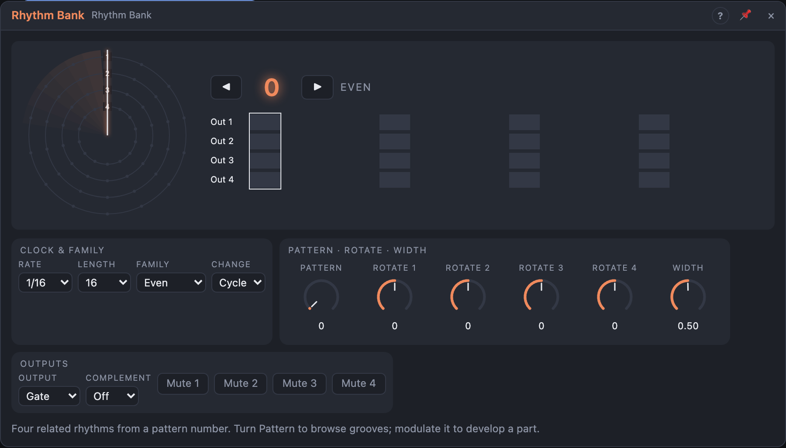

# Rhythm Bank

## Introduction

Four related rhythms from one number. Choose a **Family** (how the rhythms are
made) and turn **Pattern** (0 – 127) to browse grooves: all four outputs
change together, as parts of one beat. Out 1 is the strongest part (think
kick), Out 4 the busiest. Modulate *Pattern* with something slow and the drum
part develops over the song, the same in every render.

## How does it work?

**Families.** In most families the lower bits of *Pattern* set the density
and the higher ones how the four parts relate.

- **Even:** evenly spread hits ("Euclidean"); the parts are copies in canon,
  a ladder of densities, halves and doubles, mirror images, off-beats, …
- **Prime:** each part repeats every 2, 3, 5, 7, 11 or 13 steps; with Length
  *Open* the parts drift against each other.
- **Metric:** hits by metric weight: Pattern 0 is kick on 1, snare on 1 and 3,
  quarters and eighths; higher numbers move parts to the off-beats (backbeat).
- **Poly:** each part plays 2 – 9 hits per cycle, not tied to the steps
  (polyrhythms); *Grid* = *Free* plays them at their exact time.
- **Interlock:** parts that never hit on the same step.
- **Seeded:** random grooves weighted towards strong beats; every number is
  its own groove.

**Steps.** With nothing in *Clock*, one step is *Rate* at the song tempo,
locked to the song position. Patch a trigger into *Clock* and every pulse is a
step. *Reset* makes the next step the first. *Length* sets the cycle (2 – 32
steps, or *Open*: no cycle).

**Shaping.** *Rotate 1 … 4* delay or advance each part. *Mute 1 … 4* silence a
part. *Complement* makes the parts work together: *Avoid* (a part only plays
where no lower part plays), *Fill* (the same, and the last part fills every
empty step), *Pairs* (Out 2 plays where Out 1 doesn't, Out 4 where Out 3
doesn't).

**Changes.** With *Change* = *Cycle* a new Pattern (or Family, Length,
Complement) starts at the next step 1; with *Step* at the next step.

**Outputs.** Gates last *Width* of a step (or one-sample triggers with
*Output* = *Trigger*). *Any* is high while any part plays, *Accent* where two
or more parts hit together (before Complement), *Cycle* fires at step 1.

## How to use it?

- **A drum part:** Out 1 – 4 into a drum kit's triggers; turn *Pattern*.
- **A part that develops:** a slow LFO or Random into *Pattern*, *Change* =
  *Cycle*.
- **Accents:** *Accent* into a drum's level or a VCA.
- **Choke groups:** *Complement* = *Avoid*: hi-hat and snare never collide.

<!-- generated:demos -->
## Demo patches

Five whole patches show what Rhythm Bank does. In the standalone app open **File → Presets…** (⌘P) and pick *Rhythm Bank* under *Demos by module*; on the website, **Run in Play** opens one in your browser. Loading one replaces the project and starts the transport.

| Patch | What it shows |
|---|---|
| **Rhythm Bank: Euclid Kit** | In the Even family the four outputs spread different numbers of hits evenly over 16 steps: kick, snare, hats and rim lock into a lopsided but steady groove. Turn Pattern to browse related grooves or use Rotate 1-4 to shift one drum against the others. |
| **Rhythm Bank: Prime Marimba** | With Family on Prime and Length on Open the four parts repeat every few steps (2, 3, 5, 7 ...) and slowly drift against each other, each plucking a different note of a minor pentatonic scale, so the melody never repeats the same way twice. Try other Pattern numbers for different cycle lengths. |
| **Rhythm Bank: Metric Backbeat** | The Metric family builds a kit by metric weight: kick on the one, snare on the backbeat, hats on the off-beats. A Random steps Pattern once per bar, so the groove changes bar by bar but always from the same family. Try Complement on Avoid to stop the parts from colliding. |
| **Rhythm Bank: Cross-Rhythms** | The Poly family plays between 2 and 9 hits per cycle across the same bar, not tied to the sixteenths: with Grid on Free the hits land at their exact positions on four hand drums and a bell. Switch Grid to Snap to hear them squared up. |
| **Rhythm Bank: Interlocking Hats** | Interlock never lets two parts hit on the same step, and Complement on Fill makes Out 4 play every step the other three leave empty: kick, snare and rim weave around a continuous ride of hats. Try Rotate 1-4 or Pattern to reshuffle who plays where. |
<!-- /generated -->

## Reference

### Knobs

| Knob | Range | Default |
|---|---|---|
| Pattern | 0 – 127 | 0 |
| Rotate 1 … 4 | −16 … +16 steps | 0 |
| Width | 1 – 100 % of a step | 50 % |

### Settings

| Setting | Values | Default |
|---|---|---|
| Family | Even, Prime, Metric, Poly, Interlock, Seeded | Even |
| Length | 2 – 32 steps, Open | 16 |
| Rate | 1/1 … 1/32, dotted (.) and triplet (T) | 1/16 |
| Complement | Off, Avoid, Fill, Pairs | Off |
| Change | Step, Cycle | Cycle |
| Grid | Snap, Free (Poly) | Snap |
| Mute 1 … 4 | on / off | off |
| Output | Gate, Trigger | Gate |
| Sync To | Auto, Clock, Transport | Auto |

- **Sync To:** what steps the module. *Auto*: the clock pulses while *Clock* is patched, otherwise the transport. *Clock*: only the pulses step it. *Transport*: the song position steps it, and a patched *Clock* is ignored.

### Inputs

| Input | Signal | What it does |
|---|---|---|
| Clock | trigger | patched: each pulse is one step |
| Reset | trigger | the next step is step 1 |

### Outputs

| Output | Signal | What it does |
|---|---|---|
| Out 1 … Out 4 | gate | the four parts |
| Any | gate | high while any part is high |
| Accent | gate | steps where two or more parts hit |
| Cycle | trigger | a pulse at step 1 |
