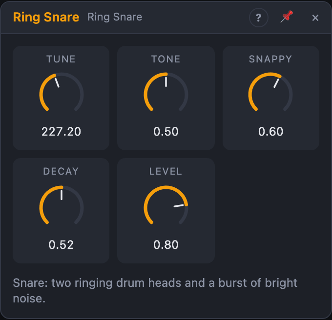

# Ring Snare

## Introduction

A snare drum: two ringing drum heads for the body, and a burst of
bright noise for the snare wires.

It belongs to the **Ring** drums: deep, round voices built from struck
resonators, noise and detuned square waves.

## How does it work?

Two resonators ring at *Tune* and a little below twice *Tune*, like the
low and high modes of a drum head. *Tone* blends between them: low and full,
or high and ringing. White noise, high-passed so it doesn't muddy the body,
plays at the same time; *Snappy* sets its level and *Decay* how long it
lasts. The body rings for about half of *Decay*.

**Playing it.** A rising edge at *Trig* plays the voice. *Velocity*, when
patched, is read at that moment: 100 % is full volume, 50 % half volume.
Unpatched, every hit is at full velocity. Velocity changes only the loudness,
never the sound, so soft hits keep their character. Hitting again while the
voice still sounds restarts the noise and adds to the ringing heads.

## How to use it?

- **Backbeat:** the defaults on beats 2 and 4.
- **Tight, dry snare:** *Decay* around 120 ms, *Snappy* 40 %.
- **Rattly, bright snare:** *Snappy* at 100 %, *Tone* high.
- **Ghost notes:** low velocities between the main hits.

## Reference

### Knobs and settings

| Control | Range | Default |
|---|---|---|
| Tune | 100 – 400 Hz | 180 Hz |
| Tone | 0 – 100 % | 50 % |
| Snappy | 0 – 100 % | 60 % |
| Decay | 50 ms – 1 s | 250 ms |
| Level | 0 – 100 % | 80 % |

- **Tune:** the pitch of the lower head; the higher one follows.
- **Tone:** the balance of the two heads, low … high.
- **Snappy:** the level of the noise (the snare wires).
- **Decay:** how long the noise lasts; the body rings for about half as long.
- **Level:** the output volume.

*Tune*, *Tone*, *Snappy*, *Decay* and *Level* are modulation destinations.

### Inputs

| Input | Signal | What it does |
|---|---|---|
| Trig | trigger | a rising edge plays the voice (gates work too) |
| Velocity | control, 0 … 1 | the loudness of each hit, read at the trigger; unpatched = 100 % |

### Outputs

| Output | Signal | What it does |
|---|---|---|
| Out | audio | the drum |
