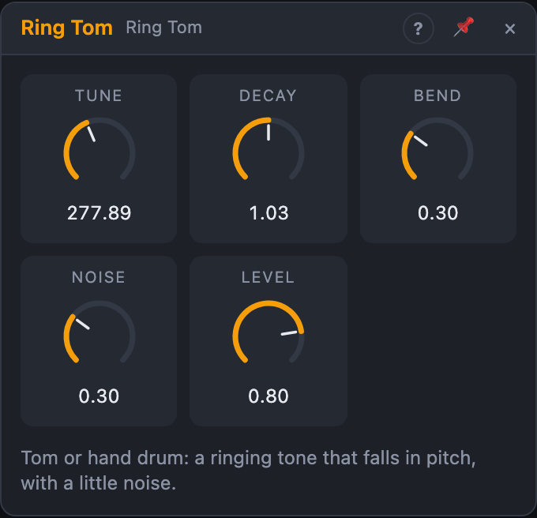

# Ring Tom

## Introduction

A tom or hand drum: a ringing tone that falls slightly in pitch as it
dies away, with a little noise for the skin. With *Noise* at 0 it becomes a
pure, conga-like tone.

It belongs to the **Ring** drums: deep, round voices built from struck
resonators, noise and detuned square waves.

## How does it work?

A resonator rings at *Tune*. *Bend* starts the pitch above *Tune* and lets
it fall back over the whole note, the way a drum head's pitch falls as it
loses tension. Low-passed noise adds the sound of the stick on the skin; it
fades in less than half the time of the tone. Use several Ring Tom nodes, tuned
apart, for a set of toms.

**Playing it.** A rising edge at *Trig* plays the voice. *Velocity*, when
patched, is read at that moment: 100 % is full volume, 50 % half volume.
Unpatched, every hit is at full velocity. Velocity changes only the loudness,
never the sound, so soft hits keep their character. Hitting again while the
voice still sounds adds to the ringing.

## How to use it?

- **Tom fills:** three Ring Toms at about 100, 140 and 200 Hz, played by
  the last steps of a sequence.
- **Hand drums:** *Noise* at 0, *Decay* around 200 ms, *Tune* 200 – 400 Hz.
- **Melodic toms:** patch a sequencer's *Pitch* onto *Tune* and adjust the
  cable's amount until the intervals sound right.

## Reference

### Knobs and settings

| Control | Range | Default |
|---|---|---|
| Tune | 50 – 600 Hz | 140 Hz |
| Decay | 50 ms – 2 s | 400 ms |
| Bend | 0 – 100 % | 30 % |
| Noise | 0 – 100 % | 30 % |
| Level | 0 – 100 % | 80 % |

- **Tune:** the pitch the tom settles on.
- **Decay:** how long the tom rings.
- **Bend:** how far above *Tune* the pitch starts; at 100 % it starts 50 % higher.
- **Noise:** the level of the skin noise. 0 % is a pure tone.
- **Level:** the output volume.

*Tune*, *Decay*, *Bend*, *Noise* and *Level* are modulation destinations.

### Inputs

| Input | Signal | What it does |
|---|---|---|
| Trig | trigger | a rising edge plays the voice (gates work too) |
| Velocity | control, 0 … 1 | the loudness of each hit, read at the trigger; unpatched = 100 % |

### Outputs

| Output | Signal | What it does |
|---|---|---|
| Out | audio | the drum |
