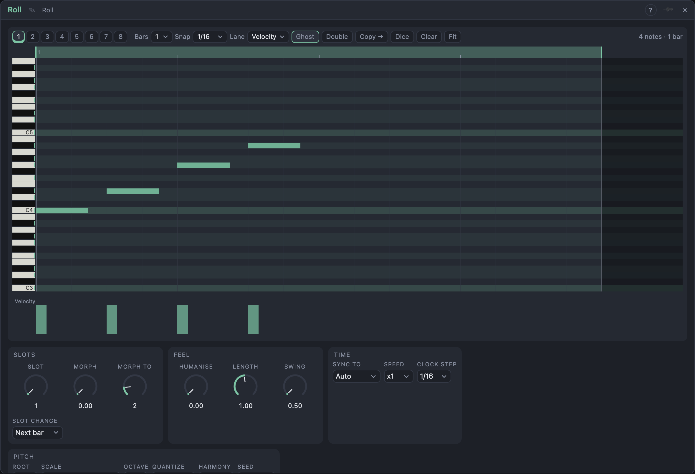

# Roll

## Introduction

Roll is a note editor you play. Notes are drawn on a pitch grid with any start,
any length and any pitch, up to **8 bars** long. They may **overlap**, so a
pattern can be a chord, a bass line under a melody, or notes held through one
another. *Notes* plays a Voice Cell with all of it at once; the **Low**, **High**
and **Last** outputs give you the lowest, the highest and the latest note as
ordinary pitch and gate signals for monosynths.

Each note carries its own **chance** and **ratchet** count. Eight **slots** hold
eight patterns. Two ideas are particular to Roll: a **ghost** of the slot that
played before sits behind the notes you edit, and the **Morph** knob blends the
playing slot into a second slot note by note.

## How does it work?

**Time.** A beat is divided into 96 ticks, a bar is four beats. With nothing in
*Clock* the playhead follows the transport, so the pattern stays on the bars
and lands right after a loop jump. *Speed* runs the pattern at ¼, ½, 1, 2 or 4
times the tempo. With a trigger in *Clock* each pulse advances the playhead by
*Clock Step* instead. *Reset* returns to the start of the loop region.

**Loop region.** The ruler above the notes sets where the playhead loops inside
the pattern's bars; the rest of the pattern stays as drawn. Double-click the
ruler to loop all bars again.

**Overlap.** Every note is its own voice with its own note-on and note-off. If
the same pitch is started again while it still sounds, it is restarted, so no
note can stick. *Length* scales every note's length (from 10 % to 200 %).

**Ratchet and chance.** A ratchet of 4 divides the note's length into four
repeats; a chance of 50 % lets the note play every second time on average. The
choice is seeded (*Seed*) and depends on the loop count, so the same Seed
renders the same variation every time.

**Humanise.** At the top the notes are late by up to 30 ms and vary in velocity
by up to a quarter. Notes are only delayed, never early, and the lengths stay.

**Pitch.** Notes are drawn as MIDI pitches. *Octave* and *Transpose* move them;
with *Quantize* set to *To scale* every note is snapped to the *Scale* (or to the
key and scale of a Harmony Master when *Harmony* is set). The rows of the editor
light up with the scale, following the Harmony Master.

**Slots, Ghost and Morph.**
- *Slot* (or the *Pattern* input, 0–1 over the eight slots) chooses what plays.
  A change waits for *Slot Change*: the next bar, the end of the loop, or no
  wait at all.
- The **Ghost** shows the slot that played before the current one as soft
  blocks behind your notes, so a new pattern can answer the old one. While you
  edit a slot that is not playing, the ghost shows the one that is.
- **Morph** blends the playing slot with the slot *Morph To*. The first note of
  one is paired with the first of the other, the second with the second, and so
  on, in order of time. Paired notes move between the two in start, length,
  pitch and velocity. Notes without a partner fade in or out one by one as the
  knob moves. At 0 % you hear the playing slot exactly, at 100 % the other one.
  The target slot shows as dashed outlines.

## How to use it?

- **Draw and Select:** the *Draw* and *Select* buttons pick what the pointer does.
  With **Draw**, a click on empty grid adds a note (its length is the *Snap*
  value; drag sideways to make it longer) and a click on a note removes it.
  Drag a note to move it, drag its right edge to resize it. Hold **Alt** to
  ignore the snap. With **Select**, drag a rectangle to select the notes it
  touches; hold **Shift** to add to the selection. Shift-click a note to add
  or remove it. The Delete key removes the selected notes; the arrow keys nudge
  them (Shift: an octave).
- **Right-click menu:** *Copy* and *Paste* (⌘C / ⌘V) copy the selected notes and
  paste them at the pointer, snapped to *Snap*. *Delete* removes the selection,
  *Double* repeats the pattern into twice the bars, *Clear* empties the slot.
  *Zoom in / out in time / in pitch* and *Fit* are here too. Right-clicking a
  note selects it first.
- **Record:** the *Rec* button writes what arrives on *Notes In*, or on *Pitch In*
  with *CV In* as its gate, into the playing slot at the playhead while the
  pattern runs. Each note starts where it was played and lasts as long as it was
  held; recorded notes are added to what is already there (overdub) and the
  button stays on until you switch it off. Notes still held when you stop are
  ended at that moment.
- **Lanes:** the strip below the notes sets **velocity**, **chance** or
  **ratchet** of the note under the pointer (all selected notes if it is one of
  them). Pick the lane in the *Lane* menu.
- **Zoom:** the mouse wheel scrolls the pitch and Shift + wheel scrolls in time.
  Ctrl/⌘ + wheel up / down zooms in time and Ctrl/⌘ + wheel left / right zooms
  the pitch rows. The right-click menu has the same zoom steps and *Fit*, which
  shows all bars and the pitch range of the notes.
- **Slots:** click a slot number to edit and play it; Shift-click edits without
  switching what plays. A bar under a number marks the slot that plays (bright)
  and the one that played before (dim).
- **A bass and a lead from one pattern:** patch *Low Pitch / Low Gate* to a bass
  voice and *High Pitch / High Gate* to a lead.
- **Evolving:** put a slow LFO on **Morph** and the pattern slides between two
  slots; or an LFO on *Slot* for a pattern per bar.

<!-- generated:demos -->
## Demo patches

Five whole patches show what Roll does. In the standalone app open **File → Presets…** (⌘P) and pick *Roll* under *Demos by module*; on the website, **Run in Play** opens one in your browser. Loading one replaces the project and starts the transport.

| Patch | What it shows |
|---|---|
| **Roll: Chord Stack** | Four overlapping chords drawn on a four-bar roll play a Voice Cell as a pad, while the Low Pitch and Low Gate outputs pick out the lowest note of each chord for a bass. Open the roll and drag a note to change a chord. |
| **Roll: Morph Drift** | Slot 1 is a steady eighth-note arp, slot 2 an offbeat line with a few extra notes. A slow LFO turns Morph so the arp bends note by note into the other pattern and back; the spare notes fade in and out. Set Morph by hand to freeze a blend. |
| **Roll: Ratchet and Chance** | Every note of this two-bar line has its own ratchet count and chance, so some notes split into quick repeats and others play only now and then. Seed changes which ones sound; Humanise adds a loose feel. |
| **Roll: Low and High** | One pattern with a bass line, a lead above it and a long held note between: the Low outputs play a bass voice and the High outputs a lead, while Notes plays a soft pad with all of it. Move a note across and it changes hands. |
| **Roll: Slow Eight Bars** | Long overlapping notes make an eight-bar drone chord progression, and a few quiet notes with ratchets and a chance of sounding sparkle on top. Everything starts a little apart thanks to Humanise. Draw a note to add your own. |
<!-- /generated -->

<!-- generated:presets -->
## Presets

The preset bar of the Roll view has 16 factory presets. Pick one to set the knobs, then change them to taste; your own presets sit next to them.

| Preset | What it does |
|---|---|
| **Rising Line** | A short rising line, the starting point. |
| **Minor Chords** | Four overlapping five-note chords, a bar each. |
| **Walking Bass** | Eight-note bass line over two bars. |
| **Held Pad Stack** | Long notes starting a little apart and ringing through each other. |
| **Ratchet Pulse** | Notes that split into 2-6 quick repeats. |
| **Chance Garden** | Sixteen notes that each play only some of the time. |
| **Humanised Keys** | Chords that arrive a hair late and uneven. |
| **Triplet Roll** | A rolling run on the triplet grid. |
| **Morph Pair** | Two arps; Morph 50 % sits halfway between them. |
| **Eight Bars** | A long melody that takes eight bars to come round. |
| **Swung Arp** | A sixteenth-note arpeggio with a rolling swing. |
| **Half-Time Drift** | Everything at half speed: a slow, stretched pattern. |
| **Double-Time Run** | The pattern at twice the speed, snapped to the scale. |
| **Loop Window** | Four bars drawn, only the second one loops. |
| **Scale Snap Cluster** | A chromatic cluster pulled into Dorian when played. |
| **Ghost Answer** | Slot 1 calls, slot 2 answers; the ghost shows the call. |
<!-- /generated -->

## Reference

### Knobs

| Knob | Range | Default |
|---|---|---|
| Morph | 0 – 100 % | 0 % |
| Humanise | 0 – 100 % | 0 % |
| Length | 10 – 200 % | 100 % |
| Swing | 50 – 75 % | 50 % |
| Slot | 1 – 8 | 1 |
| Morph To | 1 – 8 | 2 |

- **Swing:** delays notes that start on an odd sixteenth.
- **Slot** and **Morph To** are stepped knobs: a cable moves them through the eight slots.

Every knob is a modulation destination.

### Settings

| Setting | Values | Default |
|---|---|---|
| Speed | x1/4, x1/2, x1, x2, x4 | x1 |
| Clock Step | 1/32, 1/16, 1/8, 1/4, 1/32T | 1/16 |
| Root | C … B | C |
| Scale | the Step Sequencer's scales | Natural Minor |
| Octave | −3 … +3 | 0 |
| Quantize | Off, To scale | Off |
| Harmony | Off, Bus A … Bus D | Off |
| Slot Change | Immediate, Next bar, Loop end | Next bar |
| Seed | 0 – 999 | 1 |
| Sync To | Auto, Clock, Transport | Auto |
| Record | Off, On | Off |

- **Sync To:** *Auto* follows *Clock* while it is patched, otherwise the transport. *Clock* only moves with pulses; *Transport* ignores a patched *Clock*.

### Inputs

| Input | Signal | What it does |
|---|---|---|
| Clock | trigger | each pulse moves the playhead by *Clock Step* |
| Reset | trigger | back to the start of the loop region; ends all notes |
| Transpose | pitch | added to every note (1 V/oct) |
| Pattern | control, 0 – 1 | chooses the slot over the eight slots |
| Notes In | notes | notes to record while *Record* is on |
| Pitch In | pitch | the pitch of the note to record, read when *CV In* goes high |
| CV In | gate | starts a note at *Pitch In* when it goes high and ends it when it falls |

### Outputs

| Output | Signal | What it does |
|---|---|---|
| Notes | notes | every note, polyphonic |
| Low Pitch / Low Gate | pitch / gate | the lowest sounding note; the gate dips for a moment when another note becomes the lowest |
| High Pitch / High Gate | pitch / gate | the highest sounding note |
| Last Pitch / Last Gate | pitch / gate | the most recently started note that still sounds |
| Velocity | control, 0 – 1 | velocity of the latest note |
| Trigger | trigger | a pulse whenever any note starts |
| Loop | trigger | a pulse when the loop starts over |
| Position | control, 0 – 1 | where the playhead is inside the loop region |

Pitch outputs hold their last value when no note sounds.
