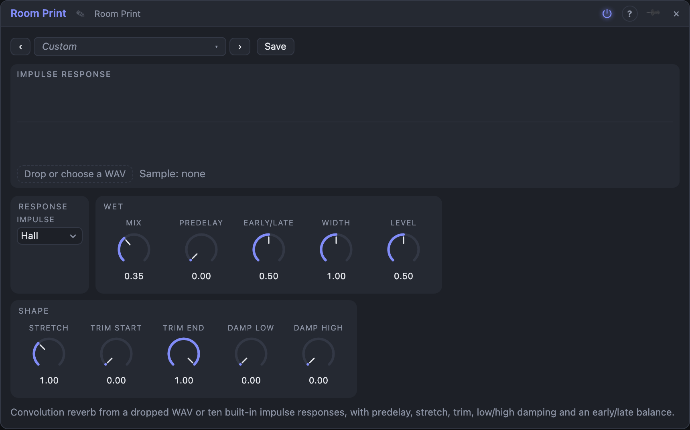

# Room Print

## Introduction

Room Print is a convolution reverb: it makes any sound ring as if it had
been played in the space whose "print" you load. The print is an impulse
response, the recording of a clap or a sweep in a room, a spring, a tank or
anything else, and you can drop your own WAV file on the module. Ten
built-in prints are made in code, so it works without files. Because the
print is just audio, you can stretch it, cut it, darken its tail, delay it and
move the balance between its first reflections and its late wash.

## How does it work?

**Convolution.** Every sample of the input is replaced by a copy of the whole
print, scaled by that sample, and the copies are added. Done directly that is
millions of multiplications per second, so Room Print splits the print into
512-sample parts and does the long ones with fast Fourier transforms
(*partitioned convolution*). The first 512 samples are done directly, which
makes the reverb **latency-free**.

**Impulse.** *Impulse* chooses the print: **Room**, **Hall**, **Cathedral**,
**Plate**, **Spring** (chirped echoes), **Tank** (ringing metal modes), **Cave**
(dark, with large echoes), **Swell** (a tail played backwards), **Gate** (a dense
burst cut off sharply), **Echoes** (ping-pong repeats), or **Sample**: the
audio file you dropped on the view (WAV, or anything the app can decode),
used as a stereo print (a mono file feeds both sides). Prints up to 4 s are
used.

**Shape.** These settings re-prepare the print (a moment after you move them):
*Stretch* plays it at 0.5× – 2× speed (2× is half as long and an octave up), *Trim
Start* and *Trim End* cut the front and the back, *Damp Low* and *Damp High* make
the low (below about 220 Hz) or high (above about 3 kHz) part of the tail die away faster
and leave the first sounds alone. The result is scaled to the same energy
whatever the file, so changing prints does not change the level.

**Early and late.** *Early/Late* is a balance: at the middle both are heard,
down only the first reflections (the first 60 ms or so), up only the tail
(from about 120 ms), with a smooth hand-over between. It can be modulated
freely. *Predelay* (up to 0.5 s) delays the input before the print.

**Stereo.** With only *In L* patched, the signal feeds both sides; with both,
each input runs through its own channel of the print. *Width* narrows or widens
the reverb's side signal (0 – 200 %).

## How to use it?

- **A natural room:** *Hall* or *Room*, *Mix* 20 – 30 %.
- **Your own room:** drop a recording of a room, set *Impulse* to Sample.
- **A tail with no wash:** *Early/Late* at 20 % keeps the room sound and drops
  the long tail: good for drums.
- **A pad bloom:** *Swell* at *Mix* 50 %, *Predelay* 80 ms.
- **Metal and springs:** *Tank* or *Spring* on a drum loop.
- **A bigger or smaller room:** *Stretch* 0.7 for larger and darker, 1.6 for a closet.
- **Dark and distant:** *Damp High* 70 % and *Trim End* 60 %.

<!-- generated:demos -->
## Demo patches

Five whole patches show what Room Print does. In the standalone app open **File → Presets…** (⌘P) and pick *Room Print* under *Demos by module*; on the website, **Run in Play** opens one in your browser. Loading one replaces the project and starts the transport.

| Patch | What it shows |
|---|---|
| **Room Print: Hall Pluck** | A plucked melody in the built-in Hall response. The late part is cut a little with Early/Late and the highs of the tail damp early, so the hall sounds warm. Raise Mix for a bigger space or switch Impulse to Cathedral. |
| **Room Print: Drum Tank** | A drum loop through the ringing Tank response: every hit excites metal modes and the kit gets a resonant, clanging halo. Early/Late at the low end keeps only the first reflections for a tighter kit. |
| **Room Print: Spring Bounce** | A bass-heavy riff through the Spring response: chirping, repeating echoes that bounce behind every note. Stretch changes the pitch and length of the boing, and Damp High softens it. |
| **Room Print: Swell Bloom** | Short chords go through the Swell response: its tail is played backwards, so each note blooms into a rising wash after the sound has gone. Predelay moves the bloom; Trim Start makes it arrive sooner. |
| **Room Print: Gated Kit** | A drum loop in the Gate response: a dense burst that stops abruptly, giving every hit a big, short, cut-off space. Stretch lengthens or shortens the burst, Mix sets how much is added. |
<!-- /generated -->

<!-- generated:presets -->
## Presets

The preset bar of the Room Print view has 15 factory presets. Pick one to set the knobs, then change them to taste; your own presets sit next to them.

| Preset | What it does |
|---|---|
| **Small Room** | A short, close room. |
| **Warm Hall** | A hall with the highs fading early. |
| **Cathedral** | A very long, lofty tail. |
| **Bright Plate** | Dense and bright, without early reflections. |
| **Spring Tank** | Chirped, boingy echoes. |
| **Metal Tank** | Ringing metal modes. |
| **Deep Cave** | Dark, with a few large echoes. |
| **Swell Bloom** | The reverb grows before the sound. |
| **Gated Burst** | A dense burst cut off sharply. |
| **Ping Pong Echoes** | Repeats that bounce left and right. |
| **Tight Early** | Only the first reflections: room without wash. |
| **Distant Wash** | Only the late tail, dark and far. |
| **Big and Dark** | Stretched to a huge, murky space. |
| **Closet** | A tiny, bright box. |
| **Wide Plate** | A plate with exaggerated width. |
<!-- /generated -->

## Reference

### Inputs and outputs

| Jack | Signal | What it does |
|---|---|---|
| In L, In R | audio | the dry input (one patched: mono) |
| Out L, Out R | audio | dry/wet mix |

### Knobs and settings

| Control | Range | Default |
|---|---|---|
| Impulse | 10 built-in, Sample | Hall |
| Mix | 0 – 100 % | 35 % |
| Predelay | 0 – 500 ms | 0 |
| Early/Late | 0 – 100 % | 50 % |
| Width | 0 – 200 % | 100 % |
| Level | 0 – 100 % | 50 % |
| Stretch | 0.5 × – 2 × | 1 × |
| Trim Start | 0 – 90 % | 0 |
| Trim End | 5 – 100 % | 100 % |
| Damp Low, Damp High | 0 – 100 % | 0 |

*Impulse* and the *Shape* settings are plain settings; the others are
modulation destinations. Samples are stored in the shared media folder; the
board keeps only the file's id.

Room Print uses several megabytes of memory per instance: in a Voice Cell it
multiplies, and the board will warn you.
