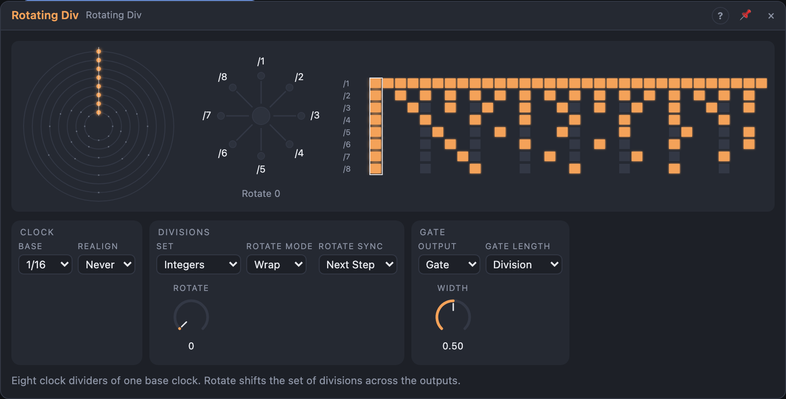

# Rotating Div

## Introduction

Eight clock dividers on one clock. Out 1 fires every step, Out 2 every second
step, Out 3 every third, and so on, and the **Rotate** knob shifts the whole
set across the outputs: one turn (or an LFO on *Rotate*) turns a steady
hi-hat into half time, odd meters or sparse accents. Everything is worked out
from the song position, so it stays on the bars, after loop jumps and in
renders.

## How does it work?

**The base step.** Unpatched, one step is *Base* (1/16 by default) at the
song's tempo. Patch a trigger into *Clock* and every pulse is a step instead.

**Sets.** *Set* chooses the eight divisions: *Integers* (1 2 3 4 5 6 7 8),
*Odds* (1 3 5 …), *Evens* (2 4 6 …), *Primes* (1 2 3 5 7 11 13 17), *Powers of
2* (1 2 4 … 128), *Fibonacci* (1 2 3 5 8 13 21 34), or *Custom* (your eight
values, typed in the view).

**Rotate.** *Wrap* cycles the eight values round the outputs: Rotate 1 on
Integers gives 2 3 4 5 6 7 8 1. *Extend* keeps going along the series, so the
outputs get slower: Rotate 4 gives 5 … 12. Custom always wraps.

**Rotate Sync.** A new Rotate (or Set) waits for the next base step (*Next
Step*), the next bar (*Next Bar*; with a clock: the next step where all
outputs line up), or applies at once (*Immediate*). A gate that is already
high always finishes its length.

**Realign.** Odd divisions drift against the bar: /3 of 1/16 notes repeats
only every 3 bars. *Realign* restarts every output every 1, 2, 4 or 8 bars;
the last cycle before the restart is shortened, and its gate ends at least
1 ms before the next one starts.

**Gates.** In *Gate* output, an output is high for *Width* of its own period
(*Gate Length* = *Division*) or of one base step (*Base Step*). *Trigger*
output sends a one-sample pulse instead.

**Stair** reads the eight outputs as a binary number (Out 1 the highest bit),
so it is a stepped shape that repeats with the pattern; into a quantizer it
makes a melody. **Align** fires when all eight outputs start together.

**Reset** makes the next base step the start of every output's cycle. When
the transport stops, every output goes low; on play, nothing fires until the
next due step.

## How to use it?

- **Drum variations:** Out 1 … 8 into drum triggers; an LFO or a Random on
  *Rotate*.
- **Odd meters that still land on the one:** Set *Odds*, *Realign* 1 bar.
- **A melody from rhythm:** *Stair* into a Quantizer Suite.
- **Phrase starts:** *Align* resets a sequencer or advances a Harmony Master.

<!-- generated:demos -->
## Demo patches

Five whole patches show what Rotating Div does. In the standalone app open **File → Presets…** (⌘P) and pick *Rotating Div* under *Demos by module*; on the website, **Run in Play** opens one in your browser. Loading one replaces the project and starts the transport.

| Patch | What it shows |
|---|---|
| **Rotating Div: Shifting Drum Roles** | A slow stepped LFO turns Rotate, so the same set of divisions moves from output to output: the part that was the kick becomes the hats, then the clap, and the groove reshapes every few bars. Turn Rotate by hand to hear one fixed arrangement, or set Rotate Sync to Next Bar to move on the downbeat. |
| **Rotating Div: Prime Bells** | The Primes set (2, 3, 5, 7, 11, 13 and on) rings eight soft bell tones, each on its own division, so they only coincide rarely and the texture keeps shifting. Change Rotate to give each bell a different, slower or faster clock without touching the tuning. |
| **Rotating Div: Powers of Two Groove** | With the Powers of 2 set (1, 2, 4, 8, 16, 32...) every output lands on a regular beat, giving a tidy four-to-the-floor skeleton of kick, claps and hats. Raise Rotate by one and each part jumps to the next division for an instant half-time or double-time feel. |
| **Rotating Div: Fibonacci Staircase** | The Stair output reads all eight gates as one binary number, a jumpy staircase that repeats with the pattern, and a Quantizer snaps it to a scale so the Fibonacci set (1, 2, 3, 5, 8...) writes a melody. Change the Quantizer's Scale, or Rotate, for a different tune from the same clocks. |
| **Rotating Div: Extending Evens** | In Extend mode, Rotate does not wrap around the set but continues it, so with the Evens set each turn of the knob brings in longer divisions (2, 4, 6... then 18, 20 and beyond). A slow sawtooth LFO turns Rotate up through the bars, thinning the hats and claps out as it climbs. |
<!-- /generated -->

<!-- generated:presets -->
## Presets

The preset bar of the Rotating Div view has 12 factory presets. Pick one to set the knobs, then change them to taste; your own presets sit next to them.

| Preset | What it does |
|---|---|
| **Integer Set** | Divisions 1 to 8 across the outputs: the plain starting point. |
| **Integers Rotated** | The same set shifted three outputs along, wrapping round. |
| **Odd Divisions** | Divisions 1, 3, 5, 7 and so on: off-kilter, interlocking pulses. |
| **Even Divisions** | Divisions 2, 4, 6 and so on: steady, related pulses. |
| **Prime Rotation** | Prime divisions shifted by two: very slow to repeat. |
| **Binary Ladder** | Powers of two: classic halving for kick, snare and hats. |
| **Fibonacci Spiral** | Fibonacci divisions for organic cross-rhythms. |
| **Extending Rotate** | Rotate extends the set upward instead of wrapping. |
| **Triggers Instant** | Triggers for drums; rotation changes take effect at once. |
| **Bar-Locked Rotation** | Rotation moves only at the bar line, resyncing each bar. |
| **Eighth Base Pulses** | A slower base clock with long gates. |
| **Triplet Fibonacci** | Triplet base with base-step gates for skittering hits. |
<!-- /generated -->

## Reference

### Knobs

| Knob | Range | Default |
|---|---|---|
| Rotate | 0 – 16 | 0 |
| Width | 1 – 99 % | 50 % |

### Settings

| Setting | Values | Default |
|---|---|---|
| Set | Integers, Odds, Evens, Primes, Powers of 2, Fibonacci, Custom | Integers |
| Rotate Mode | Wrap, Extend | Wrap |
| Rotate Sync | Immediate, Next Step, Next Bar | Next Step |
| Base | 1/1 … 1/32, dotted (.) and triplet (T) | 1/16 |
| Realign | Never, 1, 2, 4, 8 bars | Never |
| Output | Gate, Trigger | Gate |
| Gate Length | Division, Base Step | Division |
| Sync To | Auto, Clock, Transport | Auto |

- **Sync To:** what steps the module. *Auto*: the clock pulses while *Clock* is patched, otherwise the transport. *Clock*: only the pulses step it. *Transport*: the song position steps it, and a patched *Clock* is ignored.

### Inputs

| Input | Signal | What it does |
|---|---|---|
| Clock | trigger | patched: each pulse is one base step |
| Reset | trigger | every output starts a new cycle on the next base step |

### Outputs

| Output | Signal | What it does |
|---|---|---|
| Out 1 … Out 8 | gate | fires every *d* base steps, *d* the output's division |
| Stair | control, 0 – 1 | the eight gates as a binary number / 255 |
| Align | trigger | a pulse when all eight outputs start together |
