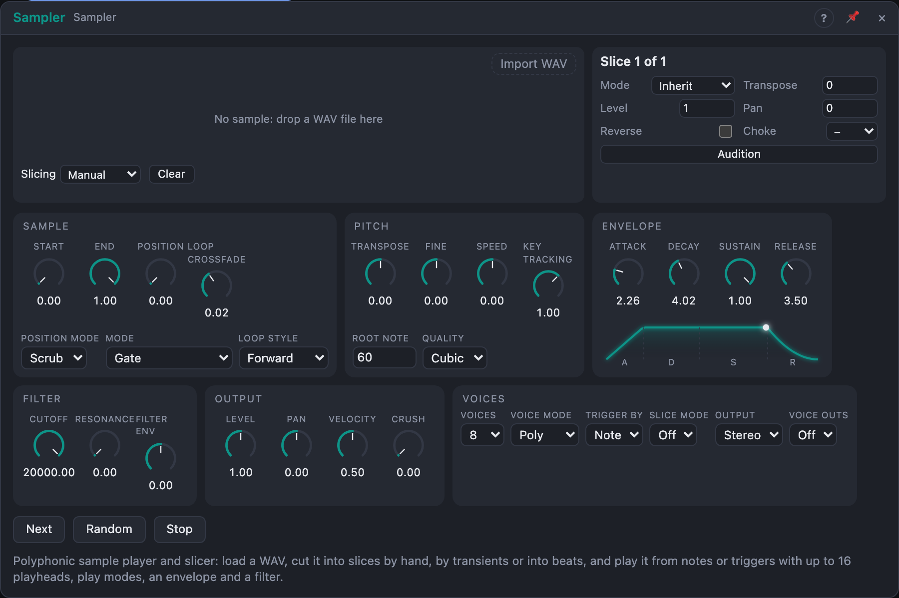

# Sampler

## Introduction

Sampler plays a WAV file like an instrument. Load a sample, optionally cut it
into **slices** (by hand, at the transients, or into beats), and play it from
notes or triggers with up to 16 independent **playheads**. A play mode decides
how each playhead ends, an ADSR envelope and a filter shape it, and Speed,
Transpose and Position move it around. Sampler is the module for "play a
sample" and "chop a loop and sequence the pieces"; *Splice* is the one for
recording onto a reel, *Grains* for a moving cloud.

## How does it work?

**Loading.** Drop an audio file on the view (or press *Import audio*): WAV, or MP3, AIFF, FLAC, OGG or M4A, which are converted to WAV on import. The file is
stored in the media folder, so the board keeps working on any computer that
has it. 8, 16, 24 and 32-bit files, mono or stereo, any sample rate.

**Slices.** Markers cut the sample into slices. *Slicing* chooses how they are
made, and all three write the same markers, so you can start automatically and
finish by hand:

- **Manual:** double-click the waveform to add a marker, double-click a marker
  to remove it, drag a marker to move it.
- **Threshold:** *Detect* finds the transients. *Sensitivity* sets how many
  (more to the right), *Min gap* the shortest slice.
- **Beats:** *Equal* cuts *Divisions* equal slices. *On BPM* cuts the sample on
  a grid: *Divisions* over *Bars* bars at *BPM*. *Detect BPM* estimates the
  tempo of a loop.

Click a slice to select it; its own settings (mode, transpose, level, pan,
reverse, choke group) appear below the waveform. Shift-click or *Audition*
plays it.

**Starting a playhead.** With *Trigger By* = *Note*, the *Notes* input plays
the sample: in whole-sample mode the note sets the pitch (the sample sounds as
recorded at *Root Note*); with *Slice Mode* on, each key plays one slice,
slice 1 on the root note and the following slices on the keys above it (keys
beyond the last slice do nothing). With *Trigger By* = *CV*, a pulse at
*Trigger* starts a playhead: *Slice* (0 – 100 % picks slice 1 … n) or the
selected slice plays, *Pitch* sets the pitch, *Velocity* the level. A *Gate*
holds the playhead open; without one, the sample plays to the end of its
region. Patch only *Gate*, without *Trigger*, and the gate's rising edge
starts it. *Step* moves the selected slice to the next one (and wraps); the
*Next* and *Random* buttons do the same by hand. *Stop* releases every
playhead.

**Play modes.** *Mode* decides how a playhead ends; each slice can override it.

- **Gate:** plays while the note is held, then fades out over *Release*. Reaching
  the end of the sample or slice stops it.
- **To end of sample:** plays on to the sample end, whatever the gate does.
- **To end of slice:** plays to the next marker, whatever the gate does.
- **Loop:** loops the sample (or the slice) until released. *Loop Style* can
  be *Ping-pong*; *Loop Crossfade* hides the seam.
- **One-shot:** plays the whole slice, ignoring the gate.

*End* fires whenever a playhead reaches its end or wraps its loop.

**Region.** *Start* and *End* trim the sample. In slice mode they trim each
slice, as a fraction of it, so End at 50 % plays the first half of every slice.

**Pitch and speed.** *Transpose* (semitones) and *Fine* (cents) set the pitch;
*Pitch* adds 1 V per octave to CV-triggered playheads. *Speed* is the
playback ratio and negative plays backwards; *Speed* (input) adds 1 V per
octave. With *Warp* on *Repitch* pitch and speed are one thing, like tape:
playing twice as fast sounds an octave higher. The other *Warp* modes stretch
time on their own, with overlapping grains, so *Speed* changes the tempo and only
*Transpose* (and the note) changes the pitch: *Beats* (short grains, for drums
and percussion), *Tones* (long grains, smooth, for pads and melodies) and
*Texture* (scattered grains, for noise and ambience). *Key Tracking* sets how much the note
number moves the pitch (100 % is normal; 0 % plays every key at the same pitch).
*Quality* is the interpolation: *Linear* (cheapest), *Cubic*, or *Sinc* (cleanest
when pitching down).

**Tempo sync.** Turn *Tempo Sync* on and *Speed* is scaled so the sample lasts
*Beats* beats at the tempo of the board: *Transport* follows the transport,
*Clock* measures the pulses on the *Clock* input (set *Clock PPQN* to match) and
*Auto* uses the clock while the jack is patched, else the transport. **÷2** and
**×2** halve and double *Beats* (twice as fast, half as fast); **Fit** guesses it from the
detected BPM. Use *Beats* or *Tones* in *Warp* to keep a drum loop's pitch while it
follows the tempo. It matches the tempo; it does not line the loop up with the bar,
so start it on the beat.

**Gain.** *Gain* (±24 dB) boosts or cuts the sample before the filter and
envelope, and the waveform display follows it, so a quiet file can be seen and
heard at a useful level.

**Recording.** Patch audio into *In L* (and *In R* for stereo; a lone *In L* is
recorded as mono) and press *Record* (or raise the *Rec* gate). Press it again,
or drop the gate, to stop: the take becomes the sample and loops at once, and is
saved with the project. Recordings can be up to 20 seconds.
- *Rec Mode* *Overdub* adds what comes in on top of the take at the playhead,
  keeping the old audio at *Feedback* (100 % layers forever, lower values fade
  the old layers out like an echo). It needs a take made here; after loading a
  project, make a new one.
- *Rec Length* *Beats* records exactly *Beats* beats at the current tempo and
  stops by itself: a perfect bar for a looper. Together with *Tempo Sync* the
  loop follows later tempo changes.
- *Monitor* sends the input to the output while recording, or always.
- With *Overdub*, *Feedback* below 100 % and *Rec Length* in beats, the Sampler is a
  tempo-synced looper-delay. Overdub assumes the playhead moves at Speed 1.

**Tabs.** The controls are in four tabs under the waveform: *Sample* (Gain,
Start, End, Position, Pitch, Warp and Tempo Sync), *Envelope & Filter*, *Output*
(Output and Voices) and *Record*.

**Moving the playhead.** With *Position Mode* *Scrub*, turning *Position* (or
modulating it) moves every sounding playhead to that point of its region, with a
3 ms crossfade, so an LFO or a sequencer can scan through the sample. With
*Offset*, *Position* is read when a playhead starts and sets where in the
region it begins (random-access starts).

**Many playheads.** *Voices* sets how many play at once (1 – 16). *Poly* gives
each note its own playhead; when all are in use the oldest (or the quietest
one already releasing) fades out in 5 ms. *Mono* plays one at a time and
goes back to the previous held note when you let go; *Legato* does the same
but changes pitch without restarting the sample. *Layers* starts several
playheads with every note: *Layers* sets how many, *Layer Pitch* the interval
between them and *Layer Offset* a delay between starts, for unison, octaves or
chords.

**Choke groups.** Slices in the same choke group cut each other off: set a
closed and an open hi-hat to the same group.

**Envelope, filter, level.** Every playhead has an ADSR envelope (attack
linear, decay and release exponential) and a low-pass filter. *Filter Env*
opens (or closes, when negative) the cutoff with the envelope, up to six
octaves. *Velocity* sets how much a note's velocity changes the level and
the brightness. *Crush* lowers the sample rate and bit depth for a gritty
sound. *Pan* balances a stereo sample, or places a mono one.

**Outputs.** *Out L* and *Out R* carry the mix. With *Voice Outs* on, a jack
for each of the 16 voices appears; a voice whose jack is patched is taken out
of the mix, so each can have its own effects. *Playhead* is the position of
the newest playhead in the file (0 – 100 %); *Active* is the share of voices
in use; *Slice* pulses when a playhead starts.

## How to use it?

- **Play a sample from a keyboard:** Mode *Gate*, Voices 8, a *Release* of
  100 ms. Set *Root Note* to the note the sample was recorded at.
- **Drum rack from a loop:** Slicing *Threshold* and *Detect*, then
  *Slice Mode* on, Mode *To end of slice*. A drum sequencer's *Notes*
  plays the slices from the root note up.
- **Resequence a break:** *Beats* with 16 divisions, *Trigger By* CV, a
  trigger source into *Trigger* and a control signal (0 – 100 %, from a
  sequencer or a random source) into *Slice*.
- **Hi-hats:** give the closed and open slices choke group 1.
- **Pad from a one-shot:** Mode *Loop*, Loop Crossfade 20 ms, Attack 300 ms,
  Release 1 s.
- **Scanning:** Mode *Loop*, a very short region (*Start* 40 %, *End* 41 %)
  and a slow LFO on *Start* and *End* together, or Position Mode *Scrub* with
  an LFO on *Position*.
- **Reverse cymbals:** *Speed* −1 with Mode *To end of slice*.
- **Chord from one note:** Voice Mode *Layers*, Layers 3, Layer Pitch 4.

**Factory samples.** The demo patches and the *Samples* cells carry short pieces of
recordings that are free to use, so they work on any computer. All of them come from
the University of Iowa Electronic Music Studios' *Musical Instrument Samples*
(Lawrence Fritts, <https://theremin.music.uiowa.edu/MIS.html>; free for any project,
without restrictions): piano, crotale, Thai gong, tam-tam, crash cymbal, hi-hat, claves,
castanets, granite block, tambourine and a balloon pop. We cut, fade and normalise them and
turn them into mono, 16-bit, 48 kHz WAV files; the wood loop is a bar we arranged
from the single hits. The rain used with *Grains* is *Rain loopable* by Ylmir
(<https://opengameart.org/content/rain-loopable>, CC0). Every file, its original and its licence
is listed in
`patch/presets/samples/README.md` in the source tree.

<!-- generated:demos -->
## Demo patches

Five whole patches show what Sampler does. In the standalone app open **File → Presets…** (⌘P) and pick *Sampler* under *Demos by module*; on the website, **Run in Play** opens one in your browser. Loading one replaces the project and starts the transport.

| Patch | What it shows |
|---|---|
| **Sampler: Wood Bar Shuffle** | One bar of claves, castanets and granite blocks is cut into sixteen equal slices. With Slice Mode on, each key plays one slice (slice 1 on the Root Note), so a step sequencer re-orders the bar into a new groove; two slices are set to Reverse in the view. Edit the sequence, drag a marker, or select a slice to change its pitch and level. |
| **Sampler: Two-Note Piano** | Two recorded piano notes, C3 and C4, each sit on their own Sampler with the right Root Note, and a step sequencer plays the left hand on one and the right hand on the other. Sampler pitches the single recording across the keyboard, tape-style. Try Quality for cleaner pitch shifting, Release for staccato, or Cutoff for a softer touch. |
| **Sampler: Gong Garden** | A Thai gong played in Layers voice mode: every note starts three playheads a fifth apart (Layer Pitch 7), each a little later than the last, so one gong becomes a bell cluster. Slow notes ring into each other. Change Layers, Layer Pitch or Layer Offset for other stacks, or switch Voice Mode back to Poly for a single gong. |
| **Sampler: Tam-Tam Drone** | A short, steady stretch of a tam-tam recording is looped (Mode Loop with a crossfade that hides the seam) and played slowly from the keys as a shimmering metallic pad. A slow LFO scrubs the Position inside the region and another opens the filter. Move Start and End to choose a different part of the gong, or shorten the region for a more electronic drone. |
| **Sampler: Shaker Choke** | A tambourine shake is cut into four slices, all in choke group 1, so each new hit cuts off the one before it. Trigger By is CV: a trigger starts a playhead and a random control signal on the Slice input picks which part of the shake plays, one of them reversed. Change the sequence, or select a slice in the view and give it another group. |
<!-- /generated -->

## Reference

### Knobs

| Knob | Range | Default |
|---|---|---|
| Start | 0 – 100 % | 0 % |
| End | 0 – 100 % | 100 % |
| Position | 0 – 100 % | 0 % |
| Transpose | −48 … +48 semitones | 0 |
| Fine | −100 … +100 cents | 0 |
| Speed | −4 … +4 | +1 |
| Attack | 0.5 ms – 10 s | 1 ms |
| Decay | 1 ms – 10 s | 100 ms |
| Sustain | 0 – 100 % | 100 % |
| Release | 1 ms – 10 s | 50 ms |
| Level | 0 – 200 % | 100 % |
| Pan | −100 … +100 % | 0 |
| Velocity | 0 – 100 % | 50 % |
| Crush | 0 – 100 % | 0 % |
| Cutoff | 20 Hz – 20 kHz | 20 kHz |
| Resonance | 0 – 100 % | 0 % |
| Filter Env | −100 … +100 % | 0 % |
| Layer Pitch | −24 … +24 semitones | 7 |
| Layer Offset | 0 – 200 ms | 0 |
| Gain | −24 … +24 dB | 0 |
| Feedback | 0 – 100 % | 100 % |
| Beats | 0.25 – 256 | 4 |

Every knob is a modulation destination. *Layer Pitch* and *Layer Offset* show
in *Layers* voice mode.

### Settings

| Setting | Values | Default |
|---|---|---|
| Trigger By | Note, CV | Note |
| Slice Mode | Off, On | Off |
| Mode | Gate, To end of sample, To end of slice, Loop, One-shot | Gate |
| Loop Style | Forward, Ping-pong | Forward |
| Loop Crossfade | 0 – 50 ms | 5 ms |
| Voices | 1 – 16 | 8 |
| Voice Mode | Poly, Mono, Legato, Layers | Poly |
| Layers | 1 – 8 | 2 |
| Root Note | 0 – 127 (MIDI) | 60 |
| Key Tracking | −100 … +200 % | 100 % |
| Quality | Linear, Cubic, Sinc | Cubic |
| Position Mode | Scrub, Offset | Scrub |
| Warp | Repitch, Beats, Tones, Texture | Repitch |
| Tempo Sync | Off, Auto, Clock, Transport | Off |
| Clock PPQN | 1, 2, 4, 8, 24, 48 | 24 |
| Rec Mode | Replace, Overdub | Replace |
| Rec Length | Free, Beats | Free |
| Monitor | Off, Recording, Always | Off |
| Voice Outs | Off, On | Off |
| Output | Stereo, Mono | Stereo |

### Per-slice settings

Mode (or *Inherit*), Transpose (±48 semitones), Level (0 – 200 %), Pan, Reverse
and Choke group (none, 1 – 8). They are saved with the markers.

### Inputs

| Input | Signal | What it does |
|---|---|---|
| Notes | notes | plays the sample (*Trigger By* Note) |
| Trigger | trigger | starts a playhead (*Trigger By* CV) |
| Gate | gate | holds CV-triggered playheads open; alone, its rising edge starts one |
| Slice | control | picks the slice for the next trigger, 0 – 100 % → 1 … n |
| Pitch | pitch | 1 V/oct for CV-triggered playheads |
| Speed | pitch | 1 V/oct, added to *Speed* |
| Velocity | control | velocity of CV-triggered playheads (full when unpatched) |
| Stop | trigger | releases every playhead |
| Step | trigger | moves the selected slice to the next one |
| Clock | trigger | tempo for *Tempo Sync* (*Auto* and *Clock*) |
| In L, In R | audio | what is recorded |
| Rec | gate | high records (or overdubs), low stops |

### Outputs

| Output | Signal | What it does |
|---|---|---|
| Out L, Out R | audio | the mix |
| End | trigger | a pulse when a playhead reaches its end or wraps |
| Slice | trigger | a pulse when a playhead starts |
| Playhead | control | the newest playhead's position in the file, 0 – 100 % |
| Active | control | voices in use ÷ *Voices* |
| Voice 1 … 16 | audio | each voice on its own (with *Voice Outs* on) |

### Not yet

Time-stretching (changing the speed without changing the pitch) is planned;
for now Speed and pitch go together.
