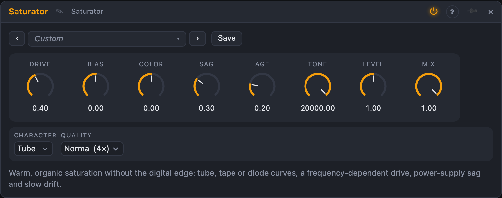

# Saturator

## Introduction

Saturator adds warmth and harmonics without the brittle, fizzy edge that digital distortion usually has. It is a small model of an analogue gain stage: a smooth curve, a frequency-dependent drive, a power supply that gives way under load and parts that slowly drift. Use it from a hint of warmth on a bus to a thick amp-like crunch.

For deliberately digital grit (bit crushing, sample-rate reduction) use **Crunch**. For metallic, folded harmonics use **Folder**.

## How does it work?

The signal passes through, in this order:

1. **Colour (pre-emphasis).** Before the curve, the highs (or lows) are boosted by up to 12 dB. The stage then distorts those frequencies harder. After the curve the boost is undone exactly, so Colour changes *what gets distorted*, not the overall tone.
2. **Bias and Drive.** Drive is gain into the curve (0 to 36 dB). Bias moves the signal off the curve's centre, so the top and bottom of the wave are rounded differently. That makes *even* harmonics (the octave, warm and full) next to the odd ones a symmetrical curve makes.
3. **The curve (Character).**
   - **Tube**: a smooth tanh curve. Reacts most to Bias and Sag. Warm, round.
   - **Tape**: a softer knee and a little memory: the stage hears a lagged copy of its own output, like the magnetic lag of tape. Gentle and glued.
   - **Diode**: soft on top, harder at the bottom. Asymmetric by itself, even without Bias. Edgier and more vocal.
4. **Sag.** A model of a power supply: loud signals lower the stage's gain and push its bias, then it recovers over about 150 ms. The result is compression and a "bloom" after hard hits. Quiet signals are left alone.
5. **Age.** Slow random drift of bias and gain (a few seconds per cycle), different on the left and the right. Nothing ever sounds exactly the same twice, as with real hardware.
6. **Clean-up.** DC from the bias is removed, then **Tone** (a 12 dB/oct low-pass, 500 Hz to 20 kHz; 20 kHz is off) rolls off the top, the way analogue stages do.

**Why it does not sound digital.** The curve runs at 2× or 4× the sample rate with first-order antiderivative anti-aliasing, so the harmonics it creates do not fold back down as inharmonic noise. **Quality** chooses 2× (Eco) or 4× (Normal).

**Level** sets the output. Drive is level-compensated: a signal at 0.5 comes out near 0.5 at any drive, so more drive changes the colour without getting much louder. **Mix** blends with the dry input; the dry path is delayed to match the oversampling, so parallel use stays in phase.

With only *In L* patched, the signal feeds both sides.

## How to use it?

- **Warmth on a bus:** Tube, Drive 25 %, Bias 20 %, Sag 30 %, Mix 100 %.
- **Tape glue on drums:** Tape, Drive 45 %, Sag 50 %, Colour −20 %.
- **Amp-like crunch:** Tube, Drive 70 %, Colour +40 %, Tone 5 kHz.
- **Fat bass without fizz:** Tube, Drive 55 %, Colour −60 %, Tone 3 kHz, Mix 70 %.
- **Edgy vocal:** Diode, Drive 40 %, Colour +30 %.
- **Alive pads:** Age 80 % and a little Drive: the harmonics breathe slowly.
- **Dynamic saturation:** an envelope or LFO on *Drive* or *Bias*.

<!-- generated:presets -->
## Presets

The preset bar of the Saturator view has 14 factory presets. Pick one to set the knobs, then change them to taste; your own presets sit next to them.

| Preset | What it does |
|---|---|
| **Subtle Warmth** | A hint of even harmonics on anything. |
| **Bus Glue** | Soft, compressed tape-like cohesion for a mix bus. |
| **Tape Drums** | Rounded transients and a fatter body for drum loops. |
| **Tube Crunch** | Amp-like crunch with edge in the upper mids. |
| **Fat Bass** | Thick low end that stays smooth on top. |
| **Sub Weight** | Even-harmonic weight under a sub. |
| **Diode Bite** | Edgy, vocal asymmetry. |
| **Vocal Heat** | Gentle presence and density for a voice. |
| **Breathing Pad** | Slow drift makes a held chord shimmer and breathe. |
| **Loose Gear** | Everything wanders a little, like old hardware. |
| **Sagging Supply** | Hard hits squash and bloom. |
| **Fuzz Wall** | Thick, compressed, anti-aliased fuzz. |
| **Parallel Grit** | Hard-driven copy blended under the clean signal. |
| **Eco Warmth** | Light on CPU for many instances. |
<!-- /generated -->
