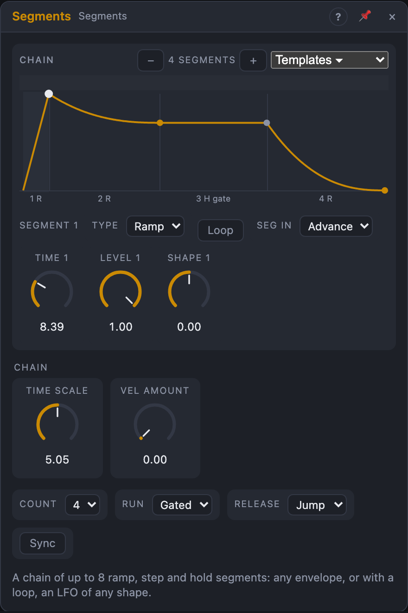

# Segments

## Introduction

Segments draws **any envelope you like** out of up to eight pieces. Each
piece (a *segment*) is a ramp, a step or a hold with its own time, level and
curve. Chain four of them and you have an ADSR; add a hold and it's an AHDSR;
add a second peak and it's a swell that breathes twice.

Mark some segments as a **loop** and the chain keeps cycling through them: an
LFO of any shape you can draw, or an envelope whose sustain wobbles. Each
segment has a gate output that is high while it runs, and a trigger input
that can end it or jump to it, so segments can wait for events and announce
when they play.

Where *ADSR* is fixed to four stages and *Function* is one rise and one fall,
Segments is the general case, edited by dragging points on a graph.

## How does it work?

### Segment types

Every segment starts from wherever the output is when it begins, so jumps and
retriggers never click.

- **Ramp** moves to its *Level* over its *Time*. *Shape* bends it: 0 is
  straight, +1 exponential (a slow start rising, a quick drop falling: the
  snappy feel of an analog envelope), −1 the opposite.
- **Step** jumps to its *Level* and stays there for its *Time*. With *Shape*
  above 0, it glides there over that share of the time instead. A few steps in
  a loop make a little stepped sequence.
- **Hold** keeps the level it starts with. Its *Wait* decides when it ends:
  after its *Time*; while the *Gate* is high (a sustain); or at the next pulse
  on its *Seg* input (or when the Gate falls).

*Time* runs from 0.5 ms to 30 s; *Time Scale* multiplies every time at once, so
patching velocity or pitch onto it makes the whole envelope faster or slower.
Modulating a *Time* knob bends the segment while it plays.

### Gates, loops and release

- **Gate rising:** the chain starts again at segment 1, from the current
  level. *Active* goes high, and *Velocity* is read: with *Vel Amount* up,
  softer notes reach lower levels.
- **The loop:** the segments from the first to the last with *Loop* on.
  After the last loop segment the chain goes back to the first and *Loop*
  fires. A single looped Ramp restarts from the level before it each time:
  a saw.
- **The sustain point** is the last Hold that waits for the Gate, or else the
  end of the loop. Everything after it is the **release**.
- **Gate falling**, *Release* = *Jump*: if the chain hasn't passed the
  sustain point yet, it jumps straight to the release, from the current
  level, like any envelope whose key is let go early. *Release* = *Finish*:
  the loop completes its pass and the earlier segments play out, then the
  release follows.
- Without a sustain point or a loop the chain is a one-shot: how long the gate
  stays high doesn't matter.
- **End** fires when the last segment finishes; the output stays at its
  level and *Active* falls.

**Seg 1 … 8 inputs.** With *Seg In* on *Advance*, a pulse ends that segment if
it's running (whatever its type). With *Jump*, a pulse makes the chain jump to
that segment from wherever it is. The **Seg outputs** are high while their
segment runs, exactly one at a time.

### Free running and sync

**Run = Free** starts the chain on its own (and again at every transport
start): with a loop it's an LFO, without one a single sweep. A rising Gate
still restarts it.

**Sync** turns each segment's time into a note value (8 bars … 1/64T,
straight, dotted and triplet), chosen in the segment's row. With *Run* = Free
and the transport playing, the chain is locked to the song: the part before
the loop plays from the transport start, and the loop sits on the bar grid,
so it is at the same place in every bar, survives loop jumps and renders the
same every time. (Holds then last their note value too.) A Gate or Seg pulse
unlocks it until the next transport start; when the transport stops it keeps
running at the current tempo.

### The editor

The graph shows the chain; each segment's width grows with its time.

- **Drag a point** up and down for the segment's *Level*, left and right for
  its *Time* (with Sync, through the note values).
- **Drag a curve** up and down for its *Shape*.
- **Click** a segment to select it. Its row below sets *Type*, *Wait* (holds),
  *Loop*, *Seg In* and the note value (with Sync), and shows its three knobs,
  with their modulation rings and cables.
- **Drag across the strip at the top** to set the loop region; click a lone
  looped segment there to clear the loop.
- **− / +** change the number of segments; **Templates** rewrites the chain
  as an AD, ADSR, AHDSR, two-peak swell, ramp or triangle LFO, a 4- or
  8-step loop, or a gated burst (one undo step).

A dot follows the output, and the running segment's label lights up.

## How to use it?

- **Envelope with a hold:** Templates › AHDSR, *Gate* from a sequencer or
  *Voice In*, *Out* onto a VCA, *Active* into *Voice Out › Active*.
- **Pluck with a second bloom:** Templates › Swell, Run Gated, onto a filter.
- **Custom LFO:** Templates › Triangle LFO, then drag the points: a lopsided,
  curved wave. Turn *Sync* on for a tempo-locked shape.
- **Stepped sequence:** Templates › 8-step loop, Sync on, each step 1/16:
  *Out* onto a quantizer, *Seg* outputs as triggers for drums.
- **Wait for the beat:** set a Hold to *Wait: Trigger* and patch a clock
  into its *Seg* input: the envelope pauses there until the next beat.
- **Swell and burst:** Templates › Gated burst: a pulsing attack while the
  key is held, then a smooth release.

<!-- generated:demos -->
## Demo patches

Five whole patches show what Segments does. In the standalone app open **File → Presets…** (⌘P) and pick *Segments* under *Demos by module*; on the website, **Run in Play** opens one in your browser. Loading one replaces the project and starts the transport.

| Patch | What it shows |
|---|---|
| **Segments: Two-Humped Envelope** | Five segments draw an envelope no ADSR can: a quick rise, a dip, a second slower swell and a long fade, and every note of the tune follows that shape. Change a segment's Level or Time and hear the hump move. |
| **Segments: Looping Filter Shape** | Set to run freely, the chain of four segments repeats like an LFO with a shape you choose: a fast ramp up, a step, a hold and a slide back. It sweeps the filter on a plucked arpeggio; stretch Time Scale or change the Shape knobs to reshape the sweep. |
| **Segments: Bouncing Ball** | Eight segments alternate between a tiny rise and a fall to zero, each bounce shorter and quieter than the last, so one gate rings out as a dropped ball. Move the Level of a segment to change how high it bounces. |
| **Segments: Segment Gates as Drummer** | A free-running chain of four equal segments hands out a gate at each step, and those gates play a kick, hat, snare and hat: the segments are the sequencer. Change a segment's Time to shift the groove, or raise Count to add steps. |
| **Segments: Swell and Breath** | One three-segment shape (rise, hold while the key is down, fall) opens the filter on a pad while its inverted output fades a noise wash down, so the sound turns from airy to tonal and back with every chord. Try Release set to Jump to cut the swell short when the chord ends. |
<!-- /generated -->

<!-- generated:presets -->
## Presets

The preset bar of the Segments view has 15 factory presets. Pick one to set the knobs, then change them to taste; your own presets sit next to them.

| Preset | What it does |
|---|---|
| **Classic Pluck** | Instant attack, exponential fall: the all-round plucked envelope. |
| **Soft Pad** | Slow swell, a gentle settle and a long fade. |
| **Organ Gate** | Fast on, sustain high, short release: organ-style keying. |
| **Piano Decay** | Strong hit, quick drop, then a long tail. |
| **Reverse Swell** | Builds slowly and cuts off: for reversed-style hits. |
| **Bowed Strings** | Bow attack with a slight bloom and a soft release. |
| **Kick Pitch Drop** | Very fast pitch-drop curve: patch to oscillator pitch for kicks. |
| **Double Hit** | Two quick strikes in a row: flams and clap-like bursts. |
| **Triple Stutter** | Three decaying hits: a rhythmic stutter from one gate. |
| **Triangle Loop LFO** | Free-running up-and-down triangle LFO at about 1 Hz. |
| **Staircase Up** | Stepped rise of held plateaus: a rough step sequencer for pitch. |
| **Wobble Loop** | Irregular free-running wobble for filter or pitch. |
| **Long Evolve** | Multi-stage slow movement over half a minute for ambient textures. |
| **Velocity Snap** | Pluck whose level follows the played velocity. |
| **Finish Tail** | Plays through all stages even on a short note: one-shot percussion. |
<!-- /generated -->

## Reference

### Knobs

| Knob | Range | Default |
|---|---|---|
| Time 1 … 8 | 0.5 ms – 30 s | 5 ms, 300 ms, 250 ms, 400 ms, then 250 ms |
| Level 1 … 8 | −1 … +1 | 1.0, 0.7, 0, 0, then 0 |
| Shape 1 … 8 | −1 … +1 | 0, +0.5, 0, +0.5, then 0 |
| Time Scale | ×0.1 – ×10 | ×1 |
| Vel Amount | 0 – 100 % | 0 % |

Every knob is a modulation destination.

### Settings

| Setting | Values | Default |
|---|---|---|
| Count | 1 – 8 | 4 |
| Run | Gated, Free | Gated |
| Release | Jump, Finish | Jump |
| Sync | Off, On | Off |

Per segment (in the editor): Type (Ramp, Step, Hold), Loop, Wait (Time, Gate,
Trigger; holds only), Seg In (Advance, Jump) and the note value used with Sync
(1/4 by default). A new module is an ADSR: Ramp, Ramp, Hold (Gate), Ramp.

### Inputs

| Input | Signal | What it does |
|---|---|---|
| Gate | gate | starts the chain; falling, goes to the release |
| Velocity | control | scales the levels through *Vel Amount* (unpatched: full) |
| Seg 1 … 8 | trigger | ends that segment (*Advance*) or jumps to it (*Jump*) |

### Outputs

| Output | Signal | What it does |
|---|---|---|
| Out | control | the chain |
| Inv | control | the chain upside down |
| Seg 1 … 8 | gate | high while that segment runs |
| Loop | trigger | a new loop pass starts |
| End | trigger | the last segment finished |
| Active | gate | from the start until *End* |
