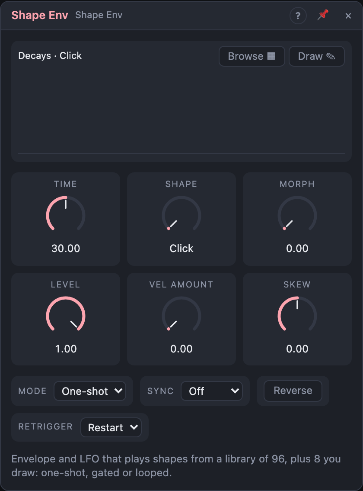

# Shape Env

## Introduction

Shape Env is an **envelope and LFO that plays shapes from a library**
instead of building them from stages. There are 96 ready-made shapes
(percussive decays, plucks, swells, sustained envelopes, bounces, stairs,
rhythmic gates, classic and unusual LFO waves, organic textures) and 8 slots
for shapes you draw yourself.

Pick a shape, set how long it takes, and trigger it: a one-shot envelope.
Hold a gate and it waits at the shape's sustain point. Loop it and it's an
LFO. Shapes that no attack-decay-sustain-release could ever make (echoing
bounces, stutters, irregular gates) are one click away.

## How does it work?

**Choosing.** *Shape* picks one of 104: 0–95 are the library, 96–103 your
own (*User 1 … 8*). The dropdown shows the shape's name. **Browse** opens a grid
of thumbnails grouped by family; hover one to see it big, click to choose it.
With the view focused, ← and → step through the shapes.

**Morph** blends the shape into its neighbour in the list. Neighbours are
related (Short exp → Long exp, Bounce 5 → Bounce 8), so Morph moves smoothly
between them; across a family boundary it blends unlike shapes, which can be
fun too.

**Time** is how long the whole shape takes (1 ms – 60 s), or one cycle in
Loop. With *Sync* it's a note value instead. **Skew** warps time without
changing the length: + plays the start faster and the end slower (at +1 the
first half takes a quarter of the time), − the other way. **Reverse** plays
the shape backwards.

**Level** scales the output, and *Vel Amount* lets the *Velocity* input
scale it: at 0 % every start is full level, at 100 % the level follows the
velocity. Velocity is read at each start.

### Modes

- **One-shot:** *Trig* or a rising *Gate* plays the whole shape once; *End*
  fires at the end and the output stays at the last value (0 for
  envelopes). A new start while it plays restarts it with a 2 ms crossfade
  (no click), or, with *Retrigger* on *Ignore*, is ignored until it's done.
- **Gated:** like One-shot, but while the Gate is high the shape waits at its
  **sustain point** (the dashed line in the preview), and plays the rest when
  the gate falls. A short gate that ends before the sustain point just plays
  through. Shapes without a sustain point behave as One-shot; *Trig* starts
  the shape like a very short gate.
- **Loop:** the shape repeats every *Time*; *End* fires at each wrap. Trig
  or Gate restart it (crossfaded). Envelope shapes loop too: a repeating
  decay is a classic rhythmic effect. With *Sync* and the transport playing,
  the loop is locked to the song position: always at the same place in the
  bar, after loop jumps too, and every render is the same.

In One-shot and Gated a new *Shape* is picked up at the next start; in Loop
it crossfades over 5 ms. *Morph* works at any time.

*Phase* outputs where the playback is (0 … 1): a ramp for other modules.
*Active* is high while the shape plays (always in Loop). *Inv* is the upside
down shape (`1 − Out`, or `−Out` for bipolar shapes).

### Drawing your own

Select a user slot (*User 1 … 8*) and press **Draw**. Drag to draw freehand,
or choose **Line** to drag straight segments. **Smooth** softens the drawing,
**Mirror** makes it symmetric, **Snap 8 / 16** turns it into steps.
**Sustain** lets you click where Gated mode should wait (**No sustain**
removes it). **Envelope / Cycle** decides whether the shape loops seamlessly
(a cycle ends where it starts), **± Bipolar** whether it spans −1 … +1.

On a library shape, **Copy to** puts the shape as you see it (with Morph,
Skew and Reverse) into a user slot, ready to be changed. Every stroke is one
undo step. Drawn shapes are saved with the board.

## How to use it?

- **Percussive accents:** Decays or Plucks, Time 200 ms, One-shot, triggered
  by a sequencer, onto a VCA.
- **Echoing gate:** *Bounces › Echoes 1/8*, Sync 1/2, triggered on the beat:
  a VCA that echoes the note.
- **Rhythmic chopper:** *Gates* family, Loop, Sync 1 bar, onto a VCA: a
  trance gate. Morph between two patterns for variations.
- **Pad envelope in a Voice Cell:** *Sustains › Pad*, Gated, *Gate* from
  *Voice In*, *Active* into *Voice Out › Active*.
- **Breathing LFO:** *Wobbles › Breathing*, Loop, Time 4 s, onto a filter.
- **Your own groove:** draw a shape in *User 1*, Snap 16, Loop, Sync 1 bar:
  a step-like modulation drawn in seconds.

<!-- generated:demos -->
## Demo patches

Five whole patches show what Shape Env does. In the standalone app open **File → Presets…** (⌘P) and pick *Shape Env* under *Demos by module*; on the website, **Run in Play** opens one in your browser. Loading one replaces the project and starts the transport.

| Patch | What it shows |
|---|---|
| **Shape Env: Pluck Morph** | A Shape Env triggered by every note replaces the ADSR: it plays a Pluck shape in One-shot mode, and a slow LFO on Morph blends it with its neighbours, so the notes slide between snappy and soft plucks. Browse other shapes with the Shape knob while it plays. |
| **Shape Env: Gate Pattern** | A drawn-style gate shape looped over one bar and locked to the song chops a sustained chord into a rhythm, like a trance gate. Change Shape to another of the rhythmic patterns, or sweep Morph to blend between two of them. |
| **Shape Env: Echoing Bell** | Shape Env plays the Echoes 1/8 shape, a burst that repeats itself on the beat grid, once per trigger from a slow melody, so every bell note comes back as a row of echoes without any delay effect. Change Sync or Skew to move the echoes, or try Ping-pong or Bounce 5. |
| **Shape Env: Breathing Filter** | The Breathing shape loops every four seconds and opens and closes a low-pass filter on a sustained chord, while Inv, the upside-down shape, moves a second filter band the opposite way. Try other Wobbles shapes or change Time for a slower or faster breath. |
| **Shape Env: Synth Drums** | Five Shape Envs build the drums from sine oscillators: Short exp as pitch drop and Pluck as amplitude make a kick and a tom, and the Roll shape fills out a snare of noise. Change Time or the shapes to retune and reshape each drum. |
<!-- /generated -->

<!-- generated:presets -->
## Presets

The preset bar of the Shape Env view has 16 factory presets. Pick one to set the knobs, then change them to taste; your own presets sit next to them.

| Preset | What it does |
|---|---|
| **Short Pluck** | Quick plucked decay for synth bass and leads. |
| **Snappy Click** | Tiny transient: for percussive attacks or pitch snaps. |
| **Long Exp Decay** | Slow exponential fade for sustained tails. |
| **Organ Gate** | Held while the key is down: organ-like on and off. |
| **ADSR Classic** | A conventional attack, decay, sustain, release contour. |
| **Slow Pad** | Gentle swell and long release for pads. |
| **Reverse Rise** | Rises slowly toward the end: for risers and swells. |
| **Bounce Ball** | Bouncing, ever-quicker hits: a dropped ball. |
| **Echo Taps** | Decaying repeats from one trigger, like a rhythmic echo. |
| **Heartbeat** | Looping double-thump pulse at about 60 BPM. |
| **Breathing** | Slow organic in and out for pads and filters. |
| **Sine LFO** | Plain looping sine at 4 Hz: vibrato or tremolo. |
| **Synced Stutter** | Rhythmic gate pattern locked to the tempo. |
| **Swing Wobble** | Tempo-synced wobble with a shuffle feel. |
| **Morphing Texture** | Irregular looping texture, shifted by Morph: organic movement. |
| **Reversed Roll** | A drum roll played backwards: builds into the next beat. |
<!-- /generated -->

## Reference

### Knobs

| Knob | Range | Default |
|---|---|---|
| Time | 1 ms – 60 s | 500 ms |
| Shape | 104 shapes (96 library, 8 user) | Click |
| Morph | 0 – 100 % | 0 % |
| Level | 0 – 100 % | 100 % |
| Vel Amount | 0 – 100 % | 0 % |
| Skew | −1 … +1 | 0 |

Every knob is a modulation destination; a cable on the *Shape* dropdown steps
through the library.

### Settings

| Setting | Values | Default |
|---|---|---|
| Mode | One-shot, Gated, Loop | One-shot |
| Sync | Off, 16 bars … 1/32T (straight, dotted, triplet) | Off |
| Reverse | Off, On | Off |
| Retrigger (One-shot, Gated) | Restart, Ignore | Restart |

### Inputs

| Input | Signal | What it does |
|---|---|---|
| Trig | trigger | starts the shape |
| Gate | gate | starts the shape; in Gated mode holds it at the sustain point while high |
| Velocity | control | scales the level through *Vel Amount* (unpatched: full) |

### Outputs

| Output | Signal | What it does |
|---|---|---|
| Out | control | the shape |
| Inv | control | the shape upside down |
| Phase | control | the playback position, 0 … 1 |
| End | trigger | the shape finished (or wrapped, in Loop) |
| Active | gate | the shape is playing |
