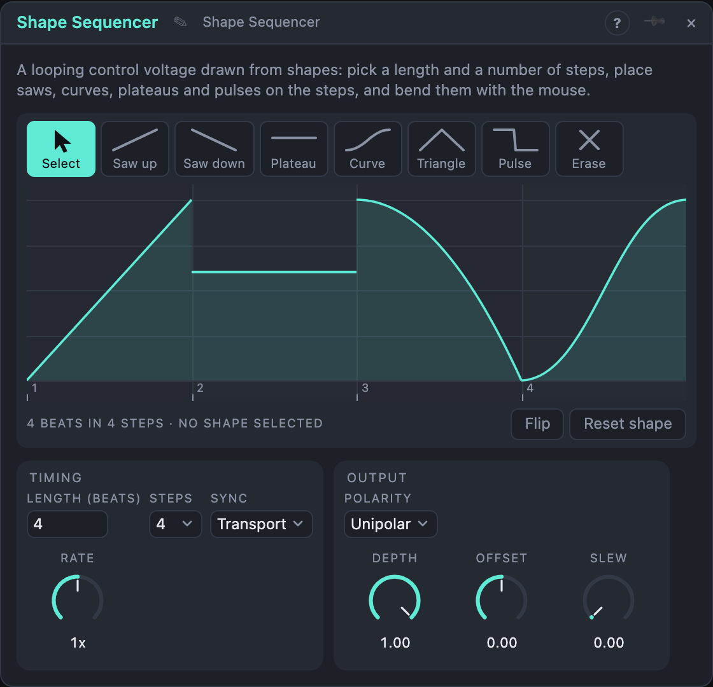

# Shape Sequencer

## Introduction

The Shape Sequencer **draws a control voltage in time with the music**. You
choose how long the loop is and how finely it is divided, then place shapes in
the steps: a rising saw, a falling saw, a plateau, a curve. Patch its output
onto a volume for a sidechain pump, a filter cutoff for a rhythmic sweep, or
a pan for a hopping stereo image.

It outputs CV only. What the shape moves is up to the module you patch it to.

## How does it work?

**Length and steps.** *Length* sets the loop in beats (4 beats is one bar, up to
64). *Steps* divides it into equal cells, from 1 to 32: the grid you paint on.
Any number works, 4 or 8 as well as 5 or 7. A loop of 4 beats on 4 steps has
a step per beat; 8 beats on 8 steps does too.

**Shapes.** Pick a shape in the palette and click or drag over steps to place it:

- **Saw up** and **Saw down** ramp between two levels.
- **Plateau** holds one level.
- **Curve** is an S-shaped glide between two levels.
- **Triangle** rises to a peak and falls back.
- **Pulse** holds one level for the first half of the shape and another for the second.
- **Erase** removes what is on a step (a step with nothing plays 0).

Choose *Select* to stop placing and just pick shapes.

**Changing the step count later.** The steps are only a grid: the shapes keep
their place in the loop. Draw four shapes on 4 steps, switch to 8, and each
shape now covers two steps. Paint a new shape onto one step of it and the
shape is cut to what is left, so you can replace one quarter note with two
eighths and leave everything else as it was.

**Editing a shape.** Click a shape to select it. Its handles appear: a yellow
square for each level (drag it up or down), and a white dot on the line that
bends the curve (drag it up or down). *Flip* swaps the start and end levels, so
a saw up becomes a saw down. *Reset shape* straightens the curve.

**Running it.** *Sync* decides what starts the loop:

- **Transport:** the loop follows the song position, so it is always on the
  grid, even after a loop jump. It rests while the song is stopped.
- **Trigger:** a pulse at *Trig / Gate* starts the loop from the beginning. A
  new pulse restarts it. *Playback* chooses *Loop* (keeps cycling) or *Once*
  (plays one pass and holds the last value).
- **Gate:** the loop runs while the gate is high and rests when it falls.

A pulse at *Reset* sends the loop back to the start.

**Output.** *Depth* scales the shape, *Offset* moves it up or down, *Polarity*
chooses 0 … 1 or −1 … +1, and *Slew* rounds off the corners. *Rate* plays the
loop at half or double speed (a quarter to four times). *Step* sends a pulse at
the start of every shape, and *Cycle* a pulse at each start of the loop, to
trigger other modules in time with the shapes.

## How to use it?

- **Sidechain pump:** Saw up on each beat (Length 4, Steps 4, four Saw up shapes)
  into a VCA's gain. Raise *Slew* a little for a softer pump.
- **Rhythmic filter:** Length 4 on 8 steps with Saw down, Plateau and Pulse
  mixed, into a filter's cutoff.
- **One-shot swell:** *Sync* Trigger, *Playback* Once, Length 8, a single Curve
  across a few steps; trigger it from a button.
- **Auto-pan:** *Polarity* Bipolar, Triangle shapes into a pan.

## Settings and knobs

| Setting | Values | Default |
|---|---|---|
| Length | 1 – 64 beats | 4 |
| Steps | 1 – 32 | 4 |
| Sync | Transport, Trigger, Gate | Transport |
| Playback | Loop, Once (Trigger sync only) | Loop |
| Polarity | Unipolar, Bipolar | Unipolar |

| Knob | Range | Default |
|---|---|---|
| Depth | 0 – 100 % | 100 % |
| Offset | −1 … +1 | 0 |
| Slew | 0 – 100 % | 0 |
| Rate | 1/4×, 1/2×, 1×, 2×, 4× | 1× |

Every knob is a modulation destination.

### Inputs

| Input | Signal | What it does |
|---|---|---|
| Trig / Gate | gate | Starts the loop (Trigger) or runs it while high (Gate) |
| Reset | trigger | Back to the start of the loop |

### Outputs

| Output | Signal | What it does |
|---|---|---|
| Out | control | The drawn shape, after Depth, Offset and Slew |
| Step | trigger | A pulse at the start of each shape |
| Cycle | trigger | A pulse at each start of the loop |

<!-- generated:demos -->
## Demo patches

Five whole patches show what Shape Sequencer does. In the standalone app open **File → Presets…** (⌘P) and pick *Shape Sequencer* under *Demos by module*; on the website, **Run in Play** opens one in your browser. Loading one replaces the project and starts the transport.

| Patch | What it shows |
|---|---|
| **Shape Sequencer: Sidechain Pump** | Four saw-up shapes, one per beat, are the gain of a held pad: each beat the sound ducks and swells back, like a sidechained compressor you can draw. Select a shape and drag its bend dot to change how quickly the pad recovers, or its start square to change how deep the duck goes. |
| **Shape Sequencer: Filter Steps** | A bar cut into eight steps mixes saws, plateaus, a pulse and a triangle, and moves a filter over an arpeggio so every eighth note opens differently. Set Steps to 16 and replace one shape with two shorter ones, or drag the yellow squares to change how high each shape lifts the cutoff. |
| **Shape Sequencer: Auto-Pan** | Set to Bipolar, two bars of triangles and plateaus swing a bell-like melody left and right: the shape's centre is the middle of the stereo field. Change Length to 16 beats for a slower drift, or raise Slew to round the corners. |
| **Shape Sequencer: One-Shot Swell** | A note every four bars triggers a four-bar shape, played once: a slow curve up, a peak and a long fall, which opens a filter and lifts a drone's volume together. Try Playback on Loop to hear it repeat on its own, or change Length to shorten the swell. |
| **Shape Sequencer: Steps as Triggers** | The Step output pulses at the start of every shape and Cycle once per loop, so the shapes themselves play drums: Step is the kick, Cycle the snare, while the shape swells the hats. Set Steps to 8 and paint two shapes into a step to double the kick pattern. |
<!-- /generated -->
