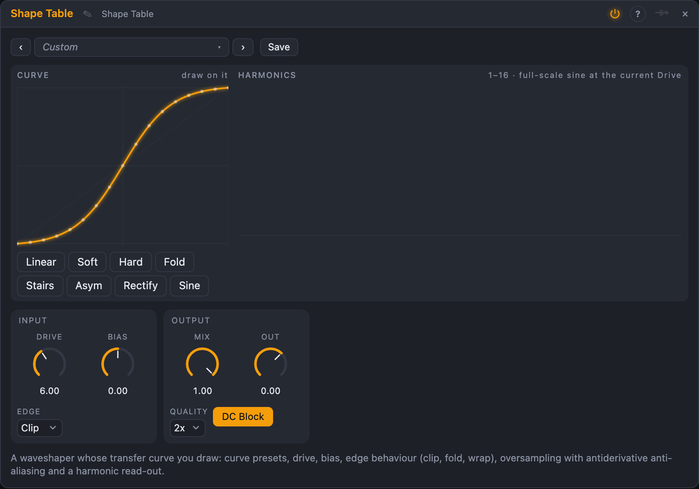

# Shape Table

## Introduction

Shape Table is a waveshaper where you draw the shape. A waveshaper maps
every input level to an output level through a curve; a straight line leaves
the sound alone, a bend adds warmth, a zig-zag adds buzz and bite. Here the
curve is a picture you paint with the mouse, or start from one of eight
presets, and the module tells you which harmonics it will make. It is
anti-aliased, so extreme curves stay clean, and the same curve is also a
function generator for control signals.

## How does it work?

**The curve.** The curve has 65 points between −1 and +1 on both axes,
joined by a smooth spline. Input goes along the bottom, output up the side.
*Soft*, *Hard*, *Fold*, *Stairs*, *Asym*, *Rectify*, *Sine* and *Linear* are
the presets; click on the curve and drag to draw. The dot on the curve shows
where the signal is right now.

**Drive and bias.** *Drive* (−12 … +36 dB) multiplies the input before the
curve: the more you drive, the more of the curve you use, and the further the
sound moves from the input. *Bias* adds an offset, which makes the curve
act asymmetrically and creates even harmonics (and a DC offset, which the
*DC Block* switch removes with a very low high-pass).

**Edge.** What happens when the input goes beyond ±1: **Clip** holds the
ends of the curve, **Fold** mirrors the curve (a bent triangle of the input), **Wrap**
repeats it. With *Wrap* and a smooth curve, the module turns a ramp into any
waveform you drew: an oscillator-like table.

**Anti-aliasing.** A curve with corners makes harmonics far above the audible
range; unless they are handled they fold back down as harsh, inharmonic noise.
Shape Table uses two defences together: oversampling (*Quality* Off, 2× or 4×)
and first-order antiderivative anti-aliasing, which is exact here because the
curve is a table made of straight pieces whose integral is another table.
At 4× a hard fold at high drive stays tens of decibels cleaner than without.
The dry path is delayed by the same latency, so *Mix* keeps both in phase.

**Harmonics.** The bar chart shows the first 16 harmonics that a full-scale sine
would get through the current curve, *Drive*, *Bias* and *Edge*, in dB: a quick
way to see why a curve sounds the way it does. A symmetric curve has bars only
at 1, 3, 5, …

**Function out.** *Func In* (a control signal, −1 … +1) goes through the same curve,
without oversampling, to *Func Out*: a custom response curve for
sequencers, a velocity map or a waveshaped LFO.

## How to use it?

- **Warm it up:** *Soft*, *Drive* 6 – 12 dB, *Mix* 50 %.
- **Fold a sine into a voice:** *Fold*, *Drive* 12 dB, an envelope on *Drive*.
- **Bit-like steps:** *Stairs* with *Drive* 0 – 6 dB.
- **Even harmonics:** *Asym* or *Bias* 20 %, *DC Block* on.
- **A custom oscillator:** *Edge* Wrap, a saw or triangle in, draw a waveform.
- **Parallel distortion:** *Mix* 30 % on drums.
- **Draw a response:** draw a curve and patch an LFO into *Func In*.

<!-- generated:demos -->
## Demo patches

Five whole patches show what Shape Table does. In the standalone app open **File → Presets…** (⌘P) and pick *Shape Table* under *Demos by module*; on the website, **Run in Play** opens one in your browser. Loading one replaces the project and starts the transport.

| Patch | What it shows |
|---|---|
| **Shape Table: Soft Bass** | A pure sine bass is driven into the soft curve: the peaks round off and odd harmonics grow with Drive, so it gets warm and then gritty. Draw on the curve to change the harmonics, or raise Drive for more edge. |
| **Shape Table: Fold Lead** | A saw lead goes through a folding curve while an envelope pushes Drive up on every note: the first moment of each note is rich and bright and settles to a simpler tone. Change Drive or draw a new curve. |
| **Shape Table: Wrap Table** | Edge is Wrap: a slow triangle sweeps its way through the repeating sine curve, so the shaper becomes an oscillator-like table whose spectrum moves with Drive. Move Bias to shift where the curve is read. |
| **Shape Table: Crushed Drums** | A drum loop through the Stairs curve mixed back under the dry kit: eight steps give a crunchy, digital grain on every hit without losing the punch. Turn Mix up for more grit, down for a subtle bite. |
| **Shape Table: Function Curve** | A slow triangle LFO goes through the drawn curve (Func In to Func Out) and the result opens the cutoff of a filter on a saw riff: a custom-shaped sweep. Redraw the curve to reshape the sweep. |
<!-- /generated -->

<!-- generated:presets -->
## Presets

The preset bar of the Shape Table view has 14 factory presets. Pick one to set the knobs, then change them to taste; your own presets sit next to them.

| Preset | What it does |
|---|---|
| **Soft Warmth** | Gentle saturation blended under the dry sound. |
| **Hard Clip** | A hard limit with bright, odd harmonics. |
| **Fold Over** | A sine folded into a rich, vocal tone. |
| **Staircase** | Eight steps: a digital, quantised edge. |
| **Lopsided** | Soft on one side, harder on the other: even harmonics. |
| **Rectifier** | Full-wave rectification: the octave jumps up. |
| **Sine Table Wrap** | The curve repeats beyond the edges: a wavetable of one sine. |
| **Mirror Fold** | The curve mirrors at the edges: folding with a smooth bend. |
| **Gentle Saturator** | Subtle warmth for a full mix. |
| **Octave Up** | Rectifier blended with the dry signal. |
| **Bias Growl** | A biased soft curve: growly and asymmetric. |
| **Wrap Chaos** | Extreme drive with wrapping: dense and metallic. |
| **Crunch Eco** | No oversampling: raw, aliased crunch. |
| **Linear Pass** | A straight line: the sound passes unchanged. Draw on it. |
<!-- /generated -->

## Reference

### Inputs and outputs

| Jack | Signal | What it does |
|---|---|---|
| In L, In R | audio | the signal (R unpatched: L feeds both) |
| Func In | control | through the curve without oversampling |
| Out L, Out R | audio | the shaped signal, mixed with the dry one |
| Func Out | control | the curve's output for Func In |

### Knobs and settings

| Control | Range | Default |
|---|---|---|
| Drive | −12 … +36 dB | +6 dB |
| Bias | −100 … +100 % | 0 |
| Mix | 0 – 100 % | 100 % |
| Out | −24 … +12 dB | 0 |
| Edge | Clip, Fold, Wrap | Clip |
| Quality | Off, 2×, 4× | 2× |
| DC Block | on / off | on |

The curve (65 values) is saved with the node.
