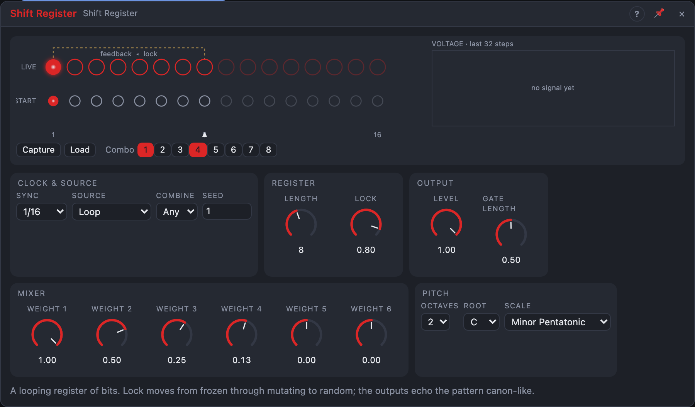

# Shift Register

## Introduction

Shift Register is a looping row of 16 bits. On every step the bits move one
place along and the bit at *Length* comes back in at the front, sometimes
flipped. Everything it outputs is read from those bits: a stepped voltage, a
quantized pitch, eight gates, a combined gate and a weighted mix. Because only
one bit is new on each step, consecutive values are related, and the gates are
delayed copies of each other: rhythms and melodies that echo through the
register like a canon. One knob, *Lock*, moves the pattern from frozen
through slowly changing to fully random.

## How does it work?

**The register.** Bit 1 is the newest bit, bit 16 the oldest. On each step:

1. The bit at position *Length* is read: that's the bit that comes back.
2. Every bit moves one place along.
3. The bit comes back in at position 1, flipped or not, depending on *Lock*.

**Lock** is the chance that the returning bit stays as it is. At +100 % nothing
ever flips: the pattern repeats every *Length* steps. Between +100 % and 0 %
it changes now and then and stays recognisable; at 0 % every bit is a coin
toss. At −100 % every returning bit is flipped: the pattern repeats every
2 × *Length* steps, with the second half the inverse of the first.

**Source** chooses what comes back: *Loop* (the register's own bit), *Data*
(the *Data* input, so the register delays an incoming rhythm, corrupted by
*Lock* below +100 %) or *Data ⊕ Loop* (the input scrambles the loop).

**Voltage and Pitch** read the first eight bits as a number from 0 to 255,
with bit 1 counting most. Each step roughly halves the previous value and adds
the new bit on top, which gives melodies from the register a recognisable
contour. *Voltage* is that number scaled to 0 … 1 (times *Level*); *Pitch*
spreads it over *Octaves*, adds *Transpose* and snaps it to *Scale*.

**Bit 1 … Bit 8** are high for *Gate Length* of a step while their bit is 1.
At 100 % consecutive 1s merge into one long gate. *Bit 2* is *Bit 1* one step
later, *Bit 3* two steps later, and so on. Bits beyond *Length* keep shifting,
so with *Length* 4, *Bit 5 … 8* are older copies of the same pattern.

**Combo** combines the bits chosen with the toggles in the view: *Any* (one of
them is 1), *All* (all of them are 1) or *Odd* (an odd number of them is 1).

**Mix** is a weighted sum of bits 1 … 6, using the six *Weight* knobs, scaled
so it stays within −1 … +1. The defaults (1, ½, ¼, ⅛) make a 4-bit version of
*Voltage*; other weights give stepped patterns that don't follow the register's
number.

**Steps** come from *Clock* if patched, else from the song position when *Sync*
is on a note value and the transport plays, else from *Rate* (or the synced
length while the transport is stopped). *Reset* reloads the start pattern on
the next step.

**Repeatable.** The flips come from *Seed* and the step number. The register
also has a **start pattern**: a transport start loads it and replays the steps
up to the song position, so a render from the same position always sounds the
same, wherever you start.

## The view

- The top row shows the live register (newest left; bits beyond *Length* dim;
  ▲ marks the bit that comes back; a ring flashes when the entering bit was
  flipped). Click a bit to flip it in the running register.
- The row below is the start pattern. Click to edit it.
- **Capture** copies the live register into the start pattern, so a pattern
  you like comes back on every play. **Load** loads the start pattern now.
- **Combo** toggles choose the bits for *Combo*.
- The strip shows the last 32 values of *Voltage*; × marks steps where the
  entering bit was flipped.

## How to use it?

- **Canon rhythms:** *Bit 1*, *Bit 3* and *Bit 6* to three drums, *Lock* 90 %.
- **A melody that evolves:** *Pitch* into an oscillator, *Step* into its
  envelope, *Lock* 80 %. Raise *Lock* to 100 % to keep a phrase, then Capture it.
- **Stepped modulation:** *Mix* to a filter, an LFO on *Weight 2* morphs
  between two stepped patterns.
- **Delay a rhythm:** *Source* on *Data*, a gate pattern into *Data*: the bit
  outputs play it back delayed by 0 … 7 steps.
- **Accents:** *Combo* on *All* with two bits chosen, into a velocity or a VCA.

<!-- generated:demos -->
## Demo patches

Five whole patches show what Shift Register does. In the standalone app open **File → Presets…** (⌘P) and pick *Shift Register* under *Demos by module*; on the website, **Run in Play** opens one in your browser. Loading one replaces the project and starts the transport.

| Patch | What it shows |
|---|---|
| **Shift Register: Locked Loop** | An eight-bit register in E minor pentatonic with Lock almost at 100 %: the melody repeats, and a very slow LFO lets it slip a note now and then before it settles again. Pull Lock down by hand to loosen it, or push it to the top to freeze the tune. |
| **Shift Register: Canon Beat** | One sixteen-step pattern in the register, read at four places: the kick takes Bit 1, the clap Bit 3, the hats Bit 4 and a rim Bit 6, so the same rhythm echoes itself two, three and five steps later. Lower Lock to let the groove mutate, change Length for new cycles. |
| **Shift Register: Rhythm Echo** | Source = Data: a little kick-and-snare pattern is fed into the register's Data input and comes back out of the bits as echoes that drive chimes and a pad of notes. Lock below 100 % corrupts the echoes, so the rhythm slowly drifts from its original. |
| **Shift Register: Mirror Flip** | Lock at -100 % flips every returning bit, so the five-step pattern comes back inverted and the whole line repeats every ten steps. The Combo output (odd number of the chosen bits) rings a high bell, Voltage opens the filter. Move Lock towards the middle to hear the mirror blur. |
| **Shift Register: Drifting Free Run** | Sync = Free: the register runs on its own Rate instead of the song tempo, and a slow LFO speeds it up and slows it down, over a whole-tone scale. A second LFO on Lock moves between frozen, mutating and random. Switch Sync to a note value to lock it back to the beat. |
<!-- /generated -->

<!-- generated:presets -->
## Presets

The preset bar of the Shift Register view has 15 factory presets. Pick one to set the knobs, then change them to taste; your own presets sit next to them.

| Preset | What it does |
|---|---|
| **Frozen Loop** | The pattern repeats exactly every eight steps. |
| **Slowly Mutating** | Mostly stable, with an occasional note changing. |
| **Restless** | Changes often but keeps a recognisable contour. |
| **Pure Random** | Every bit is a coin toss: random melodies. |
| **Inverted Echo** | Repeats every twelve steps, the second half inverted. |
| **Short Four** | A four-step loop for a hypnotic riff. |
| **Odd Seven** | Seven steps: the loop slides across the bar. |
| **Long Sixteen** | A long register that drifts slowly over time. |
| **Slow Eighths** | Slower steps with long gates for a calm line. |
| **Staccato Burst** | Fast, short notes in an Eastern scale. |
| **Wide Four Octaves** | The pitch spreads over four octaves: big leaps. |
| **Free Running** | Ignores the song tempo and steps at a set rate. |
| **Gate Weights** | Different weights make the Mix output stepped and uneven. |
| **All-Bits Combo** | Combo goes high only when every chosen bit is 1: sparse rhythms. |
| **Odd-Parity Combo** | Combo of an odd number of bits: busy, shifting gate patterns. |
<!-- /generated -->

## Reference

### Knobs and settings

| Control | Range | Default |
|---|---|---|
| Lock | −100 … +100 % | +80 % |
| Rate | 0.05 – 50 Hz | 4 Hz |
| Level | 0 – 100 % | 100 % |
| Gate Length | 1 – 100 % of a step | 50 % |
| Weight 1 … 6 | −1 … +1 | 1, 0.5, 0.25, 0.125, 0, 0 |
| Length | 2 – 16 bits | 8 |
| Sync | Free, 1/32, 1/16, 1/8, 1/4, 1/2, 1 bar, 2 bars, 4 bars, 8 bars | 1/16 |
| Source | Loop, Data, Data ⊕ Loop | Loop |
| Combine | Any, All, Odd | Any |
| Octaves | 1 – 4 | 2 |
| Root | C … B | C |
| Scale | the Step Sequencer's scales | Minor Pentatonic |
| Seed | 0 – 999 | 1 |
| Sync To | Auto, Clock, Transport | Auto |

- **Sync To:** what steps the module. *Auto*: the clock pulses while *Clock* is patched, otherwise the transport. *Clock*: only the pulses step it. *Transport*: the song position steps it, and a patched *Clock* is ignored. With *Transport* (or Auto and nothing patched), the *Sync* setting still picks a note value or free running.
- **Lock:** the chance the returning bit is kept: flip chance = (1 − Lock) / 2.
- **Rate:** steps per second when *Sync* is *Free* and *Clock* is unpatched.
- **Level:** scales *Voltage*.
- **Gate Length:** length of the bit gates and *Combo*, as a share of a step.
- **Weight 1 … 6:** the mixer's weights for bits 1 … 6.
- **Length:** which bit comes back. Changing it never clears bits.
- **Sync:** one step per note value at the song tempo.
- **Source, Combine, Octaves, Root, Scale:** see above.
- **Seed:** picks the sequence of flips.

*Lock*, *Rate*, *Level*, *Gate Length*, the weights and *Length* are
modulation destinations.

### Inputs

| Input | Signal | What it does |
|---|---|---|
| Clock | trigger | each pulse is a step; overrides *Rate* and *Sync* |
| Reset | trigger | the next step reloads the start pattern and counts as step 0 |
| Data | gate | the bit to write with *Source* on *Data* or *Data ⊕ Loop* |
| Transpose | pitch | added to *Pitch* before quantizing, read at each step |

### Outputs

| Output | Signal | What it does |
|---|---|---|
| Voltage | control, 0 … 1 | the first eight bits as a number, times *Level* |
| Pitch | pitch | the same number over *Octaves*, quantized to *Scale* |
| Bit 1 … Bit 8 | gate | high while that bit is 1 |
| Combo | gate | the chosen bits combined |
| Mix | control, −1 … +1 | weighted sum of bits 1 … 6 |
| Step | trigger | a pulse on every step |
| Loop | trigger | a pulse every *Length* steps |
