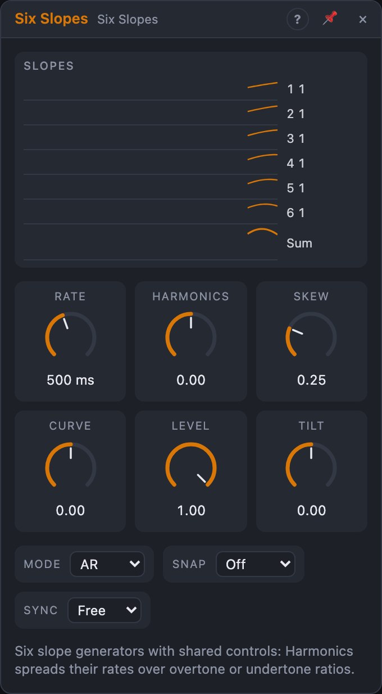

# Six Slopes

## Introduction

Six Slopes is **six slope generators on one set of knobs**. Each slope rises
and falls; together they can be six envelopes, six LFOs or, at audio rate,
six oscillators that form a chord of harmonics.

The trick is the *Harmonics* knob. In the middle all six run at the same
speed. Turn it right and they spread out over the overtone series (1, 2, 3, 4,
5, 6 times as fast); turn it left and they slow down over the undertones (½,
⅓ … ⅙). In between, the speeds are uneven, so looping slopes drift in and
out of phase: slow, shifting patterns from one knob.

## How does it work?

**One slope.** *Rate* sets how fast channel 1 runs; *Skew* is the share of
the slope spent rising (25 %: a quick rise and a longer fall), and *Curve*
bends it: −1 logarithmic, 0 straight, +1 exponential. The *Pitch* input adds
octaves to the rate of all six.

**Six speeds.** Each channel runs at channel 1's rate times its ratio. With
*Harmonics* at +1 the ratios are 1, 2, 3, 4, 5, 6: channel 6 is six times as
fast, so its envelope is six times as short. At −1 they're 1, ½, ⅓, ¼, ⅕, ⅙.
*Snap* rounds the ratios:

- **Integer** snaps to whole numbers (or whole-number fractions to the
  left), so the knob steps through whole-number chords: at 0.4 the ratios are
  1, 1, 2, 2, 3, 3.
- **Just** snaps each ratio to the nearest note of a just scale (1, 9/8, 5/4,
  4/3, 3/2, 5/3, 15/8, in any octave): in Sound mode, six notes of a pure,
  beatless chord.

The lane next to each slope shows its current ratio as a fraction (or the
note it plays in Sound mode).

**Shared triggers.** Every channel has its own *Trig* input. An unpatched Trig
listens to the nearest patched one above it, so one gate into *Trig 1* starts
all six, and with *Harmonics* up the six envelopes end one after another, a
natural "strum" of decays. Patch *Trig 4* too, and channels 4–6 follow it
while 1–3 still follow *Trig 1*.

### Modes

- **AR:** a one-shot envelope per trigger. The rise starts from wherever the
  level is, so a retrigger during the fall never jumps.
- **ASR:** rises while the gate is high, holds at the top, falls when the
  gate goes low (from wherever it is, even during the rise).
- **Loop:** six LFOs. A Trig rising edge restarts that channel's cycle. With
  nothing patched they run freely, all starting together.
- **Sound:** six oscillators. *Rate* now spans 16 Hz – 4 kHz with C4 in the
  middle; Skew moves the wave from saw to triangle to ramp and Curve bends it
  (+0.5 is close to a sine). A Trig edge hard-syncs its channel. Partials
  above a quarter of the sample rate fade out instead of aliasing.

**Sync** (AR, ASR, Loop) makes channel 1's slope one note value long at the
current tempo; the others keep their ratios. In Loop with the transport
playing every channel is locked to the song position, so with whole-number
ratios they meet again on every note value, after loop jumps too, and every
render is the same. *Pitch* then shifts in whole octaves.

### Levels and Sum

*Level* scales all six. *Tilt* balances them: at +1 channel 1 is silent and
channel 6 at full level, at −1 the other way round (a darker chord in Sound
mode, as with natural overtones).

*Sum* mixes the six: six unipolar slopes reach full scale when about half of
them are up. In Loop it's a complex, slowly changing contour; in Sound mode
it's the mixed tone, gently limited.

*End 1* fires when channel 1 finishes its slope or cycle. *Active* is high
while any channel moves (AR, ASR) and always in Loop and Sound.

## How to use it?

- **Strummed decays:** a sequencer gate into *Trig 1*, AR, Skew 5 %,
  Harmonics +0.6; patch the six outputs to six VCAs or filter cutoffs.
- **Six-part rhythm envelopes:** six drum triggers into the six Trigs, one
  envelope each, with one set of shape knobs.
- **Phasing LFOs:** Loop, Harmonics at a small, uneven value like 0.13: six
  slow waves that drift apart and back. *Sum* onto a filter for a contour that
  never quite repeats.
- **Polyrhythm on the grid:** Loop, Sync 1 bar, Snap Integer, Harmonics +1:
  six LFOs at 1–6 cycles per bar, locked to the song.
- **A just chord:** Sound, Snap Just, *Pitch* from *Voice In › Pitch*,
  *Sum* into a VCA. Turn Harmonics for different chords and Tilt to the left
  for a softer tone.

## Demo patches

Five whole patches show what Six Slopes does. In the standalone app open **File → Presets…** (⌘P) and pick *Six Slopes* under *Demos by module*; loading one replaces the project and starts the transport.

| Patch | What it shows |
|---|---|
| **Six Slopes: Strummed Chord** | One trigger on *Trig 1* in *AR* with *Harmonics* at +0.6 and a short *Skew*: six notes open one after another like a strum. |
| **Six Slopes: Phasing Pulses** | *Loop* mode with a small *Harmonics* value: six slow swells drift apart and back over a chord. |
| **Six Slopes: Bar Polyrhythm** | *Loop*, *Sync* on one bar and *Snap* on Integer: six slopes at one to six cycles per bar, locked to the song. |
| **Six Slopes: Six-Part Percussion** | Six drum triggers fire six slopes, each shaping a different sine tone; one *Skew* and *Curve* set shapes all decays. |
| **Six Slopes: Just Drone** | *Sound* mode with *Snap* on Just and the sequencer on *Pitch*: six oscillators in pure ratios, moved by an LFO on *Harmonics*. |

## Reference

### Knobs

| Knob | Range | Default |
|---|---|---|
| Rate | 0.02–1000 Hz (shown as 50 s – 1 ms); Sound: 16 Hz – 4 kHz | 2 Hz (500 ms) |
| Harmonics | −1 … +1 | 0 |
| Skew | 0 – 100 % | 25 % |
| Curve | −1 … +1 | 0 |
| Level | 0 – 100 % | 100 % |
| Tilt | −1 … +1 | 0 |

Every knob is a modulation destination.

### Settings

| Setting | Values | Default |
|---|---|---|
| Mode | AR, ASR, Loop, Sound | AR |
| Snap | Off, Integer, Just | Off |
| Sync (not in Sound) | Free, 8 bars … 1/32T | Free |
| Polarity (Loop) | Unipolar, Bipolar | Unipolar |

### Inputs

| Input | Signal | What it does |
|---|---|---|
| Trig 1 … Trig 6 | gate | starts, holds, restarts or syncs its channel; unpatched, follows the nearest patched Trig above |
| Pitch | pitch | added to Rate in octaves |

### Outputs

| Output | Signal | What it does |
|---|---|---|
| Out 1 … Out 6 | control | each channel's slope |
| Sum | control | the six mixed |
| End 1 | trigger | channel 1 finished its slope or cycle |
| Active | gate | a channel is moving (always high in Loop and Sound) |
