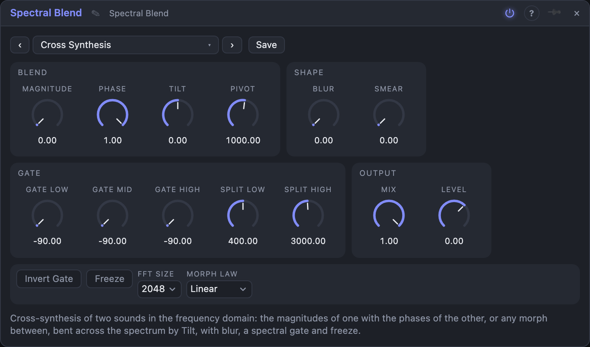

# Spectral Blend

## Introduction

Spectral Blend takes **two sounds** apart in frequency and puts them together again
in a different way. Every sound has a *magnitude* spectrum (which partials are
there and how loud) and a *phase* spectrum (where each of them is in its cycle). By default the output uses **the magnitudes of In A with the phases of In B**: A's
loudness shape, B's texture and timing. Two knobs let you morph either of them from A to B.

Around the blend sit **Blur** and **Smear** (soften partials across frequency and time),
a **spectral gate** in three frequency regions, **Freeze**, and **Tilt**, which bends
the blend across the spectrum: low frequencies can follow A while the highs follow B.

## How does it work?

The module cuts both inputs into overlapping frames, Hann-windowed, and takes the Fourier
transform of each. In every frequency bin it picks a magnitude and a phase from A and B, does the
blur, gate and smear, turns the bins back into sound and overlaps the frames again. The result is
delayed by one frame (**FFT Size**: 512 – 4096 samples, 11 – 85 ms at 48 kHz).

- **Magnitude** is where the loudness shape comes from: 0 % = A, 100 % = B.
- **Phase** is where the phases come from: 0 % = A, 100 % = B. With Magnitude 0 and Phase 100 you get cross-synthesis; the other way round
  swaps the roles; 0 and 0 is A alone (delayed), 100 and 100 is B alone.
- **Morph Law**: *Linear* mixes magnitudes by amplitude; *Geometric* mixes them in dB, so a partial present in
  only one sound stays quiet halfway: a cleaner morph.
- **Tilt** bends the Magnitude and Phase knobs across the spectrum around the **Pivot**: at +1 everything
  below the pivot is A and everything above is B, with a smooth crossover about two octaves wide; at −1 it is the other
  way round. Between, the knobs and the tilt share the work.
- **Blur** averages the magnitudes of neighbouring bins: partials widen and lose their edges.
- **Smear** makes the magnitudes fall slowly (up to about four seconds), so sounds leave a spectral afterglow.
- **Gate Low / Mid / High** remove every bin below a threshold in dB. The regions are separated by **Split Low**
  and **Split High**. At −90 dB a region is open. **Invert Gate** keeps what is below instead.
- **Freeze** (knob or *Freeze* gate input) holds the spectrum: the magnitudes stay and each bin
  keeps turning at its own rate, so tones go on as a steady drone.
- **Mix** blends the result with In A (delayed to match), **Level** sets the output gain.

If nothing is patched into *In B* it is copied from *In A*.

## How to use it?

- **Voice and synth:** a spoken or sung line into *In A*, a rich pad into *In B*. The pad is
  articulated like the voice. Swap them to hear the difference.
- **Drums with a texture:** a drum loop into *In A* and sustained noise into *In B*: the beat in a different material.
- **Two instruments in one:** *Tilt* at +1 with a bass in A and a bright synth in B.
- **Hold a chord:** set *Freeze* while a chord plays. Add *Blur* for a pad.
- **Clean up or destroy:** use the gate to cut quiet bins and keep the skeleton, or *Invert Gate* to keep only the quiet bins.
- **Single input:** with B unpatched, *Blur*, *Smear* and the gate act as a spectral processor for A alone.

<!-- generated:demos -->
## Demo patches

Five whole patches show what Spectral Blend does. In the standalone app open **File → Presets…** (⌘P) and pick *Spectral Blend* under *Demos by module*; on the website, **Run in Play** opens one in your browser. Loading one replaces the project and starts the transport.

| Patch | What it shows |
|---|---|
| **Spectral Blend: Drums Wear a Pad** | A drum loop in A and a sustained minor chord in B: it keeps the pad's colour while every hit chops it into the beat's spectral shape. Swap Magnitude and Phase (0/1 against 1/0) to hear which sound lends the rhythm and which the tone. |
| **Spectral Blend: Bass Below, Arp Above** | A bass line in A and a bright arpeggio in B are joined at a pivot frequency: with Tilt up, the lows come from the bass and the highs from the arp, so one sound seems to play both. A slow LFO moves the Pivot up and down; try a Tilt of -1 to turn the roles around. |
| **Spectral Blend: Frozen Moments** | A pluck melody runs through Spectral Blend while a gate from a clock divider freezes the spectrum on every other bar, turning a single note into a long drone under the live line. Change the divider for shorter or longer holds, or add Blur to soften the frozen chord. |
| **Spectral Blend: Partials Come and Go** | A drum loop goes into In A alone, and the spectral gate removes every frequency bin below a threshold while Smear leaves a spectral afterglow; a slow LFO on the mid gate lets partials appear and vanish. Raise Smear for a bigger wash or turn on Invert Gate to keep only what is quiet. |
| **Spectral Blend: Geometric Morph** | Two different melodies, a soft sine line in A and a buzzy saw line in B, are morphed in the geometric law, where a partial only one of them has stays quiet halfway, so the change is smooth. Slow random values move Magnitude and Phase; try Linear for a cruder cross-fade. |
<!-- /generated -->

<!-- generated:presets -->
## Presets

The preset bar of the Spectral Blend view has 15 factory presets. Pick one to set the knobs, then change them to taste; your own presets sit next to them.

| Preset | What it does |
|---|---|
| **Cross Synthesis** | The loudness shape of In A with the phases of In B: A speaks with B's texture. |
| **Phase Swap** | The reverse: B's shape on A's phases. |
| **Half and Half** | Both magnitudes and phases halfway between the two sounds. |
| **Geometric Morph** | A morph that follows loudness in dB: partials present in only one sound stay quiet. |
| **Low A, High B** | Below 1 kHz it is A, above it is B, with a smooth crossover. |
| **High A, Low B** | The other way round: B's lows under A's highs. |
| **Soft Blur** | A single input made hazy; the blur softens its partials. |
| **Wash** | Blur and a long smear turn anything into a slowly fading wash. |
| **Spectral Tail** | Half dry, half a lingering ghost of the spectrum. |
| **Ghost Gate** | A spectral gate removes everything quiet: what is left is a skeleton of the loudest partials. |
| **Inverse Gate** | Keeps only what is below the threshold: the sound without its loudest partials. |
| **Bass Keeper** | Lows pass untouched, the mids and highs are gated hard. |
| **Frozen Moment** | Holds the spectrum at the moment of switching on, as a steady drone. |
| **Crisp Cross** | Short frames: tighter timing, rougher pitch resolution. |
| **Dark Tilt** | Mostly B's shape and A's phases, with B's highs pushed back. |
<!-- /generated -->

## Reference

### Knobs

| Knob | Range | Default |
|---|---|---|
| Magnitude | 0 – 100 % | 0 % |
| Phase | 0 – 100 % | 100 % |
| Tilt | −1 – +1 | 0 |
| Pivot | 100 Hz – 8 kHz | 1 kHz |
| Blur | 0 – 100 % | 0 % |
| Smear | 0 – 100 % | 0 % |
| Gate Low / Mid / High | −90 – 0 dB | −90 dB (open) |
| Split Low | 80 Hz – 2 kHz | 400 Hz |
| Split High | 800 Hz – 12 kHz | 3 kHz |
| Mix | 0 – 100 % | 100 % |
| Level | −24 – +12 dB | 0 dB |

### Settings

| Setting | Values | Default |
|---|---|---|
| Morph Law | Linear, Geometric | Linear |
| Invert Gate | on / off | off |
| Freeze | on / off | off |
| FFT Size | 512, 1024, 2048, 4096 | 2048 |

### Inputs

| Input | Signal | What it does |
|---|---|---|
| In A | audio | the first sound |
| In B | audio | the second sound; copied from In A when unpatched |
| Freeze | gate | holds the spectrum while high |

### Outputs

| Output | Signal | What it does |
|---|---|---|
| Out | audio | the blended sound, delayed by one FFT size |

## Origin

Short-time Fourier analysis with overlap-add resynthesis, and the idea of combining one sound's magnitudes with another's phases, are textbook signal processing. The code was written for this module; nothing was ported.
