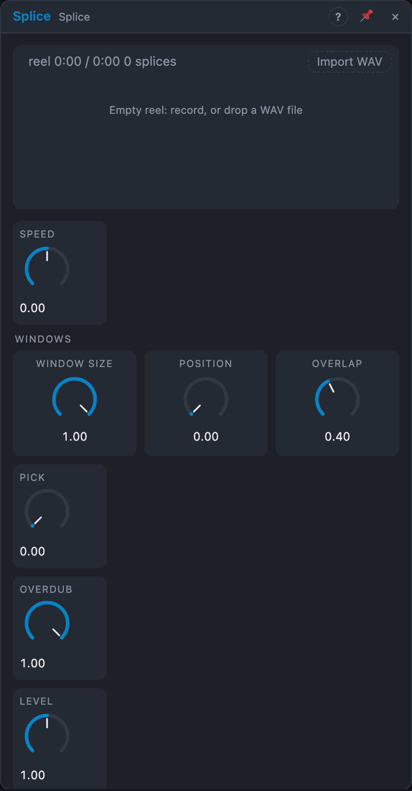

# Splice

## Introduction

Splice is a tape-style sampler and looper. You record onto a **reel** of up to
two minutes of stereo, cut it into **splices** with markers, and play them
back at any speed, forwards or backwards. Inside a splice, *Window Size*,
*Position* and *Overlap* break playback into small repeating pieces, from
micro-loops to a granular cloud. Triggers move between splices, a control
signal picks one directly, and WAV files can be dropped onto the reel.
Splice is the module for "record something, then play with it"; *Grains* is
the one for a live, moving cloud.

## How does it work?

**Recording.** Press **● Rec** (or send a gate or trigger to *Record*) to
start and again to stop (*Record Mode* *Toggle*); with *Gate*, recording runs
while the gate is high. *Record Target* decides where it goes:

- **New splice** (default): the take is appended to the reel as a new
  splice, which becomes the current one and plays as soon as you stop.
- **Current splice**: overdubs into the splice that's playing, at the play
  head and at its speed (tape style). *Overdub* sets how much of the old
  audio stays: 0 % replaces it, 100 % layers on top.
- **Whole reel**: clears the reel and records from the start.

*Reel Length* (15 s – 2 min) is how much the reel can hold. *Monitor* passes
the input through: never, while recording, or always.

**Splices.** **Mark** (button or trigger) cuts: while recording, it splits the
take there; while playing, it splits the current splice at the play head. In
the view, double-click the reel to add a marker, double-click a marker to
remove it (the two splices merge), drag a marker to move it, click a splice
to pick it.

**Playback.** **Speed** is the playback ratio: 1 normal, 2 an octave up,
negative backwards, 0 stops the tape. The *Speed* input adds 1 V per octave,
so a sequencer plays the reel melodically. At the end of the splice it loops,
or with *Loop* on *One-shot* it stops until **Play**. *End* fires at the end
of each pass. With *Sync* on 1, 2, 4 or 8 bars, the speed is set so the
splice lasts exactly that long at the song's tempo (pitch follows, like tape)
and stays locked to the bars, even after a loop jump.

**Moving between splices.** **Next** steps to the next splice (and wraps).
*Select* (0 … 1, a control input) picks a splice directly; without it, the
**Pick** knob does. *Shift* decides when the change happens: *Immediate*
(crossfaded over *Fade*), *End of window*, or *End of splice*. The view shows
a pending splice with a dashed outline. **Play** restarts the current (or
pending) splice.

**Windows.** *Window Size* is the length of a piece of the splice (down to
0.5 ms), *Position* where in the splice it sits. *Overlap* decides how the
windows play:

- **0 – 30 %:** each window plays once, then a gap: rhythmic stutter (the gap
  shrinks as Overlap rises).
- **30 – 50 %:** windows repeat back to back with a short crossfade: a clean
  loop. This is the default; at Window Size 100 % the whole splice loops.
- **50 – 100 %:** 2 to 4 overlapping windows with soft edges: a granular
  texture. Above 75 % some windows play an octave up or down or a fifth up,
  spread across the stereo field (from *Seed*, so it repeats).

A slow LFO on *Position* scrubs through the splice. With *End Mode* on
*Window*, *End* fires at every window: a clock taken from the audio.
*Position* and *Splice* (outputs) report the play head within the splice and
which splice is playing. **Fade** sets the crossfades at window and splice
boundaries and the record punch-in and out; at 0 the playback is
sample-exact. **Level** sets the output level.

**Saving.** The reel is stored as a WAV file in the media folder; the view
saves it whenever the audio has changed and recording has stopped (the header
says "unsaved" until then), and the board keeps its name, markers and current
splice. **Import WAV**: drop a file on the reel or the *Import WAV* box; it
replaces the reel. **Clear reel** empties it.

## How to use it?

- **Live looper:** Monitor *Always*, record a phrase, it loops when you
  stop. Record Target *Current splice* and Overdub 100 % to layer more.
- **Chopped break:** import a drum loop, add markers on the hits, patch a
  sequencer's trigger into *Next* (Shift *Immediate*), or a stepped random
  source into *Select*.
- **Tape tricks:** an envelope onto *Speed* for tape-stop; *Speed* −1 for
  reverse.
- **Melodic sampler:** a sequencer's *Pitch* into the *Speed* input, Window
  Size 100 %, Loop *One-shot*, its trigger into *Play*.
- **Texture:** Window Size 3 %, Overlap 90 %, a slow LFO on *Position*.
- **Phrase in time:** Sync *2 bars*: whatever you recorded fits two bars.

<!-- generated:demos -->
## Demo patches

Five whole patches show what Splice does. In the standalone app open **File → Presets…** (⌘P) and pick *Splice* under *Demos by module*; on the website, **Run in Play** opens one in your browser. Loading one replaces the project and starts the transport.

| Patch | What it shows |
|---|---|
| **Splice: Two-Bar Loop** | A plucked phrase is recorded onto the reel for two bars, then the splice loops it back with Sync on 2 bars, so the loop stays on the beat. The live phrase is heard while it is recorded (Monitor). Try Sync, Speed or Window Size to bend the loop, or set Record Target to Current splice and Overdub to layer more on top. |
| **Splice: Tape Stop** | A drum bar is recorded, then plays from the reel while a ramp pulls Speed down towards zero every two bars: the whole loop slows, drops in pitch and winds to a halt before the tape snaps back to full speed. Edit the ramp's Rate or amount, or try a negative Speed to run the tape backwards. |
| **Splice: Reel Keyboard** | One recorded note is replayed as an instrument: a sequencer's Pitch drives the Speed input (1 V per octave) and its trigger restarts the splice, with Loop on One-shot. Change the sequence for a new tune, or Window Size for another timbre; pitch and speed move together, like tape. |
| **Splice: Break Chopper** | A drum bar is recorded and then replayed one eighth at a time: Window Size is 1/8 of the splice and a stepped random source picks Position every eighth note, so the break is re-cut into a stuttering new beat. The random loops after eight steps, so the pattern repeats; raise Loop towards 0 for endless variation. |
| **Splice: Micro Cloud** | A short chord arpeggio is recorded, then replayed in 3 % windows with Overlap at 90 %, which turns it into a granular cloud; a slow LFO scrubs Position across the splice. Raise Window Size to hear the phrase re-emerge, or lower Overlap below 30 % for a rhythmic stutter. |
<!-- /generated -->

## Reference

### Knobs

| Knob | Range | Default |
|---|---|---|
| Speed | −4 … +4 (×1 in the middle) | +1 |
| Window Size | 0.001 – 100 % of the splice | 100 % |
| Position | 0 – 100 % | 0 % |
| Overlap | 0 – 100 % | 40 % |
| Pick | 0 – 100 % | 0 % |
| Overdub | 0 – 100 % | 100 % |
| Level | 0 – 200 % | 100 % |
| Fade | 0 – 50 ms | 3 ms |

Every knob is a modulation destination.

### Settings

| Setting | Values | Default |
|---|---|---|
| Reel Length | 15 s, 30 s, 60 s, 120 s | 60 s |
| Record Mode | Gate, Toggle | Toggle |
| Record Target | New splice, Current splice, Whole reel | New splice |
| Shift | Immediate, End of window, End of splice | End of splice |
| End Mode | Splice, Window | Splice |
| Loop | Loop, One-shot | Loop |
| Monitor | Off, Input while recording, Always | Input while recording |
| Sync | Free, 1 bar, 2 bars, 4 bars, 8 bars | Free |
| Seed | 0 – 999 | 1 |

### Inputs

| Input | Signal | What it does |
|---|---|---|
| In L, In R | audio | the recording source; *In L* alone feeds both sides |
| Record | gate | starts/stops recording (per *Record Mode*) |
| Mark | trigger | adds a marker at the record or play head |
| Next | trigger | moves to the next splice |
| Select | control | 0 … 1 picks splice 1 … n |
| Play | trigger | restarts the current splice |
| Speed | pitch | 1 V/oct on top of *Speed* |

### Outputs

| Output | Signal | What it does |
|---|---|---|
| Out L, Out R | audio | the playback (and the input, per *Monitor*) |
| End | trigger | the end of each splice pass (or window) |
| Position | control | the play head within the splice, 0 … 1 |
| Splice | control | which splice plays, 0 … 1 |

The reel takes 46 MB at 48 kHz (always sized for two minutes); inside a Voice
Cell each voice has its own reel.
