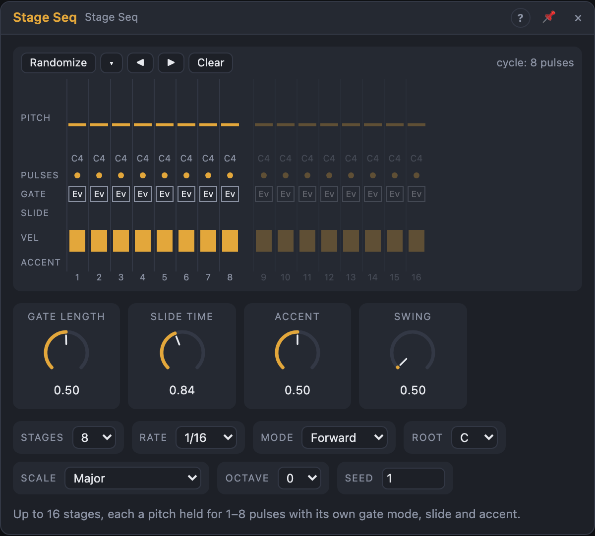

# Stage Seq

## Introduction

The Stage Seq plays **stages** instead of steps. Each of up to 16 stages has
a **pitch** and a **length in pulses** (1–8), and a **gate mode** that decides
what those pulses sound like: one long note, a note on every pulse, only the
first pulse, silence, or fast **ratchets**. **Slides** glide into a stage,
**accents** make it louder.

Because every stage has its own length, a few stages make long, uneven
phrases: the factory pattern is 8 stages and 12 pulses, so it shifts against
the bar every time round. It's a natural bass-line and lead sequencer.

Patch *Notes* into a Voice Cell and press play.

## How does it work?

**Pulses.** With nothing in *Clock*, pulses follow the transport at *Rate*;
with a trigger in *Clock*, each trigger is one pulse. A stage of 3 pulses
lasts three pulses, then the next stage starts.

**Order.** *Mode* chooses how the stages follow each other:

- **Forward** 1 … S, **Reverse** S … 1, **Pendulum** 1 … S … 2 (the end
  stages once per turn).
- **Random** jumps to a random stage, never the same one twice in a row.
- **Brownian** walks: one stage on (50 %), one back (25 %) or stays (25 %),
  wrapping around at the ends.

The fixed orders are worked out from the song position, so a loop jump lands
on the right stage and pulse. Random and Brownian start a new walk at every
**Phrase** (1–16 bars): the walk depends only on *Seed* and the phrase, so it
plays the same in every render, and after a jump the module replays the walk
from the phrase start and lands where it should. A stage that would cross the
end of a phrase is cut short there.

**Gate modes.**

| Mode | Gate | Notes |
|---|---|---|
| Rest | low | none; Pitch and Velocity hold |
| First | *Gate Length* of the first pulse | one |
| Every | *Gate Length* of each pulse | one per pulse |
| Hold | the whole stage | one long note |
| Ratchet | each pulse split into 2–4 fast gates | pulses × ratchets |

**Slide.** A stage with slide is entered **legato**: the previous note keeps
sounding into it (its gate is stretched to the stage boundary), the new
note-on comes before the old note-off, and *Pitch* glides there over *Slide
Time*. A Voice Cell in *Legato* mode glides with it. A slide into a Rest stage
does nothing.

**Accent.** An accented stage plays louder — by how much is set with the
*Accent* knob — and holds the *Accent* gate high while its notes sound.

**Hold.** While the *Hold* input is high, a stage that ends starts again. With
a clock, the order carries on where it stopped when Hold falls. With the
transport, the module rejoins the song position at the next pulse, so it's
never out of time.

**No hanging notes.** Stopping, Reset, changing *Stages*, *Mode* or *Phrase*,
and changing the sounding stage's gate mode or pulses all end the note.

## How to use it?

- **A bass line:** *Notes* into a Voice Cell with a low *Octave*. Use *Hold*
  stages for long notes and a slide or two for the squelch.
- **Editing:** the timeline shows each stage as wide as its pulses. Drag in
  the *Pitch* lane (it snaps to the scale; Shift for semitones; double-click
  resets). Drag sideways in *Pulses* to set the length, or scroll on the dots.
  Click *Gate* to cycle Rest → First → Every → Hold → Ratchet; scroll (or
  Shift-click) a Ratchet stage to set 2–4. Click *Slide* and *Accent* to
  toggle them; drag *Vel*.
- **Randomize** rewrites the lanes you tick in **▾** (pitch, pulses, gate,
  slide, accent, velocity), with the pitch range, the longest stage and the
  slide and accent chances. ◀ ▶ rotate the stages; **Clear** starts over.
- **Generative lines:** *Mode* = Brownian, *Phrase* = 4 bars. Change *Seed*
  until you like the walk; it stays the same every time you play.
- **Breaks:** patch a gate from another sequencer into *Hold* to stutter the
  current stage.
- **Chaining:** *Stage Start* fires on every stage, *End* when the cycle (or
  phrase) starts over.

## Reference

### Knobs

| Knob | Range | Default |
|---|---|---|
| Gate Length | 1 – 100 % of a pulse | 50 % |
| Slide Time | 1 ms – 2 s | 80 ms |
| Accent | 0 – 100 % | 50 % |
| Swing | 50 – 75 % | 50 % |

- **Gate Length:** the gate of *First*, *Every* and *Ratchet* notes (for
  ratchets, of each fast gate).
- **Slide Time:** how long *Pitch* takes to reach a slide stage (99 %).
- **Accent:** how much accented stages are boosted, from not at all to full
  velocity.
- **Swing:** delays every second pulse.

Every knob is a modulation destination.

### Settings

| Setting | Values | Default |
|---|---|---|
| Stages | 1 – 16 | 8 |
| Rate | 1/1 … 1/32, dotted (.) and triplet (T) | 1/16 |
| Mode | Forward, Reverse, Pendulum, Random, Brownian | Forward |
| Phrase | 1, 2, 4, 8, 16 bars (Random and Brownian) | 4 bars |
| Root | C … B | C |
| Scale | the Step Sequencer's scales | Major |
| Octave | −3 … +3 | 0 |
| Seed | 0 – 999 | 1 |

### Inputs

| Input | Signal | What it does |
|---|---|---|
| Clock | trigger | each pulse is one pulse of the current stage; unpatched, the transport drives the pulses |
| Reset | trigger | the next pulse is stage 1, pulse 1 |
| Hold | gate | while high, the current stage repeats |
| Transpose | pitch | added before quantizing (1 V/oct) |

### Outputs

| Output | Signal | What it does |
|---|---|---|
| Notes | notes | the stages' notes; slides as legato |
| Pitch | pitch | the stage's quantized pitch, gliding into slide stages; holds on Rest |
| Gate | gate | the gates of the gate modes |
| Velocity | control, 0 – 1 | the stage's velocity, accent included |
| Accent | gate | high while an accented stage's notes sound |
| Trigger | trigger | a pulse at each note start, ratchets included |
| Stage | control, 0 – 1 | the playing stage: first 0, last 1 |
| Stage Start | trigger | a pulse at every stage start |
| End | trigger | a pulse when the cycle (or a phrase) starts over |
