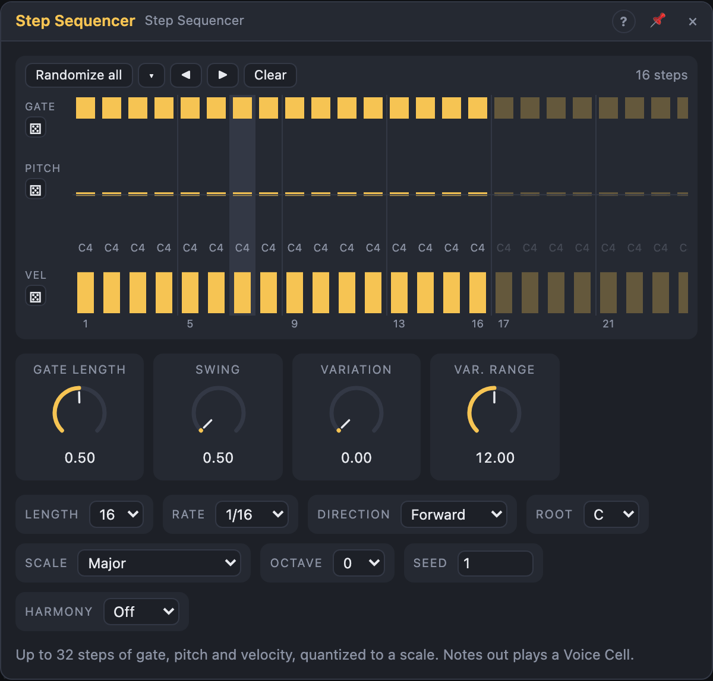

# Step Sequencer

## Introduction

The Step Sequencer plays a melody of up to **32 steps**. Each step has a
**gate** (off, on or tied to the next step), a **pitch** and a **velocity**,
drawn in three lanes. Pitches snap to a **scale**, so every pattern stays in
key. **Randomize** buttons write new gates, pitches or velocities in one click, and the **Variation** knob
adds seeded variation while the pattern plays, without changing it.

Patch *Notes* into a Voice Cell and you have a polyphonic synth playing a
sequence. The *Pitch*, *Gate* and *Velocity* outputs drive everything else.

## How does it work?

**Timing.** With nothing in *Clock*, the sequencer follows the transport: the
step is worked out from the song position at the chosen *Rate*, so it's always
in time with the bars and lands on the right step after a loop jump. When the
transport stops, the note ends. Patch a trigger into *Clock* and each pulse
moves one step instead. *Reset* makes the next step step 1.

**Steps.** *Length* sets how many steps play (1–32). Steps beyond it keep
what you drew, so shortening a pattern loses nothing. *Direction* plays the
steps forward, backward, back and forth (*Ping-Pong*) or in a seeded random
order that never repeats a step twice in a row.

**Gates and ties.**
- **On** plays a note for *Gate Length* of the step.
- **Tie** holds the note into the next step. If the next step has another
  pitch, the new note starts before the old one ends, so a Voice Cell in
  *Legato* mode glides instead of retriggering. With the same pitch, the note
  just continues.
- **Off** plays nothing; *Pitch* and *Velocity* keep their last values.

**Pitch.** A step's pitch counts semitones above *Root* + *Octave*. The result
(plus the *Transpose* input) snaps to the nearest note of the *Scale*; halfway
between two notes it goes down. Transpose is applied before snapping, so a
transposed melody stays in the scale.

**Variation.** At each step, with the chance set by *Variation*, the step plays
a random scale note within *Var. Range* of its own pitch, and a velocity up to
25 % louder or softer. Gates never change. The choices come from *Seed* and the
step's place in the song, so the same Seed plays the same variations every
time.

## How to use it?

- **A sequenced synth:** patch *Notes* into a Voice Cell's *Notes* input.
  Press play.
- **Drawing:** click a gate to cycle Off → On → Tie; drag across gates to paint
  them. Drag in the pitch lane to draw a melody; it snaps to the scale (hold
  Shift for single semitones outside it). Double-click a pitch to reset it to
  the root. Drag in the velocity lane to draw accents.
- **New ideas:** each lane has its own dice button (⚄) next to its name: new
  gates and ties, new pitches from the scale, or new velocities, leaving the
  other lanes alone. **Randomize all** rewrites all three. The **▾** button
  sets how many steps get a gate (*Density*), the pitch range in octaves and
  the velocity range. Each click is one undo step.
- **Moving patterns:** ◀ and ▶ rotate the steps; **Clear** turns all gates off.
- **Evolving lines:** patch a slow Function or Random onto **Variation**. The
  melody wanders off and comes back.
- **Key changes:** patch another sequencer's *Pitch*, or a MIDI Device's
  *Pitch*, into *Transpose*.
- **Without Voice Cells:** *Gate* into an ADSR, *Pitch* into an Oscillator.
- **Chaining:** *End* fires when the pattern starts over; use it to reset or
  advance other modules.

<!-- generated:presets -->
## Presets

The preset bar of the Step Sequencer view has 15 factory presets. Pick one to set the knobs, then change them to taste; your own presets sit next to them.

| Preset | What it does |
|---|---|
| **Straight Sixteenths** | Plain forward sixteenth notes in C major: the neutral starting point. |
| **Tight Staccato** | Short, clipped gates in minor pentatonic for plucks and bass. |
| **Legato Eighths** | Full-length gates in eighths so the notes run together. |
| **Swung Shuffle** | Sixteenths with a loose swing in Dorian for a laid-back groove. |
| **Triplet Roll** | Eighth-note triplets for a rolling, rounded feel. |
| **Slow Pendulum** | Eight steps bouncing back and forth in Lydian: dreamy and floating. |
| **Backward Run** | Plays the pattern in reverse for a falling line. |
| **Short Loop Eight** | A tight eight-step loop in Phrygian for driving basslines. |
| **Odd Five** | Five steps against a four-beat bar: the pattern keeps shifting. |
| **Dense Random** | Thirty-second notes in random order across the whole scale. |
| **Gentle Drift** | Notes wander a few semitones from the written pitches. |
| **Wild Variation** | Heavy variation of up to an octave: the sequence never plays the same twice. |
| **Blues Walk** | Dotted eighths in an A blues scale with a little swing. |
| **Eastern Lines** | Sixteenth triplets in a Phrygian dominant scale. |
| **Low Octave Drone** | Slow, held quarter notes two octaves down for a sub line. |
<!-- /generated -->

## Reference

### Knobs

| Knob | Range | Default |
|---|---|---|
| Gate Length | 1 – 100 % of a step | 50 % |
| Swing | 50 – 75 % | 50 % |
| Variation | 0 – 100 % | 0 % |
| Var. Range | 0 – 24 semitones | 12 |

- **Gate Length:** how long each *On* step sounds. Ties ignore it.
- **Swing:** delays every second step; 50 % is straight, 75 % a heavy shuffle.
- **Variation:** the chance per step of playing a varied note.
- **Var. Range:** how far a varied note may move from the step's own pitch.

Every knob is a modulation destination.

### Settings

| Setting | Values | Default |
|---|---|---|
| Length | 1 – 32 steps | 16 |
| Rate | 1/1 … 1/32, dotted (.) and triplet (T) | 1/16 |
| Direction | Forward, Backward, Ping-Pong, Random | Forward |
| Root | C … B | C |
| Scale | Chromatic, Major, Natural Minor, Harmonic Minor, Melodic Minor, Dorian, Phrygian, Lydian, Mixolydian, Locrian, Phrygian Dominant, Major Pentatonic, Minor Pentatonic, Blues, Whole Tone, Diminished, Hirajoshi | Major |
| Octave | −3 … +3 | 0 |
| Seed | 0 – 999 | 1 |
| Harmony | Off, Bus A – Bus D: follow a Harmony Master (its key becomes the root, its scale replaces Scale) | Off |
| Sync To | Auto, Clock, Transport | Auto |

- **Sync To:** what steps the module. *Auto*: the clock pulses while *Clock* is patched, otherwise the transport. *Clock*: only the pulses step it. *Transport*: the song position steps it, and a patched *Clock* is ignored.

### Inputs

| Input | Signal | What it does |
|---|---|---|
| Clock | trigger | each pulse plays the next step; unpatched, the transport drives the steps |
| Reset | trigger | the next step is step 1 |
| Transpose | pitch | added before quantizing (1 V/oct: 1/12 per semitone) |

### Outputs

| Output | Signal | What it does |
|---|---|---|
| Notes | notes | one note per step, ties as legato |
| Pitch | pitch | the step's quantized pitch, held between steps |
| Gate | gate | high while a step sounds, across ties |
| Velocity | control, 0 – 1 | the step's velocity, held between steps |
| Trigger | trigger | a pulse when a step starts a new note |
| End | trigger | a pulse when the pattern starts over |
| Step | control, 0 – 1 | where the playhead is: first step 0, last step 1 |
