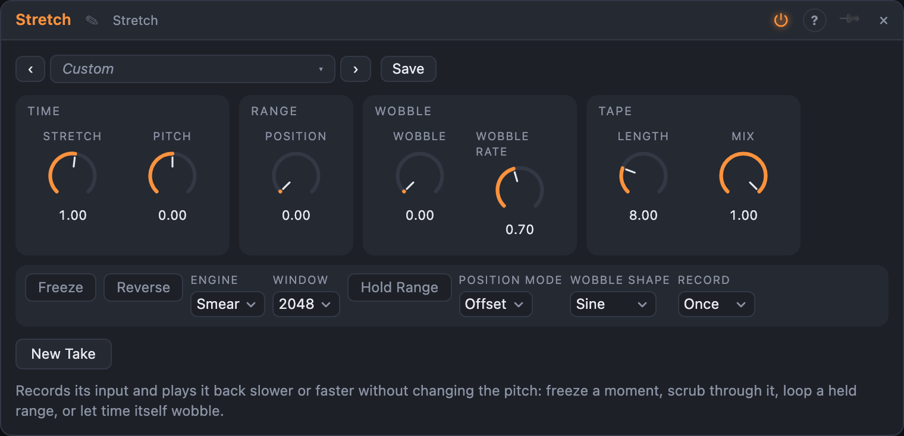

# Stretch

## Introduction

Stretch **records** what you send it and **plays it back at another speed without
changing the pitch**: a voice at a quarter of the speed is still the same voice, a chord stretched
to ten times its length becomes an evolving pad. It can also **freeze** a moment, **scrub** through the recording
from a CV, shift the pitch independently, and run the recording backwards. It is stereo.

Two things are its own. **Hold Range** loops a small window of the recording, so you
can stay inside one syllable or one beat. And the **stretch factor can wobble**: a slow wave or a random walk
modulates it, so time itself speeds up and slows down.

## How does it work?

The module writes its input into a buffer (up to 30 seconds, you choose **Length**). A play head moves through the recording at
*one divided by Stretch* seconds of recording per second, and a loop goes round at the end. Two **engines** turn the head's
position into sound:

- **Grains** cuts short overlapping grains from the head and plays them again. The grains are lined up
  by their waveforms, so a tone keeps its pitch. **Grain** is their length, **Overlap** how many sound at once,
  **Scatter** spreads where each starts: a clean texture at 0, a cloud at 100 %. Best for rhythmic and textural material, and cheap.
- **Smear** is a *phase vocoder*: it analyses the spectrum at the head and lets every partial go on turning at its own measured
  frequency. Tones stretch smoothly into long drones; transients smear. **Window** sets the frame length: 1024 is quicker, 4096
  has the finest pitch resolution. Smear sounds are delayed by one window.

**Record** says how the tape works: *Once* records from the start until **Length** is full (or until you press *New Take*, or
a trigger arrives at *New Take*), then stops; *Rolling* never stops and keeps the last **Length** seconds; *Off* plays what is
there. **Mix** blends the live input (0 %) with the stretched sound (100 %).

- **Stretch** is the time factor, ×0.1 (ten times faster) to ×8 (eight times slower). **Freeze** stops the head;
  **Reverse** runs it backwards. **Pitch** shifts the sound up or down 24 semitones, independent of speed.
- **Hold Range** loops a window: **Start** is where it begins and **Range** how long it is, both as a share of the recording.
- **Position** moves the head by hand or CV. With *Position Mode* **Offset** it is added to the moving head (a
  CV makes the playback jump around); with **Scrub** it is the head itself: 0 % at the start of the window, 100 % at its end, and
  Stretch no longer matters. Scrubbing a frozen sound gives you a spectral scrubber.
- **Wobble** is the depth of the stretch modulation (up to ±1.5 octaves of factor), **Wobble Rate** its speed and **Wobble Shape** sine, random or saw.

The **Head** output (0…1) shows where in its window the head is.

## How to use it?

- **Slow a sound down:** play something while *Record* is *Once*, then set *Stretch* to 4.
- **Freeze a moment:** switch *Freeze* on at the moment you like, or patch a button to the *Freeze* input.
- **Pad from anything:** *Smear*, *Stretch* 8, a bit of *Wobble* and *Mix* at 100 %.
- **Granular scatter:** *Grains*, a long *Grain*, *Scatter* high and *Overlap* 4×.
- **Looping a syllable:** *Hold Range* with a small *Range*; move *Start* to pick the syllable.
- **Scrub with a CV:** *Position Mode* *Scrub* and an LFO or a pad into *Position*.
- **Live stretching:** *Record* *Rolling* with a short *Length*: the head slides through the last seconds of what you play.
- **Slowed and low:** *Stretch* 2 with *Pitch* −12 is the classic slowed-down sound.

<!-- generated:demos -->
## Demo patches

Five whole patches show what Stretch does. In the standalone app open **File → Presets…** (⌘P) and pick *Stretch* under *Demos by module*; on the website, **Run in Play** opens one in your browser. Loading one replaces the project and starts the transport.

| Patch | What it shows |
|---|---|
| **Stretch: Melody into Pad** | A plucked loop is recorded into a four second rolling tape and played back four times slower by the Smear engine, so the notes melt into a slowly changing pad over a plain beat. Try Stretch at 8 for a still drone, Wobble for a drifting sense of time, or Mix lower to hear the live melody under the pad. |
| **Stretch: Granular Cloud** | An arpeggio is cut into 250 ms grains that are scattered around the play head, four at a time, while the head crawls through a four second tape at a quarter of the speed. The result is a shimmering cloud with the dry arpeggio underneath. Move Scatter between 0 and 100 %, shorten Grain for a glitchier texture, or raise Pitch. |
| **Stretch: Frozen Scanner** | A short chord progression is recorded once, then the tape is frozen and Position Mode is set to Scrub, so a slow LFO on Position sweeps a spectral scanner back and forth through the chords. It sounds like one sustained organ whose harmony slides between the recorded chords. Change the LFO rate, or turn Freeze off to hear the tape move again. |
| **Stretch: Hold Range Stutter** | Hold Range loops a window of only 4 % of a one-bar tape, which stutters a bright pluck line into a tiny repeating loop. A slow random source moves Start, so the stutter keeps landing on a different piece of the phrase. Change Range for longer or shorter loops, or Grains for a rougher edge. |
| **Stretch: Time Wobble** | A drum and bass loop is replayed from a rolling tape seven semitones up while Wobble with a random shape keeps changing the stretch factor, so the groove slows down, speeds up and smears as if time itself was swaying. Turn Wobble down for a steady pitch-shifted copy, or set Pitch to -12 for a heavy, slowed sound. |
<!-- /generated -->

<!-- generated:presets -->
## Presets

The preset bar of the Stretch view has 15 factory presets. Pick one to set the knobs, then change them to taste; your own presets sit next to them.

| Preset | What it does |
|---|---|
| **Half Speed** | Plays the recording at half speed with the pitch where it was. |
| **Slow Motion** | Four times as long: transients melt, tones hold. |
| **Crawl** | The longest stretch with the finest frequency resolution. |
| **Double Time** | Twice as fast, same pitch. |
| **Granular Cloud** | Long scattered grains: a cloud made from the recording. |
| **Freeze Frame** | Stops time at the head and holds that moment as a drone. |
| **Scrub Pad** | Position is the play head: move it by hand or with a CV to scrub. |
| **Loop Window** | Loops a small window of the recording over and over. |
| **Time Wobble** | Time itself sways: the sound speeds up and slows down but never changes pitch. |
| **Drunk Time** | Time takes an uneven walk around a slow stretch. |
| **Backwards Smear** | The recording plays backwards, slowly. |
| **Octave Down Slow** | Half speed, an octave lower: the classic slowed-down sound. |
| **Shimmer Stretch** | A slow sheen an octave above, mixed under the live sound. |
| **Rolling Capture** | Keeps recording round a four-second loop while the head stretches through it. |
| **Stutter Loop** | A tiny window of the last seconds on repeat. |
<!-- /generated -->

## Reference

### Knobs

| Knob | Range | Default |
|---|---|---|
| Stretch | ×0.1 – ×8 | ×1 |
| Pitch | −24 – +24 st | 0 st |
| Grain (Grains) | 20 – 400 ms | 120 ms |
| Scatter (Grains) | 0 – 100 % | 10 % |
| Start (Hold Range) | 0 – 100 % | 0 % |
| Range (Hold Range) | 1 – 100 % | 25 % |
| Position | 0 – 100 % | 0 % |
| Wobble | 0 – 100 % | 0 % |
| Wobble Rate | 0.05 – 20 Hz | 0.7 Hz |
| Length | 1 – 30 s | 8 s |
| Mix | 0 – 100 % | 100 % |

### Settings

| Setting | Values | Default |
|---|---|---|
| Freeze | on / off | off |
| Reverse | on / off | off |
| Engine | Grains, Smear | Smear |
| Overlap (Grains) | 2×, 3×, 4× | 3× |
| Window (Smear) | 1024, 2048, 4096 | 2048 |
| Hold Range | on / off | off |
| Position Mode | Offset, Scrub | Offset |
| Wobble Shape | Sine, Random, Saw | Sine |
| Record | Once, Rolling, Off | Once |

### Inputs

| Input | Signal | What it does |
|---|---|---|
| In L | audio | left input |
| In R | audio | right input; copied from In L when unpatched |
| Position | control | added to the Position knob |
| Freeze | gate | stops the head while high |
| New Take | trigger | starts a new take (Record: Once) |

### Outputs

| Output | Signal | What it does |
|---|---|---|
| Out L | audio | left output |
| Out R | audio | right output |
| Head | control | 0…1, where the head is inside its window |

### Buttons

| Button | What it does |
|---|---|
| New Take | the same as a trigger on *New Take* |

The recording is not saved with the board: a new session starts with an empty tape.

## Origin

The Grains engine is waveform-similarity overlap-add; the Smear engine is the phase vocoder with identity phase locking. Both are published techniques, written for this module from their descriptions; no source code was ported.
