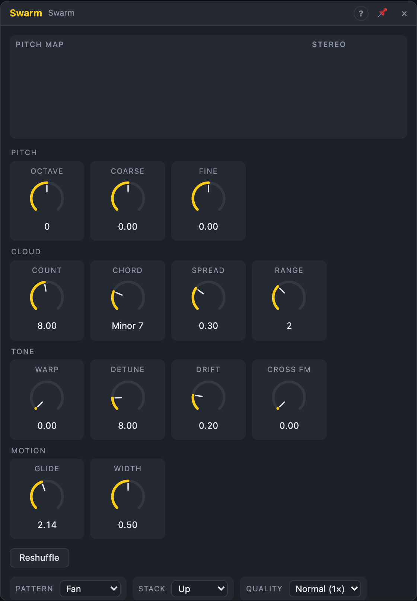

# Swarm

## Introduction

The Swarm is a cloud of up to 16 oscillators played from one pitch. Their
notes are spread over a chord or scale around the root, so a single *Pitch*
signal plays anything from a thick unison to a wide, shimmering chord stack.
*Spread* opens the cloud from unison into the chord, and every oscillator
glides to its new note at its own pace, so the swarm moves like a flock
instead of switching. It is a drone and pad source on its own, and a fat
detuned-saw lead with *Spread* at 0.

For a precise chord with named inversions and pitch outputs per tone, use the
Chord Osc; for several independent notes, a Voice Cell.

## How does it work?

**The stack.** *Chord* chooses a set of notes: a chord (Minor 7, Quartal,
Cluster, …) or a whole scale. The stack lists those notes upward through
*Range* octaves, e.g. Minor 7 over two octaves is C E♭ G B♭ C E♭ G B♭ C. The
oscillators are spread evenly over the stack, whatever their *Count*, so
8 oscillators on a 9-note stack skip one note. With *Stack* on *Centred* the
stack reaches down half the range and up half; on *Down*, all of it below
the root.

**Spread.** At 0 % every oscillator plays the root. As *Spread* rises, each
oscillator aims at its stack note scaled by *Spread* and snapped to the
nearest chord note, so the oscillators leave the root one after another,
the highest first: the cloud blooms open. Oscillator 1 always stays on the
root.

**Glide.** Each oscillator slides to a new target with its own time, between
half and one and a half times *Glide* (drawn from *Seed*). A change of
*Chord* or *Spread* therefore unfolds note by note. Changes of the root
(*Pitch*, *Octave*, *Coarse*, *Fine*) move the whole swarm at once.

**Warp** morphs every oscillator's waveform: sine → triangle → rounded saw (a
saw with soft corners, few upper harmonics, gentle in dense chords) → bright
saw.

**Detune** offsets the oscillators by up to ±*Detune* cents in a *Pattern*:
*Fan* spreads them evenly from flat to sharp, *Alternate* goes sharp, flat,
less sharp, less flat, …, *Random* draws seeded values, *Outer* detunes the
lowest and highest the most and the middle not at all. **Drift** adds a slow
random walk to each detune (up to half of *Detune*), each oscillator at its
own pace. The root oscillator is never detuned.

**Cross FM** connects the oscillators in a ring: each one's phase is pushed
by the previous one's sine (by up to half a cycle at 100 %). A little adds
grit and beating; a lot turns chords into dense, metallic noise.

**Level and stereo.** The oscillators are summed and divided by √*Count*, so
*Count* changes the thickness, not the loudness. *Width* scatters them
across the stereo field, alternating sides and wider the further they are
from the root; the root stays centred. Oscillators that would play above
0.45 × the sample rate fade out instead of aliasing.

**Quality.** *High* runs the whole swarm at twice the sample rate with a
half-band decimator: cleaner high notes and deep Cross FM, at about twice the
CPU.

## How to use it?

- **Pad:** Voice In *Pitch* → *Pitch*; *Out L/R* → Filter → VCA. Default
  settings (8 oscillators on Minor 7, *Spread* 30 %) already sound like a
  chorus of voices.
- **Blooming chord:** patch an envelope or slow LFO onto *Spread* and set
  *Glide* to 1–2 s: the chord opens and closes in waves.
- **Supersaw lead:** *Spread* 0, *Warp* 100 %, *Count* 7, *Detune* 15–25 ct,
  *Pattern* Fan.
- **Shimmer:** *Chord* on a scale (Major Pentatonic, Hirajoshi), *Range* 3–4,
  *Spread* 100 %, *Drift* high, *Width* 100 %.
- **Separate filtering:** *Upper* carries only the oscillators above the root
  octave; filter it brighter or darker than the main mix. *Root* is a clean
  anchor for a sub or for syncing another oscillator.
- **Follow the opening:** patch *Spread* (output) to a filter's cutoff so it
  opens with the cloud.
- **New variation:** press *Reshuffle* (or send a trigger) for a new random
  pattern and new glide times.

## Reference

### Knobs and settings

| Control | Range | Default |
|---|---|---|
| Octave | −4 … +4 | 0 |
| Coarse | −12 … +12 st | 0 st |
| Fine | −100 … +100 ct | 0 ct |
| Count | 1 – 16 | 8 |
| Chord | 16 chords, then the 17 scales | Minor 7 |
| Spread | 0 – 100 % | 30 % |
| Range | 1 – 4 octaves | 2 |
| Warp | 0 – 100 % | 0 % (sine) |
| Detune | 0 – 50 ct | 8 ct |
| Drift | 0 – 100 % | 20 % |
| Cross FM | 0 – 100 % | 0 % |
| Glide | 0 – 5 s | 300 ms |
| Width | 0 – 100 % | 50 % |
| Pattern | Fan, Alternate, Random, Outer | Fan |
| Stack | Up, Centred, Down | Up |
| Quality | Normal (1×), High (2×) | Normal |
| Seed | 0 – 999 | 1 |

- **Count:** oscillators sounding; between whole numbers the last one fades
  in.
- **Chord:** Unison, Octaves, Fifths, Sus2, Sus4, Major, Minor, Major 7,
  Minor 7, Dominant 7, Minor 9, Major 9, Add 9, Quartal (stacked fourths),
  Quintal (stacked fifths), Cluster (three semitones), then every scale:
  Chromatic, Major, Natural Minor, …, Hirajoshi. A stepped knob: a cable moves
  it from entry to entry.
- **Seed:** chooses start phases, glide times, the drift walks, pan jitter
  and the *Random* pattern. The same seed always sounds the same.

All knobs are modulation destinations; *Pattern*, *Stack*, *Quality* and
*Seed* are settings. The *Reshuffle* button does the same as the input.

### Inputs

| Input | Signal | What it does |
|---|---|---|
| Pitch | pitch, 1 V/oct | the root; 0.0 = C4 |
| Reshuffle | trigger | new random pattern and glide times (from *Seed* and a counter that restarts with the transport) |
| Sync | trigger | restarts all oscillators at their start phases |

### Outputs

| Output | Signal | What it does |
|---|---|---|
| Out L, Out R | audio | all oscillators, panned by *Width*, divided by √*Count* |
| Root | audio | oscillator 1 alone: the root, never detuned, ±1 |
| Upper | audio | the oscillators above the root octave, mono |
| Spread | control, 0 … 1 | how far the cloud has opened, after glide |
