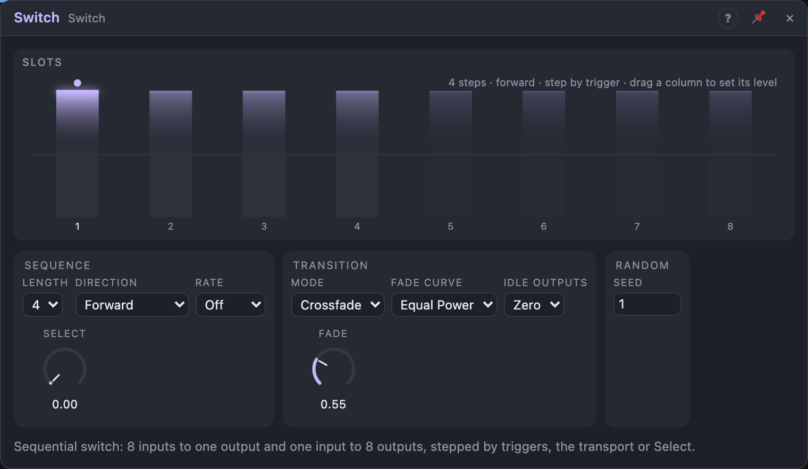

# Switch

## Introduction

The Switch is a sequential switch with up to 8 steps. It picks one of eight
inputs for its *Out*, and at the same time sends its *In* to one of eight
outputs. The step moves on each trigger, follows the song, or is chosen with
the *Select* knob. It can cycle through melodies, pick a sound source, send one
sequence to several voices in turn, or, with nothing patched, be an 8-step
sequencer of knob values.

## How does it work?

**One step, two sections.** The current step chooses:

- **8 → 1:** which of *In 1 … In 8* plays at *Out*. Each input is multiplied by
  its *Level*. An unpatched input plays its *Level* as a constant, so the
  eight *Level* knobs are eight steps of a value sequencer.
- **1 → 8:** which of *Out 1 … Out 8* gets *In*. The other outputs are silent
  (*Idle Outputs* *Zero*) or keep their last value (*Hold*).

**Moving the step.** *Length* sets how many steps are used (2 … 8).

- A trigger at **Step** moves one step in *Direction*: *Forward*, *Backward*,
  *Ping-Pong*, *Random* (never the same step twice) or *Random Walk* (one step
  up or down at random). *Reset* goes back to the first step.
- With *Step* unpatched and a **Rate** set, the switch steps with the song,
  locked to the bars: after a loop it is at the same step again.
- **Select** adds an offset: with *Length* 4, 0 … 0.25 is no offset, 0.25 …
  0.5 one step, and so on. With nothing stepping, *Select* chooses the step;
  patch an LFO onto it to sweep through the steps.

**Changing smoothly.** Each change fades over *Fade*. Short fades (the default
2 ms) remove clicks from audio; 0 switches instantly, right for gates and
stepped values. A change in the middle of a fade continues from what's
playing, so fast switching never jumps. *Fade Curve* *Equal Power* keeps the
loudness even between two different sounds; *Linear* is right for modulation
and for two versions of the same sound.

With **Mode** *Glide*, *Out* doesn't crossfade but slides from the old value
to the new one over *Fade*: portamento for a value sequencer driving a pitch.

*Gate* drops for one sample at every step change (to restart envelopes),
*Changed* fires a trigger, *End* fires when the steps start a new round, and
*Position* tells where the switch is.

## How to use it?

- **Source selector:** four oscillators into *In 1–4*, *Out* to the filter.
  Turn *Select*, or patch a slow random onto it.
- **8-step sequencer from knobs:** leave the inputs unpatched, set the *Levels*,
  a clock into *Step* (or set *Rate*), *Out* to an oscillator's pitch through a
  Quantizer. *Gate* plays an envelope on each step; *Mode* *Glide* adds slides.
- **Alternating melodies:** two sequencers' *Pitch* into *In 1–2*, *Length* 2,
  one sequencer's *End* into *Step*.
- **Spread notes over voices:** one random source into *In*, *Idle Outputs*
  *Hold*, a clock into *Step*: eight outputs, each with its own held value.
- **Rhythmic routing:** a drum into *In*, *Out 1–4* to four different effects,
  *Rate* 1/16, *Direction* *Random*.

<!-- generated:demos -->
## Demo patches

Five whole patches show what Switch does. In the standalone app open **File → Presets…** (⌘P) and pick *Switch* under *Demos by module*; on the website, **Run in Play** opens one in your browser. Loading one replaces the project and starts the transport.

| Patch | What it shows |
|---|---|
| **Switch: Four Timbres in Rotation** | The same riff is played by four different oscillators, and the Switch hands the output to the next one every half note with a short crossfade: saw, hollow pulse, triangle and a bright octave. Change Direction to Ping-Pong or Random, or lengthen Fade to blend the voices. |
| **Switch: Random Walk Textures** | Four sustained layers, a soft pad, a breathy noise band, a deep sine and a shimmering high chord, are slowly crossfaded by the Switch in Random Walk order, one step at a time, so the texture wanders without ever jumping. Change Seed for another route. |
| **Switch: One Riff, Four Treatments** | Used the other way round, one input goes to eight outputs: a single riff is sent to a dry output, an echo, a high-pass filter and a huge reverb in turn, each for half a bar. Try Direction Random or Length 2 to make it jump between only two of them. |
| **Switch: Gliding Drone Chords** | Four sine drones stacked on different chord tones are passed one at a time through the Switch in Glide mode and ping-pong order, with a long Fade so each tone seems to slide into the next. Change Mode to Crossfade for a cleaner blend or Fade for a quicker move. |
| **Switch: Drum Voice Carousel** | One drum pattern plays four different drums at once, but the Switch lets only one of them through, stepping to the next each bar by a trigger: the same groove turns from kick to snare to clap to tom. Lengthen the Length setting to add silent bars, or change Direction. |
<!-- /generated -->

## Reference

### Knobs and settings

| Control | Range | Default |
|---|---|---|
| Level 1–8 | −1 … +1 | +1 |
| Select | 0 … 1 | 0 |
| Fade | 0 … 2 s | 2 ms |
| Length | 2 … 8 | 4 |
| Direction | Forward, Backward, Ping-Pong, Random, Random Walk | Forward |
| Rate | Off, 1/32 … 8 bars | Off |
| Fade Curve | Equal Power, Linear | Equal Power |
| Mode | Crossfade, Glide | Crossfade |
| Idle Outputs | Zero, Hold | Zero |
| Seed | 0 … 999 | 1 |

- **Rate:** only used while *Step* is unpatched. One step per this length,
  locked to the song position.
- **Seed:** chooses the sequence of the random directions.

### Inputs

| Input | Signal | What it does |
|---|---|---|
| In 1–8 | audio | The sources for *Out*. Unpatched: the *Level* as a constant. Any signal type passes. |
| In | audio | The source for *Out 1–8* |
| Step | trigger | Moves one step |
| Reset | trigger | Back to the first step |

### Outputs

| Output | Signal | What it does |
|---|---|---|
| Out | audio | The selected input |
| Out 1–8 | audio | *In* at the selected output |
| Gate | gate | Low for one sample at each step change, high otherwise |
| End | trigger | When the steps start a new round |
| Position | control | The current step, 0 (first) … 1 (last) |
| Changed | trigger | A pulse at each step change |
