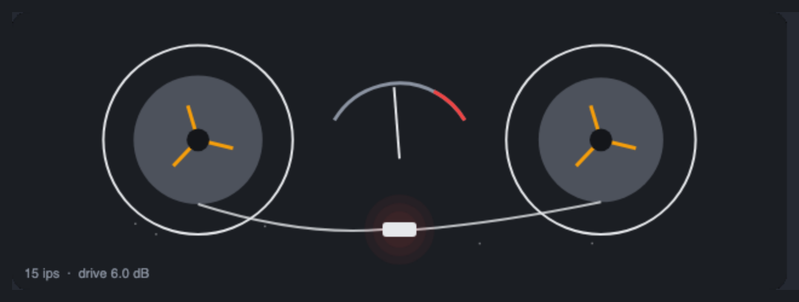

# Tape Machine



## Introduction

Tape does not just add a little distortion. It is a whole chain of small, level-dependent effects that together make a recording sound **glued, rounded and slightly alive**: the treble squashes before the bass does, the low end gets a soft bump, the top end rolls off more at slow speeds, the pitch wanders a few cents, and a faint hiss sits under everything. The Tape Machine models that chain, so it is much more than a saturator with a tape-coloured curve.

Typical uses: warmth and glue on a drum bus or a mix, a vintage lo-fi sound on a loop or a synth (slow speed, Rough tape, some wow and dropouts), or a subtle "this was recorded on a machine" finish on a single instrument (fast speed, Modern tape, a touch of drive).

The module is stereo (In L / In R, Out L / Out R). It adds a fixed delay of about 6.7 milliseconds (the dry signal in the Mix is delayed by the same amount, so dry and wet stay in phase).

## How does it work?

Each channel runs this chain:

```text
In -> wow / flutter delay -> compression -> Input Level -> record pre-emphasis
   -> magnetic hysteresis (oversampled) -> hiss, modulation noise, dropouts
   -> playback de-emphasis -> head bump -> gap and spacing loss -> Output
```

**Wow and flutter.** The signal first goes through a delay line whose length moves, which bends the pitch like an uneven tape transport. *Wow* is the slow part (0.5 to 2 Hz): a sine whose frequency itself wanders, plus a random walk. *Flutter* is the fast part (6 to 15 Hz): two tones that jitter in frequency, plus a little noise. The delay is read with cubic interpolation. A real transport moves both channels together, so most of the modulation is shared; the **Stereo Drift** knob mixes in an independent part for each channel. Slower speeds wobble more than faster ones.

**Compression.** A slow, soft gain reduction that follows the level (it reacts in a couple of milliseconds and lets go over about a tenth of a second). It is the "tape squashes the peaks" part, before the magnetic saturation.

**Pre-emphasis.** The signal is multiplied by the **Input Level** and then boosted in the treble by about 9 dB above a corner that depends on the speed (2.3 kHz at 7.5 ips, 4.6 kHz at 15 ips, 9.1 kHz at 30 ips). Treble therefore hits the tape harder than bass and saturates earlier: at slow speeds the corner is lower, so more of the spectrum is affected. After the tape the playback de-emphasis is the **exact inverse** of the pre-emphasis, so for a small signal the pair cancels and the response is flat.

**Magnetic hysteresis.** This is the heart of the module, a compact reduced form of the Jiles-Atherton model of magnetisation. The field `H` (the signal divided by the saturation field of the tape) magnetises the tape. Two things happen:

- the *reversible* part follows the smooth saturation curve `tanh(H)`;
- the *irreversible* part moves towards that curve only while the field is travelling in the direction that pulls it there, and only a fraction `x / (1 + x)` of the way, where `x` is the field travel divided by the loop width. When the field reverses, the irreversible part stays where it was until the curve comes back to it. That is the hysteresis loop.

The output is a mix of the two parts. The model is stable by construction: the irreversible part never overshoots the curve, and nothing can exceed full magnetisation, so the output is bounded and finite for any input and any knob setting. For small signals the loop is nearly closed and the sound is the smooth saturation, mostly odd harmonics with a little even harmonic from a slight asymmetry of the tape. With a wide loop (under-bias) small signals do not move the irreversible part at all, so the gain rises with level and low-level distortion appears. The stage runs at twice (Eco) or four times (Normal) the sample rate so that the sharp corners of the loop do not alias.

**Noise and dropouts.** Hiss is added at the tape, before the playback de-emphasis, so it is shaped like real tape noise. On Vintage and Rough tape a small *modulation noise* wobbles the level of the signal itself. Dropouts are short, smooth dips of 4 to 22 dB lasting 5 to 60 milliseconds at random (seeded) times, different in each channel.

**Playback.** After the de-emphasis come the **head bump** (a broad low-frequency peak, near 150 Hz at 7.5 ips, 90 Hz at 15 ips and 50 Hz at 30 ips, with a gentle low cut below it) and the **gap and spacing loss**, a smooth high-frequency roll-off that gets higher with speed (the -3 dB point is about 11 kHz at 7.5 ips, 17 kHz at 15 ips and 24 kHz, that is, beyond the audio band, at 30 ips, scaled by the tape type).

**Level compensation.** The output gain is set so that a signal at about -18 dBFS comes out at about the same level for any Input Level. Turning up the drive therefore adds colour and compresses the peaks, instead of just making the signal louder, so you can compare settings at equal loudness.

## How to use it?

- **Warmth on a drum bus:** Speed 15 ips, Tape Vintage, Input Level +6 dB, Bias 0, Compress 30 %, Wow 0 %, Flutter 0 %, Hiss 0 %. Raise Input Level until the snare's transient softens and the cymbals lose their edge.
- **Subtle tape finish on a mix:** Speed 30 ips, Tape Modern, Input Level +3 dB, Compress 15 %, Wow and Flutter 5 %, Hiss 5 %. Almost transparent, with a faint low-end bump and glue.
- **Lo-fi loop:** Speed 7.5 ips, Tape Rough, Input Level +9 dB, Wow 60 %, Flutter 35 %, Hiss 40 %, Dropouts 25 %, Stereo Drift 30 %. Dull, wobbly and noisy.
- **Gritty guitar or synth:** Speed 15 ips, Tape Vintage, Input Level +14 dB, Bias -50 %, Compress 50 %. Under-bias adds the crackly low-level distortion of a machine that is not aligned.
- **Dark, polished sound:** Speed 7.5 ips, Tape Modern, Bias +60 %, Input Level 0 dB. Over-bias is clean and a little dull.
- **Only the wobble:** Input Level -12 dB (almost linear), Compress 0 %, Hiss 0 %, then set Wow and Flutter. The tape then acts mostly as a slightly dulling, wavering delay.
- **Parallel tape:** Mix 40 % with Input Level +12 dB for heavy saturation underneath the clean signal. Dry and wet are time-aligned.

Eco halves the processing of the magnetic stage. Use Normal for bright, hard-driven material; Eco is fine for bass, drums or anything dull.

## The module's own UI

The node shows two reels instead of a plain row of knobs. They turn at the tape speed, the tape pack moves from the left reel to the right one, and the tape sags and the reels speed up and slow down with the wow and flutter the module is producing right now. A VU needle follows the output, the head glows warm as the tape saturates, sparkles show the hiss and the whole machine flashes at a dropout. Click a reel to change the speed; drag up or down anywhere else to set Input Level. The normal knobs stay below the picture.

What the UI demonstrates:

- **Smoothing polled probes.** The module reports its probes a few times a second; the UI eases each value towards its probe with `1 - Math.exp(-dt * k)` (fast attack, slow release for the needle), so the picture moves smoothly at 60 frames a second.
- **Idle animation.** The reels always turn, so the picture is alive even when no sound plays.
- **Hit testing.** A click inside a reel's circle (a distance test) changes the speed; anything else is a drag.
- **Reading and writing knobs.** `bleep.param(id)` gives the value in its own units and `set` or `setNormalised` changes it.
- **Probes added for the picture:** `dropout` (depth of the current dropout) and `wobble` (pitch deviation in cents).

## Reference

### Inputs and outputs

| Jack | Type | Meaning |
| --- | --- | --- |
| In L | audio | Left input. |
| In R | audio | Right input. With Input set to Auto, nothing patched here means the left input feeds both channels. |
| Out L | audio | Left output. |
| Out R | audio | Right output. |

### Knobs and settings

| Control | Range | Default | Meaning |
| --- | --- | --- | --- |
| Speed | 7.5 / 15 / 30 ips | 15 ips | Head bump frequency and size, high-frequency loss, pre-emphasis corner, hiss and wobble. |
| Tape | Modern / Vintage / Rough | Vintage | Saturation level, loop width, asymmetry, hiss, modulation noise, top end and dropout rate. |
| Stereo Drift | 0 to 100 % | 20 % | How independent the wobble of the two channels is (0 is identical, 100 % is independent). |
| Wow | 0 to 100 % | 20 % | Slow pitch wander (0.5 to 2 Hz). 100 % is up to about plus and minus 10 cents at 15 ips. |
| Flutter | 0 to 100 % | 15 % | Fast pitch flutter (6 to 15 Hz). 100 % is up to about plus and minus 4 cents at 15 ips. |
| Input Level | -12 to +24 dB | +6 dB | The level driven into the tape. The output is level-compensated. |
| Bias | -100 to +100 % | 0 % | 0 is the optimum. Negative widens the loop (more low-level distortion, brighter). Positive is cleaner but duller and a little quieter. |
| Compress | 0 to 100 % | 30 % | Soft, slow compression of the level before the saturation. |
| Hiss | 0 to 100 % | 20 % | Tape hiss. At 100 % it is about -56 dBFS at 15 ips on Vintage tape, about 5 dB louder at 7.5 ips and about 4 dB quieter at 30 ips. |
| Dropouts | 0 to 100 % | 0 % | Rate of dropouts. 100 % is about 1.3 per second on Vintage tape, somewhat fewer on Modern and about twice as many on Rough. |
| Output | -24 to +12 dB | 0 dB | Output level, after the level compensation. |
| Mix | 0 to 100 % | 100 % | Dry against processed. |
| Input (setup) | Auto / Stereo / Mono | Auto | Auto uses the left input for both channels when the right input has been silent (exactly zero) for 2048 samples. Mono always uses the left input. |
| Quality (setup) | Eco / Normal | Normal | Oversampling of the magnetic stage: 2 times or 4 times. |

### Probes

| Probe | Meaning |
| --- | --- |
| Saturation | How far into saturation the tape is driven (0 to 1; 1 is full magnetisation). |
| Level | The output level. |

### Things to know

- The module needs about 145,000 cost units per 32-sample chunk by the checker's conservative estimate (it counts the Normal setting), which is below the 150,000 this project allows for the heaviest modules and well below the refusal limit of 400,000. Eco costs less at run time.
- Extreme settings can alias: a very bright tone (above 10 kHz) driven by +12 dB or more is squared by the saturation, and harmonics that fold back into the band are heard as a faint non-harmonic hash, especially on Eco. Normal keeps them at least 10 dB lower.
- Tape type Vintage and Rough add modulation noise, so a steady tone does not have a perfectly steady level. Modern does not.
