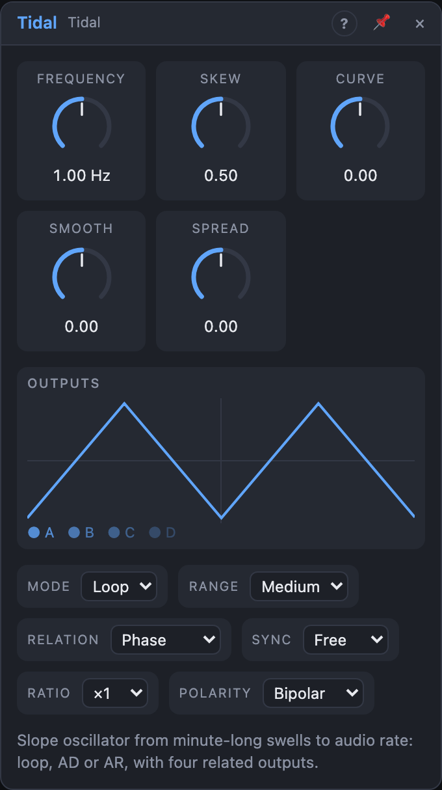

# Tidal

## Introduction

Tidal is a **slope generator**: a voltage that rises and falls, again and
again. Slow, it's a swell that takes minutes; medium, it's an LFO; fast, it's
a tone you can hear. Trigger it and it becomes an envelope.

One knob, *Skew*, decides how the cycle is split between rising and falling,
*Curve* bends the slopes, and *Smooth* either rounds everything into a
sine-like curve or folds it into a bright, many-peaked contour. Four outputs
carry four related versions of the same slope, so one Tidal can move four
things in a pattern that belongs together.

## How does it work?

**One cycle** is a rise and a fall. *Frequency* sets how many cycles per
second; *Range* picks the knob's span: *Slow* (one cycle per 1000 s up to
1 Hz), *Medium* (0.02–50 Hz) or *Audio* (8 Hz – 8 kHz, C4 at the centre).
The *Pitch* input adds octaves (1 V/oct), so in the Audio range Tidal plays
in tune.

**Skew** is the share of the cycle spent rising. At 50 % it's a triangle; at
0 % a falling saw, at 100 % a rising saw. The total time stays the same. In
the Audio range Skew stops just short of the ends, so the wave never jumps
vertically.

**Curve** bends both slopes: −1 logarithmic (quick start, slow arrival), 0
straight, +0.5 a round cosine (a sine-like wave at Skew 50 %), +1
exponential (slow start, quick arrival).

**Smooth** below 0 passes each output through a gentle low-pass that follows
the cycle rate: at −1 every shape becomes an almost pure sine, and Tidal
restores its full level once per cycle so the swing doesn't shrink. Above 0
it **folds**: the slope is amplified and mirrored back into range each time
it hits an edge. At +1 a triangle turns into seven peaks per cycle: busy
contours at LFO rates, rich tones at audio rate.

### Modes

- **Loop:** cycles all the time. A rising edge on *Trig* restarts the cycle.
- **AD:** waits at 0. A rising edge on *Trig* plays one rise and one fall,
  then *End* fires. A new trigger during the fall rises again from where the
  level is, without a jump.
- **AR:** rises while *Trig* is high, holds at the top, and falls when it
  goes low, from wherever the level is. Rise time is Skew ÷ Frequency, fall
  time the rest.

AD and AR are always unipolar (0 … 1). In Loop, *Polarity* chooses −1 … +1 or
0 … 1.

### The four outputs

*A* is the main slope. *B*, *C* and *D* follow it as *Relation* says, and
*Spread* sets how far apart they are (at 0 all four are the same):

- **Phase:** each output is shifted along the cycle. At +1 the four are a
  quarter cycle apart (0°, 90°, 180°, 270°); negative Spread shifts the other
  way. In AD/AR the envelopes start one after another instead, a quarter of
  the slope's length apart at ±1.
- **Level:** the outputs get quieter: B at two thirds, C at a third, D at
  nothing for Spread ±1. Below 0, B and D are also upside down: a fan that
  alternates.
- **Ratio:** rhythmic ratios that come back together. Spread picks a set
  (the knob shows it): 2 · 3 · 4, then 3/2 · 2 · 3, 4/3 · 3/2 · 2,
  5/4 · 3/2 · 7/4, 5/3 · 7/4 · 9/4, faster on the right, the slower
  reciprocals on the left. All four restart together whenever their pattern
  repeats (for 4/3 · 3/2 · 2: every 6 cycles of A).
- **Harmonic:** frequency ratios. At +1 B, C and D run 2, 3 and 4 times as
  fast as A (overtones), at −1 at ½, ⅓ and ¼ (undertones). In between the
  ratios are uneven and the outputs slowly drift against each other.

In AD and AR, *Ratio* and *Harmonic* change each output's length instead: an
output at ratio 2 is an envelope half as long. One trigger, four accents.

### Timing

- **Free:** Frequency and Pitch, modulated every sample (smooth FM).
- **Sync:** one cycle per note value (1/32T … 8 bars). While the transport
  plays, the cycle is locked to the song position: always at the same point
  at the same bar, even after a loop jump, and the Ratio and Harmonic
  outputs lock with it. *Pitch* still shifts the speed in whole octaves (+1:
  two cycles per note value).
- **Clock:** patch a clock into *Clock* and Tidal measures its tempo
  (averaging the last four pulses) and runs at *Ratio* × the clock. For ×2
  and faster the cycle restarts on every pulse, for ÷2 and slower on every
  n-th pulse, so it stays in step. After a pause the measurement starts
  again instead of jumping to a wild rate. The Frequency knob then shows the
  ratio and the measured BPM. Clock wins over Sync, Sync over Frequency.

*Rise* is high while A rises. *End* fires when A finishes a cycle (Loop) or
reaches 0 (AD, AR). Both come from A before smoothing, so they're on time
even when Smooth delays the curve.

## How to use it?

- **Slow swell:** Range *Slow*, Frequency to a few minutes per cycle, A onto
  a filter's cutoff. Skew 80 % for long rises and quicker falls.
- **Circular motion:** Relation *Phase*, Spread +1, Curve +0.5: A and B are
  a sine and a cosine. Patch them to two pans, or A to a filter and C (the
  opposite) to a reverb send.
- **Polyrhythm:** Relation *Ratio*, Sync 1 bar, Spread at 4/3 · 3/2 · 2:
  four modulations that meet again every six bars.
- **Accent pattern:** Mode *AD*, Relation *Harmonic*, Spread +1, one trigger
  from a sequencer: four envelopes of four lengths onto four VCAs.
- **Oscillator:** Range *Audio*, *Pitch* from a sequencer or *Voice In ›
  Pitch*, A into a VCA's audio input. Turn Skew for saw-to-triangle, Smooth
  up for folded overtones, down for a pure sine.
- **Clocked LFO:** a sequencer's clock into *Clock*, Ratio ÷4: one cycle per
  bar that follows tempo changes and a manual clock.

## Reference

### Knobs

| Knob | Range | Default |
|---|---|---|
| Frequency | Slow 0.001–1 Hz, Medium 0.02–50 Hz, Audio 8 Hz – 8 kHz | 1 Hz (Medium) |
| Skew | 0 – 100 % | 50 % |
| Curve | −1 … +1 | 0 |
| Smooth | −1 … +1 | 0 |
| Spread | −1 … +1 | 0 |

Every knob is a modulation destination. Changing *Range* keeps the knob's
position and the cycle's phase.

### Settings

| Setting | Values | Default |
|---|---|---|
| Mode | AD, Loop, AR | Loop |
| Range | Slow, Medium, Audio | Medium |
| Relation | Ratio, Phase, Level, Harmonic | Phase |
| Sync | Free, 8 bars … 1/32T (straight, dotted, triplet) | Free |
| Ratio | ÷16, ÷8, ÷6, ÷4, ÷3, ÷2, ×1, ×2, ×3, ×4, ×6, ×8, ×16 | ×1 |
| Polarity (Loop) | Bipolar, Unipolar | Bipolar |

### Inputs

| Input | Signal | What it does |
|---|---|---|
| Trig | gate | AD: starts a slope. AR: high rises and holds, low falls. Loop: a rising edge restarts the cycle |
| Clock | trigger | follow this clock at *Ratio* |
| Pitch | pitch | added to Frequency in octaves |

### Outputs

| Output | Signal | What it does |
|---|---|---|
| A | control | the main slope |
| B, C, D | control | related slopes (*Relation*, *Spread*) |
| Rise | gate | high while A rises |
| End | trigger | A finished a cycle or reached 0 |
