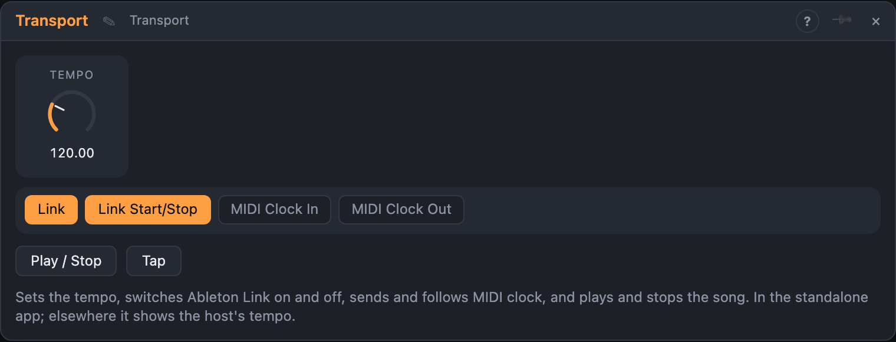

# Transport

## Introduction

Transport is the control panel for the song's clock. Set the tempo, switch
**Ableton Link** on or off, send **MIDI clock** to a drum machine, follow the
MIDI clock of another device, and start and stop the song from the module's
buttons, from cables or from incoming MIDI. Everything on the board that keeps
time (sequencers, delays, LFOs) follows what Transport sets.

Transport changes the clock in the **standalone app**. In Live the host's own
transport leads, and in the browser there is none: there it still sends MIDI
clock and shows the tempo, but cannot change it.

## How does it work?

**Tempo.** Move *Tempo* to set it. With *Tap*, tap a few times in the beat you
want. The tempo stays what you set; loading a board does not change it, so a
project keeps its own tempo. With Link on, the tempo is shared with the other
Link apps and devices, and they can change it too.

**Link.** *Link* turns Ableton Link on or off. Playing and
stopping is always shared with the other Link apps. Link needs an app built with it; without,
the switch has no effect and the app runs on its own clock.

**MIDI clock out.** With *MIDI Clock Out* on, Transport sends 24 pulses per beat
while the song plays, plus Start when it begins at the beginning, Continue when
it resumes anywhere else, and Stop. Patch *MIDI Out* into a MIDI Out module.

**MIDI clock in.** With *MIDI Clock In* on, patch a MIDI In or MIDI Device
module's *Notes* into *MIDI In*. Transport measures the incoming clock and sets
the tempo from it; it settles after about a beat and follows changes within a
bar. Start, Continue and Stop from the device start and stop your song. This
sets the tempo, but does not line up the beats exactly: for that, use Link.

**Play and Stop.** The *Play* button starts a stopped song and lights up while it
plays; the *Stop* button stops it. A trigger in *Play* starts a
stopped song from the beginning, a trigger in *Stop* stops it. Patch a Button
or a pad to either.

## How to use it?

- **Tempo on a knob:** put a Dial on the *Tempo* knob's input (or play with the
  knob itself).
- **Drum machine follows you:** *MIDI Clock Out* on, *MIDI Out* → MIDI Out
  (the drum machine's port). Start your song and the machine starts with it.
- **You follow the drum machine:** *MIDI Clock In* on, its MIDI Device's
  *Notes* → *MIDI In*. Press play on the machine.
- **Tap tempo:** press *Tap* to the beat, four times or more.
- **Footswitch:** a MIDI Device's gate or a Button into *Play* and *Stop*.
- **A lamp that shows the song runs:** *Playing* into a Level Meter or a light.
- **Tempo-linked effects:** *Tempo* into a control input (BPM / 100: 120 BPM is 1.2).

Do not connect the module's *MIDI Out* back into its own *MIDI In* with both
clock settings on: that makes a loop.

<!-- generated:demos -->
## Demo patches

Five whole patches show what Transport does. In the standalone app open **File → Presets…** (⌘P) and pick *Transport* under *Demos by module*; on the website, **Run in Play** opens one in your browser. Loading one replaces the project and starts the transport.

| Patch | What it shows |
|---|---|
| **Transport: Playing Gate Pad** | The Transport's Playing output is high whenever the song runs, and here it opens an envelope that slowly fades in a warm pad under a beat, then lets it ring out when you press Stop. Move the Tempo knob to change the speed of everything, or press Stop and Play to hear the pad breathe in and out. |
| **Transport: Tempo Brightness** | The Tempo output carries the speed as a control value (BPM divided by 100) and here it also sets the cutoff of a filter on an arpeggio, so a faster song is automatically a brighter one. Drag the Tempo knob up and down and listen to the tone follow the speed. |
| **Transport: Tempo Ride** | A very slow LFO is patched into the Tempo knob, so the whole song speeds up and slows down by a few BPM over about a minute like a band pushing and pulling. Lower the cable amount on the LFO, or unpatch it to hold the tempo steady. |
| **Transport: MIDI Clock Out Groove** | MIDI Clock Out is switched on, so while this groove plays the Transport also sends clock, start and stop to a connected MIDI Out, keeping outboard gear in time with it. You will hear a driving bass line over a four-on-the-floor kick; use Tap to set the tempo. |
| **Transport: Link Session Arp** | Link is switched on, so this song shares its tempo and start with any other Link-enabled app on the network, while a dreamy arpeggio and a soft beat play. Turn Link off to go solo, or use MIDI Clock In to follow a drum machine instead. |
<!-- /generated -->

## Reference

### Knobs, settings and buttons

| Control | Range | Default |
|---|---|---|
| Tempo | 20 … 400 BPM | 120 |
| Link | Off, On | On |
| MIDI Clock In | Off, On | Off |
| MIDI Clock Out | Off, On | Off |
| Play | button | |
| Stop | button | |
| Tap | button | |

If the board also has a *Link* node, its *Start/Stop Sync* setting decides.

### Inputs

| Input | Signal | What it does |
|---|---|---|
| Play | trigger | Starts the song from the beginning |
| Stop | trigger | Stops the song |
| MIDI In | notes | The MIDI clock to follow (MIDI Clock In) |

### Outputs

| Output | Signal | What it does |
|---|---|---|
| MIDI Out | notes | MIDI clock, Start, Continue and Stop (MIDI Clock Out) |
| Playing | gate | High while the song runs |
| Tempo | control | The tempo in BPM divided by 100 (120 BPM is 1.2) |
