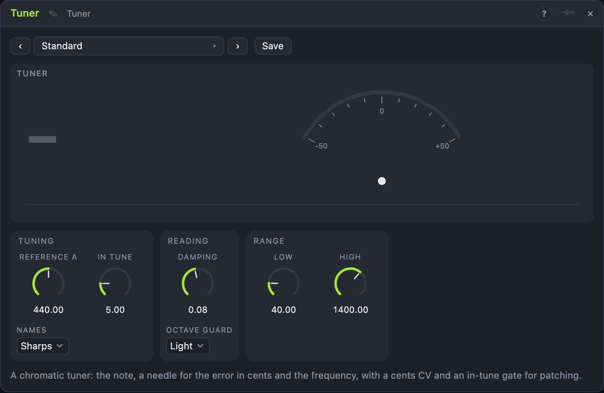

# Tuner

## Introduction

The Tuner shows **which note** a sound is and **how far** from it, in cents (one
hundredth of a semitone). Patch an instrument, a voice or an oscillator into *In*:
a large note name, a needle, the heard frequency and the frequency it should be
appear in the view. A green needle means in tune.

It also works as a **module in a patch**: *Cents* is the error as a CV, *In Tune* a
gate that is high while the note is within the window, and *Pitch* the V/oct of
what it hears.

## How does it work?

The module uses the same pitch tracker as the *Pitch Follower* and the *Pitch
Snap*, with a vote of three and a firm confidence, so only a clear, steady tone is
shown. The heard frequency is turned into the nearest note of equal temperament
around the **Reference A** and the error in cents.

- **Reference A** sets the pitch of A4: 440 Hz is concert pitch; 415 is a semitone
  lower for period instruments; 442 is common for orchestras.
- **In Tune** is the window in cents around the note that counts as in tune. The
  gate opens when the sound has stayed inside it for 60 ms and closes when it
  leaves a window 1.4 times as wide, so a note on the edge does not flicker.
- **Damping** smooths the reading. A long time gives a calm needle; a short one
  shows every vibrato. A new note, more than 60 cents away from the old one,
  shows at once.
- **Low** and **High** limit the range (as in the Pitch Follower: a lower *Low*
  makes the answer slower).
- **Octave Guard** keeps one stray octave estimate from showing up on the
  needle.
- **Names** chooses sharps or flats for the display.

When the sound stops the last note stays on the screen, dimmed.

## How to use it?

- **Tune an instrument:** patch it into *In*, pluck a string and turn the peg until
  the needle is green. Use *Guitar*, *Bass Tuner* or *Violin and Voice* for
  a range that fits.
- **Tune a synth by ear:** put an oscillator into *In* and adjust its fine
  tune until *In Tune* lights.
- **Patch the result:** *Cents* into a VCA or a light: it moves with the error.
  *In Tune* can fire a trigger once a note is right.
- **Watch a vibrato:** *Fast Needle* and the history strip below the needle.

<!-- generated:demos -->
## Demo patches

Five whole patches show what Tuner does. In the standalone app open **File → Presets…** (⌘P) and pick *Tuner* under *Demos by module*; on the website, **Run in Play** opens one in your browser. Loading one replaces the project and starts the transport.

| Patch | What it shows |
|---|---|
| **Tuner: Tuning Game** | A pure tone drifts slowly sharp and flat of a note; each time it slides through the In Tune window the Tuner's gate strikes a soft bell, so you can hear the moment it is right. Widen In Tune for more bells per sweep, or narrow it to catch only the exact centre. |
| **Tuner: Detune Pan** | Two saw voices a fifth apart share a pad; the upper one wanders in pitch and the Tuner's Cents output pans it and opens a filter, so how sharp or flat it is becomes the movement. Try a wider Damping for lazier motion, or invert the cable amounts. |
| **Tuner: Drift Chime** | A drone pair floats in pitch, and whenever one voice passes through tune the Tuner strikes a mallet voice that plays the note it is hearing, a fifth up, into a long reverb. Change Reference A to shift where the chime lands, or raise In Tune for a busier shimmer. |
| **Tuner: Gated Octave** | A pluck line slowly slips out of tune and back; the Tuner follows its pitch and re-pitches a second voice an octave up, which only sounds while the line is in tune. Make In Tune smaller for shorter, rarer answers, or shorten Damping for a quicker tracker. |
| **Tuner: Baroque Pitch** | A melody is played a semitone low, and the Tuner's Reference A is set to 415 so it reads each note as exactly in tune, ticking a hi-hat on every sure note. Move Reference A away from 415 and the ticks stop; at 440 the whole line reads flat. |
<!-- /generated -->

<!-- generated:presets -->
## Presets

The preset bar of the Tuner view has 11 factory presets. Pick one to set the knobs, then change them to taste; your own presets sit next to them.

| Preset | What it does |
|---|---|
| **Standard** | Concert pitch, A = 440 Hz. |
| **Baroque 415** | A = 415 Hz, a semitone lower, for period instruments. |
| **Bright 442** | A = 442 Hz, as many orchestras tune. |
| **Warm 432** | A = 432 Hz. |
| **Bass Tuner** | Low range for bass strings; slower and steadier. |
| **Guitar** | Six strings and a tight in-tune window. |
| **Violin and Voice** | High range for strings and singers, with a forgiving window. |
| **Strict** | Only within two cents counts as in tune. |
| **Loose** | A wide window for a quick check of a rough sound. |
| **Slow Needle** | The needle takes its time and hardly twitches. |
| **Fast Needle** | Shows every movement at once, e.g. to watch a vibrato. |
<!-- /generated -->

## Reference

### Knobs

| Knob | Range | Default |
|---|---|---|
| Reference A | 400 – 480 Hz | 440 Hz |
| In Tune | 1 – 25 ct | 5 ct |
| Damping | 10 – 600 ms | 80 ms |
| Low | 25 – 400 Hz | 40 Hz |
| High | 200 – 4000 Hz | 1400 Hz |

### Settings

| Setting | Values | Default |
|---|---|---|
| Names | Sharps, Flats | Sharps |
| Octave Guard | Off, Light, Firm | Light |

### Inputs

| Input | Signal | What it does |
|---|---|---|
| In | audio | the sound to tune |

### Outputs

| Output | Signal | What it does |
|---|---|---|
| Cents | control | the error, −1…+1 for −50…+50 cents |
| In Tune | gate | high while the note is within the *In Tune* window |
| Pitch | pitch | the smoothed pitch in V/oct, held while nothing is heard |

## Origin

Pitch detection is shared with the Pitch Follower (the published difference-function method, written for this project); the note arithmetic is plain equal temperament. No source code was ported.
