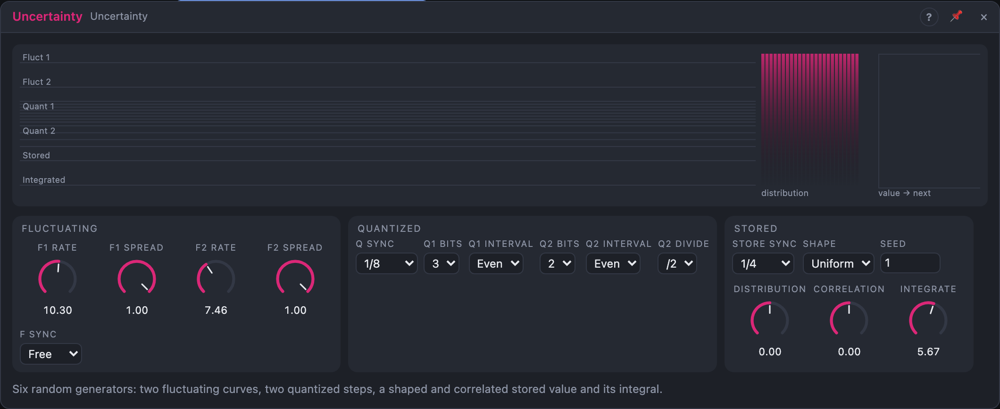

# Uncertainty

## Introduction

Uncertainty is six random generators in one module, each with a different
character: two **Fluctuating** voltages that wander continuously, two
**Quantized** voltages that jump between a few levels, a **Stored** value
whose distribution you can skew and whose values can depend on each other,
and an **Integrated** voltage that turns the stored values into random
slopes. Whenever something in a patch should move unpredictably, one of
these six probably fits.

## How does it work?

**Fluctuating 1 and 2** are smooth curves through random points. In Free mode
the points come on average every 1 / *Rate* seconds, irregularly spaced so
there is no audible pulse. With *F Sync* on a note value and the transport
playing, the points sit on the grid and the curve is a function of the song
position. *Spread* sets the size. The two have different default rates, so
they rarely move together.

**Quantized 1 and 2** jump on each clock to one of 2, 4, 8 or 16 levels
(*Bits* 1 … 4). With *Interval Even* the levels spread evenly over 0 … 1
(1 bit is a random on/off voltage). With an interval in semitones each level
is that many semitones above the last: 3 bits with 7 semitones jumps between
eight notes a fifth apart. Few levels give a small vocabulary the ear hears as
a pattern. Quantized 2 has its own *Clock Q2* input; while it's unpatched it
follows Quantized 1's clock divided by *Q2 Divide*.

**Stored** takes a new value on each *Store* event. Three controls shape it:

- **Correlation:** how much each value depends on the previous one. 0 %:
  independent. Positive: each value stays near the last, a slow stepped
  wander. Negative: values alternate high and low, a zig-zag. The overall
  spread of values stays the same.
- **Shape:** *Uniform*, *Bell* (values gather in the middle) or *Edges* (values
  are pushed outward).
- **Distribution:** skews the values toward the top (+) or the bottom (−).

**Integrated** uses Stored as a slope: it rises while Stored is positive and
falls while it's negative, at a speed set by *Integrate*, and bounces back
from ±1. The result is a line that changes direction and speed at every Store
event. With positive Correlation it makes long sweeps; with negative
Correlation it trembles around a point.

**Clocks.** Each clock follows its input when patched, else the song position
when its *Sync* is on a note value (at the synced length while the transport
is stopped), else its *Rate*. A synced Fluctuating curve holds while the
transport is stopped.

**Repeatable.** Every value comes from *Seed*. Synced generators are a
function of the song position and render the same from any start; the free
ones and Integrated render the same from the same start.

## How to use it?

- **Slow, organic movement:** *Fluct 1* and *Fluct 2* to two filter cutoffs or
  pans.
- **A small random melody:** *Quant 1* with *Q1 Interval* 2 semitones and
  3 bits into an oscillator's pitch, *Q Sync* 1/8.
- **Random octaves:** *Q2 Interval* 12, *Q2 Bits* 2.
- **A random on/off switch:** 1 bit on Quantized 2, *Q2 Divide* /4.
- **A drifting value per note:** inside a Voice Cell, *Voice In › Trigger* into
  *Store*, *Correlation* +80 %: each note's value is near the last one.
- **Random sweeps:** *Integrated* to a filter cutoff, *Correlation* +60 %.

## Demo patches

Five whole patches show what Uncertainty does. In the standalone app open **File → Presets…** (⌘P) and pick *Uncertainty* under *Demos by module*; loading one replaces the project and starts the transport.

| Patch | What it shows |
|---|---|
| **Uncertainty: Random Melody** | *Quant 1* with *Q1 Bits* 3 and *Q1 Interval* 2 st, snapped to D minor pentatonic by a quantizer, plays an endless random tune. |
| **Uncertainty: Drifting Pad** | *Fluct 1* and *Fluct 2* at different rates move the filters, waveforms and pans of a four-voice pad. |
| **Uncertainty: Random Sweeps** | *Stored* with *Correlation* +65 % feeds *Integrated*, a random sweep on the cutoff of an arpeggio; a one-bit *Quant 2* switches the hats. |
| **Uncertainty: Random Octaves** | *Q2 Interval* 12 st sends a fixed riff to random octaves and a one-bit *Quant 1* at 7 st adds fifths. |
| **Uncertainty: Drunken Walk** | *Stored* with *Correlation* +85 % and *Shape* Bell wanders pitch step by step; a quantizer and pinged gates turn it into bells. |

## Reference

### Knobs and settings

| Control | Range | Default |
|---|---|---|
| F1 Rate, F2 Rate | 0.01 – 20 Hz | 0.5 Hz, 0.17 Hz |
| F1 Spread, F2 Spread | 0 – 100 % | 100 % |
| Q Rate | 0.05 – 40 Hz | 2 Hz |
| Store Rate | 0.05 – 40 Hz | 1 Hz |
| Distribution | −100 … +100 % | 0 % |
| Correlation | −95 … +95 % | 0 % |
| Integrate | 0.01 – 10 /s | 0.5 /s |
| F Sync | Free, 1/32 … 8 bars | Free |
| Q Sync | Free, 1/32 … 8 bars | 1/8 |
| Store Sync | Free, 1/32 … 8 bars | 1/4 |
| Q1 Bits, Q2 Bits | 1 – 4 | 3, 2 |
| Q1 Interval, Q2 Interval | Even, 1, 2, 5, 7, 12 st | Even |
| Q2 Divide | /1, /2, /3, /4, /8 | /2 |
| Shape | Uniform, Bell, Edges | Uniform |
| Seed | 0 – 999 | 1 |

- **F Rate:** the average number of points per second of a Fluctuating curve
  (Free mode). Changing it stretches the curve; it never jumps.
- **F Spread:** the size of a Fluctuating output.
- **Q Rate / Store Rate:** the free clocks of Quantized 1 and Stored (shown
  while their *Sync* is *Free*).
- **Distribution, Correlation, Shape:** shape Stored (see above).
- **Integrate:** the speed of Integrated per unit of Stored.
- **Bits:** 2^Bits levels. **Interval:** Even spreads them over 0 … 1;
  semitones stack them at 1 V/oct.
- **Q2 Divide:** while *Clock Q2* is unpatched, Quantized 2 steps on every
  n-th step of Quantized 1.
- **Seed:** one seed; each generator has its own stream of it.

All knobs are modulation destinations.

### Inputs

| Input | Signal | What it does |
|---|---|---|
| Clock Q1 | trigger | each pulse steps Quantized 1 |
| Clock Q2 | trigger | each pulse steps Quantized 2; unpatched: Quantized 1's clock / *Q2 Divide* |
| Store | trigger | each pulse takes a new Stored value |

### Outputs

| Output | Signal | What it does |
|---|---|---|
| Fluct 1, Fluct 2 | control, −1 … +1 | continuously wandering voltages |
| Quant 1, Quant 2 | control (0 … 1, or 1 V/oct) | stepped random on 2^Bits levels |
| Stored | control, −1 … +1 | the stored value |
| Integrated | control, −1 … +1 | random slopes from the stored values |
| Store Trig | trigger | a pulse when Stored takes a new value |
