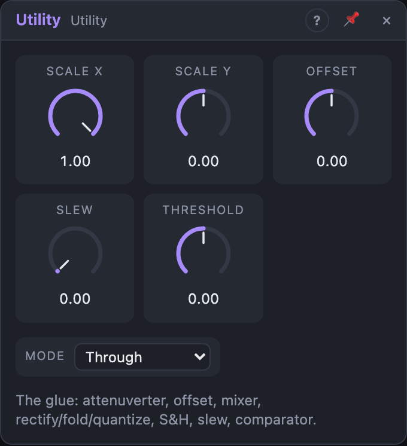

# Utility

## Introduction

Utility is the glue between modules. It scales, inverts, offsets and mixes
control signals, then shapes the result: rectify, fold, quantize to semitones
or sample and hold. It can smooth the result with a slew and turn it into a gate
with a comparator. Whenever a signal is almost what you need, put a Utility in
between.

## How does it work?

The signal passes through four stages, in this order:

1. **Mix:** X × *Scale X* + Y × *Scale Y* + *Offset*. The scales are
   attenuverters: +1 passes the input unchanged, 0 mutes it, −1 inverts it.
2. **Mode:** one shaping function (see *Mode* below).
3. **Slew:** a smoothing filter that limits how fast the value can change.
4. **Outputs:** *Out* is the result, *Inv* is the same value inverted,
   and *Gate* is high while *Out* is above *Threshold*.

With nothing patched, *Out* is simply the *Offset*: a constant you can set by
hand or modulate.

## How to use it?

- **Attenuate or invert:** patch a signal into *X* and set *Scale X*. At −1
  an LFO runs the other way.
- **Unipolar from bipolar:** an LFO running −1 … +1 into *X*, *Scale X* 0.5,
  *Offset* 0.5 gives 0 … 1.
- **Mix two modulators:** one into *X*, one into *Y*, and balance them with
  the two scales.
- **Quantized melodies:** feed a slow random or LFO into *X*, choose
  *Quantize*, and patch *Out* into an oscillator's *Pitch*.
- **Sample and hold:** patch noise or an LFO into *X*, a clock into *Clock*,
  and choose *Sample & Hold* for stepped values on each clock.
- **Portamento and smoothing:** raise *Slew* to round off steps from a
  sequencer or Random. For pitch that gives glide.
- **Wavefolding:** choose *Fold* and push the level with *Scale X* or *Offset*
  beyond ±1. Folding turns a simple LFO into a complex shape.
- **Gates from control signals:** use *Gate* with a *Threshold*. An LFO into
  *X* becomes a square gate; an envelope follower becomes a trigger when a
  sound gets loud.

## Reference

### Knobs and settings

| Control | Range | Default |
|---|---|---|
| Scale X | −1 … +1 | +1 |
| Scale Y | −1 … +1 | 0 |
| Offset | −1 … +1 | 0 |
| Slew | 0 – 5 s | 0 s |
| Threshold | −1 … +1 | 0 |
| Mode | Through, Rectify, Fold, Quantize, Sample & Hold | Through |

- **Scale X:** gain for the *X* input. Negative values invert it.
- **Scale Y:** gain for the *Y* input. It starts at 0, so *Y* does nothing
  until you turn it.
- **Offset:** a constant added to the mix. Shifts a signal up or down, or acts
  as a manual control on its own.
- **Slew:** smoothing time (a one-pole lag). The output covers about two thirds
  of a jump in this time. 0 is instant. The knob's centre is 100 ms.
- **Threshold:** the level *Out* must exceed for *Gate* to go high.
- **Mode:** how the mixed signal is shaped before the slew:
  - *Through:* unchanged.
  - *Rectify:* the absolute value; negative parts flip up. An LFO becomes a
    bouncing shape at twice the rate.
  - *Fold:* anything beyond ±1 is reflected back inside, again and again. More
    input level means more folds.
  - *Quantize:* rounded to steps of 1/12: semitones at 1 V/oct.
  - *Sample & Hold:* the value is taken on each rising edge at *Clock* and held
    until the next.

*Scale X*, *Scale Y*, *Offset*, *Slew* and *Threshold* are modulation
destinations. Modulating *Scale X* from an envelope makes a simple VCA for
control signals.

### Inputs

| Input | Signal | What it does |
|---|---|---|
| X | control | first input, scaled by *Scale X* |
| Y | control | second input, scaled by *Scale Y* |
| Clock | gate | rising edges sample the signal in *Sample & Hold* mode |

X and Y take audio, pitch and control signals alike; they are just numbers.

### Outputs

| Output | Signal | What it does |
|---|---|---|
| Out | control | the result (limited to ±10) |
| Gate | gate | high while *Out* > *Threshold* |
| Inv | control | −*Out* |
