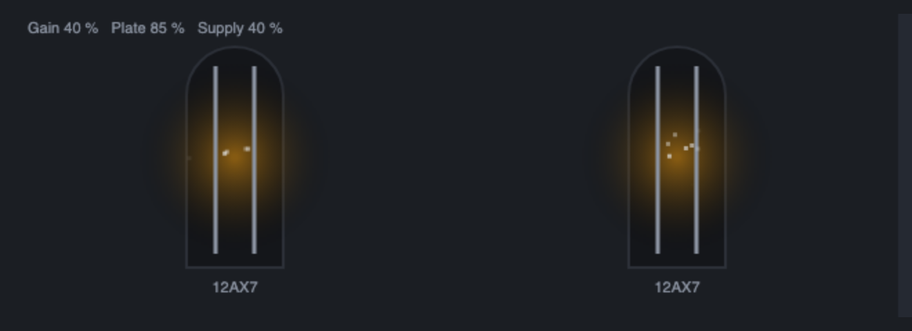

# Valve Stage



## Introduction

A tube amplifier stage is not a waveshaper in a box. It is a small circuit whose parts argue with each other: the tube's plate current, the load on its plate, the capacitor between it and the next stage, the cathode resistor, the power supply that feeds all of it. Each of those has a time constant and a limit, so what comes out depends on how loud you play, how long you have played it and how fast the signal moves.

The Valve Stage models a cascade of **one to three** such stages, one after the other, with the things that make tubes sound like tubes:

- an **asymmetric transfer curve**: the plate current starts abruptly at cutoff and rises softly, the plate voltage bottoms out on the load line;
- **grid-current clipping**: when the signal drives the grid positive it conducts, which clips the positive peaks hard;
- **blocking**: that grid current charges the coupling capacitor, so for a moment after a loud peak the stage is biased colder, and quiet notes after a hit are weaker until the charge has leaked away;
- **Miller roll-off** whose corner falls with the gain of the stage;
- **cathode bypass**: a frequency-dependent gain, from flat to a bright, bass-light stage;
- a **sagging supply**: the louder you play, the lower the plate voltage, so the gain and the headroom shrink and recover over a fraction of a second;
- a **starved plate** that gives the stage the gated, sputtering, crackly sound of a tube run with too little voltage.

The module is stereo (In L / In R, Out L / Out R). The two channels share one power supply (a loud left channel sags the right as well).

## How does it work?

```text
In -> Gain -> [ Miller low-pass -> coupling capacitor and grid -> cathode -> tube -> plate load ] x 1..3
   -> DC block -> level compensation -> Mix -> Out
```

Each bracketed stage runs at twice the sample rate (Normal) or at the base rate (Eco). Between the stages, the signal is scaled so that each stage drives the next one a little harder than it was driven itself (by 2.5 times for the 12AX7, 3 times for the 12AU7).

**The tube.** The grid-to-cathode voltage is measured in units of the bias voltage, so that the quiescent point is 0 and cutoff is at -1. The voltage is soft-rectified (a smooth knee about 0.12 wide for the 12AX7, 0.22 for the 12AU7, 0.08 for the EL34) and the plate current is that value to the power 1.5, the Child-Langmuir law of a triode. A load line turns the current into a plate voltage: the voltage across the load is `z / (1 + z)` of the supply for a current-scaled value `z`, a soft knee, or for the pentode `z / (1 + z^4)^(1/4)`, a hard one. The stage's small-signal gain is set to 28 (12AX7), 9 (12AU7) or 14 (EL34). The polarity is corrected, so the module does not invert.

**The EL34 is a push-pull pentode power stage.** Two halves see opposite grid voltages and their plate voltages are subtracted, so the transfer is odd (even harmonics cancel) and the knee is hard. When the EL34 is chosen, the stages before the last are 12AX7 drivers, and the last is the power stage. On its own (Stages = 1) its input is scaled down, so you will want more Gain.

**Grid and coupling capacitor.** Each stage has a coupling capacitor that leaks to the signal's mean: a high-pass filter (about 2.5 Hz for the first stage, 6 to 10 Hz for the others). When the grid voltage passes the conduction point, the excess is turned into grid current. That current clamps the grid (a hard-ish positive clip with a smooth start) and charges the capacitor. The charge decays through the same high-pass, so the stage takes tens of milliseconds to recover. This is the blocking.

**Miller capacitance.** The input of every stage is a low-pass whose corner falls as the stage gain rises: about 90 kHz divided by `1 + 4 * miller * gain` for the first stage (60 kHz for the others), with a Miller factor of 0.12 (12AX7), 0.05 (12AU7) and 0.04 (EL34). A cascade of 12AX7 stages therefore loses its top end quickly; a 12AU7 hardly does. When the supply sags, the gain falls and the corner moves up.

**Cathode bypass.** The cathode voltage follows the plate current through a capacitor. What the capacitor cannot hold is negative feedback. **Bright** sets the capacitor: at 0 % it is large (corner 12 Hz) and the gain is flat; at 100 % it is small (corner 1.2 kHz) and the bass loses gain to the feedback while the top does not (an 8 kHz tone against an 80 Hz tone tilts by about 8 dB between 0 and 100 %), which also linearises the bass.

**Plate and Sag.** The **Plate** knob sets the supply voltage (35 % of nominal at 0 %, 100 % at 100 %) and, as it goes down, moves the bias towards cutoff and sharpens the knee. A low supply makes the load line steeper, so the stage compresses earlier; near cutoff low-level signals only cross the threshold on one side, which gates them. A random bias flicker (a new value about every 0.7 ms, bounded and seeded so that two renders are identical, different on the two channels) is added when the plate is starved: that is the crackle. **Sag** follows the output level (fast up, slow down) and lowers the supply by up to half of the nominal at Sag 100 % and a loud signal. The level compensation is done without the sag, so you can hear it.

**Level compensation.** At each block the module evaluates the static curve of the whole cascade for a -12 dBFS sine and sets the gain that brings it back to -12 dBFS. More Gain means more colour, not more volume. The weak and very loud ends are free to differ: that is what compression is.

**Turning knobs.** Gain, Bias, Plate, Bright and Sag are followed, not jumped to: the circuit takes about 40 ms to arrive at a new setting, so turning a knob (or sweeping it with a cable) makes no zipper noise or clicks. Tube, Stages and Quality cannot be followed: when one changes, the input fades out over about 3 ms, the new circuit starts from rest and the input fades back in over 5 ms.

## How to use it?

- **Warm a DI bass:** 12AX7, 1 stage, Gain 30 %, Plate 90 %, Sag 20 %, Bright 10 %. The even harmonics come in as you play harder; the bass stays full.
- **Classic crunch:** 12AX7, 2 stages, Gain 55 %, Bias 0 %, Plate 85 %, Sag 35 %, Bright 30 %. The grid current clips the peaks and the second stage squares them off.
- **Clean-ish lead channel:** 12AU7, 2 stages, Gain 60 %, Bright 40 %. Less gain per stage, a bright top, odd and even harmonics in balance.
- **Power amp in the red:** EL34, 2 stages, Gain 70 %, Sag 60 %, Plate 90 %. The driver pushes the push-pull pair: odd harmonics, a hard knee and a supply that gives way on hard hits.
- **Sputtery lo-fi synth:** 12AX7, 3 stages, Gain 60 %, Plate 15 %, Bias -30 %. At low levels it gates and crackles, louder notes open the stage up and clean it a little.
- **Blocking on a drum hit:** 12AX7, 1 stage, Gain 80 %, Sag 0 %. After a loud hit, listen to the quiet notes that follow: they come back over about a tenth of a second.
- **Parallel warmth:** Mix 35 %. The dry signal is delayed to match the oversampling.
- **CPU:** Eco runs the stages at the base rate: it is the cheapest, but a hard-driven cascade will alias. Normal runs them at twice the rate.

## The module's own UI

The Valve Stage shows **glowing tubes**, as many as the Stages knob says. The plate glows with the supply and dims in a brownout when the supply sags (Supply probe), blue-white sparks jump at the grid when it conducts (Grid probe), and a starved plate sputters orange sparks. **Click** a tube to cycle the tube type; **drag** a tube up or down to set Gain. The file is `src/valve-stage.view.js`.

Tricks it demonstrates:

- a fixed pool of particles, allocated once and reused, so a busy picture creates no garbage per frame;
- telling a click from a drag by how far the pointer moved before it was released;
- setting a choice knob by its index (`tube.set(i)`) and reading its names from `choices`;
- hit testing by dividing the canvas into one slot per tube;
- driving effects from several probes at once (supply, grid, level) and from knob values (Plate, Stages).

## Reference

### Inputs and outputs

| Jack | Type | Meaning |
| --- | --- | --- |
| In L | audio | Left input. |
| In R | audio | Right input. With Input set to Auto, nothing patched here means the left input feeds both channels. |
| Out L | audio | Left output. |
| Out R | audio | Right output. |

### Knobs

| Knob | Range | Default | Meaning |
| --- | --- | --- | --- |
| Tube | 12AX7, 12AU7, EL34 | 12AX7 | The tube. High gain and soft knee; low gain and clean; push-pull pentode power stage. |
| Stages | 1 to 3 | 2 | How many stages are cascaded. |
| Gain | 0 to 100 % | 40 % | The level into the first grid, -12 dB to +20 dB (the 12AU7 and a single EL34 are scaled down). |
| Bias | -100 to +100 % | 0 % | Bias point. Cold (negative) sits near cutoff; hot (positive) sits near grid current. |
| Plate | 0 to 100 % | 85 % | Plate voltage. Low is starved: less gain, more compression, gating and crackle. |
| Sag | 0 to 100 % | 30 % | How far the supply gives way under a loud signal. |
| Bright | 0 to 100 % | 25 % | Cathode bypass: flat (0 %) to bass-light and bright (100 %). |
| Output | -24 to +12 dB | 0 dB | Output level after the level compensation. |
| Mix | 0 to 100 % | 100 % | Dry against processed. |
| Input | Auto, Stereo, Mono | Auto | Where the right channel gets its signal. |
| Quality | Eco, Normal | Normal | Base rate or 2 times oversampling. |

### Probes

| Probe | Meaning |
| --- | --- |
| Supply | How much of the supply voltage is left (1 is full). |
| Grid | How far the first coupling capacitors have been charged by grid current (0 to 1). |
| Level | The output level (average, scaled so that a loud signal reads near 1). |

### Numbers worth knowing

- Cost: about 149,000 operations per 32-sample chunk at the heaviest setting (3 stages, 2 times oversampling); the checker warns above 60,000 and refuses above 400,000. A 4 times mode did not fit under 150,000.
- With the 12AX7, 2 stages, Gain 40 %, a 1 kHz tone has its second harmonic at -41 dBc at -40 dBFS and at -13 dBc at -12 dBFS (the third stays 30 to 40 dB lower until the peaks start to clip); the fundamental's gain falls from -1.9 dB at -12 dBFS to -8.0 dB at -1 dBFS (the output is compensated at -12 dBFS).
- Top roll-off at 12 kHz against 500 Hz, Bright 0 %, small signal: 12AX7 two stages -14 dB, 12AU7 two stages -1 dB; one 12AX7 stage -6 dB, three -23 dB.
- Aliasing, Normal, a 7 kHz tone at -6 dBFS: -63 dBc of non-harmonic energy at Gain 30 % (two stages), -61 dBc for one stage at Gain 60 %, -50 dBc for two cascaded stages at Gain 60 % (two hard clippers in a row). Eco has no oversampling and is about -19 dBc in that last case.
