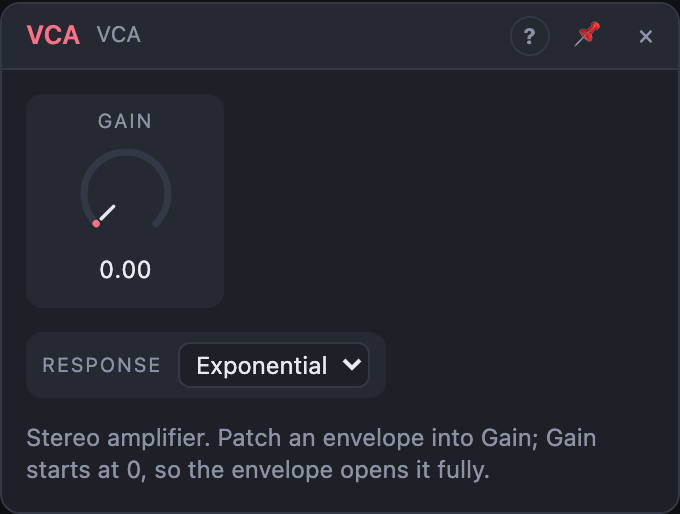

# VCA

## Introduction

A VCA (voltage-controlled amplifier) sets the volume of a signal. On its own
it's a stereo volume knob. Patch an envelope or an LFO onto its **Gain** and the
volume follows that signal. This is how a note gets its loudness shape, and how
tremolo and ducking work.

## How does it work?

Both channels are multiplied by the same gain:

    Out = In × gain

*Gain* is a 0 – 100 % knob. With the **Linear** response, gain is the knob
value. With **Exponential**, it is the value cubed: 50 % on the knob is
about −18 dB, and the bottom of the range fades smoothly toward silence. This
sounds more natural for fades and envelopes.

Gain starts at **0 %** (closed). Modulation adds to the knob, so an envelope
patched at 100 % amount opens the VCA from silence to full volume and closes
it again.

**Range** sets how far the amplifier can go: 100 % (the default), 200 % or
400 %. It multiplies the result, so the Gain knob and envelopes keep their
meaning (100 % on the knob, or a full envelope, is now 2× or 4× the input, up to
+12 dB). Use it to lift a quiet signal; mind the level after it.

If only *In L* is patched, it feeds both channels. A mono oscillator then comes
out on both sides.

## How to use it?

- **Note volume:** Oscillator *Out* → VCA *In L*; ADSR *Env* → VCA **Gain**
  knob. VCA *Out L/R* goes to Voice Out or an output port.
- **Tremolo:** turn Gain up to about 50 % and patch a Function (cycling) onto
  Gain with a small amount.
- **Ducking:** set Gain to 100 % and patch an envelope onto Gain with a
  *negative* amount: each trigger dips the volume.
- **Plain volume or mute:** use the knob without any cable.
- To shape a control signal instead of audio, use **Utility**. The VCA is
  built for audio.

## Reference

### Knobs and settings

| Control | Range | Default |
|---|---|---|
| Gain | 0 – 100 % | 0 % |
| Response | Linear, Exponential | Exponential |

- **Gain:** the amplification, from silence (0 %) to unity (100 %). The VCA
  never boosts. Patch envelopes and LFOs here; the ring around the knob shows
  the gain really used.
- **Response:** how the gain value maps to volume.
  - *Linear:* volume = gain. Good for amplitude modulation at audio rate and for
    signals that should stay proportional.
  - *Exponential:* volume = gain³ (about −60 dB to 0 dB). Fades and envelopes
    sound even, the way our ears expect.

### Inputs

| Input | Signal | What it does |
|---|---|---|
| In L | audio | left input; also feeds the right channel when *In R* is not patched |
| In R | audio | right input |

### Outputs

| Output | Signal | What it does |
|---|---|---|
| Out L | audio | left input × gain |
| Out R | audio | right input × gain |
