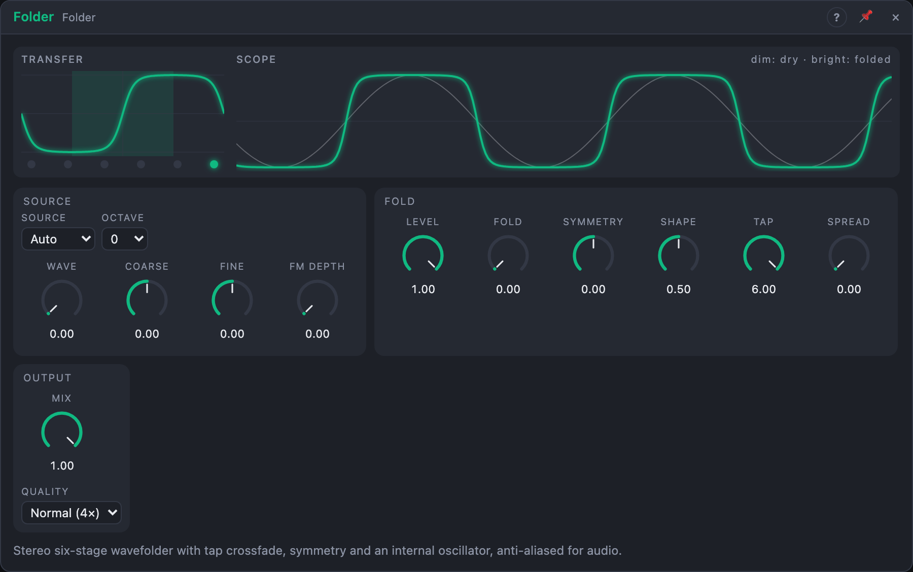

# Folder

## Introduction

The Folder is a stereo wavefolder: six folding stages in a row turn a simple
waveform into a rich, bright, vocal tone. Its *Fold* knob sweeps through the
harmonics the way a filter sweeps through a spectrum, only upwards.
*Symmetry* adds even harmonics, *Tap* chooses how many stages you hear. It is
anti-aliased, so deep folds on high notes stay clean. With a cable in *Pitch*
it plays its own sine/triangle oscillator, which makes it a complete
"west coast" voice on its own.

## How does it work?

**Folding.** When a signal goes past ±1, a folder reflects it back instead
of clipping it: a sine driven twice as hard comes back with a dip at each
peak, driven harder it folds again and again. Every fold adds harmonics.
*Shape* chooses the fold curve: at 0 % a soft fold (a sine curve, which
already rounds a full-scale signal a little), at 100 % a hard, mirror-like
fold that leaves signals within ±1 untouched.

**Stages.** The signal runs through six folders in a row. Each multiplies it
by the *Fold* gain (1× at 0 %, 4× at 100 %) before folding, so the folds
multiply from stage to stage. *Symmetry* adds an offset before the first
stage (and half of it before the second): the folds become lopsided and even
harmonics appear. *Tap* picks the stage you hear, 1 to 6; between two whole
numbers it crossfades the neighbouring stages, so modulating *Tap* opens the
sound from a gentle fold to a dense one without changing the level. Stages
after the tapped one are not computed.

**Anti-aliasing.** Folding creates harmonics far above the audible range;
without care they fold back down as inharmonic noise. The Folder runs the
stages at 4× the sample rate (*Normal*) or 2× (*Eco*), and each stage uses
antiderivative anti-aliasing, which smooths the corners. At *Normal* a C5
sine folded with *Fold* 100 % at *Tap* 2 keeps aliases about 84 dB below the
fundamental; very deep settings (high *Fold* at *Tap* 4–6) are meant to sound
like dense noise and do.

**Dry and DC.** *Mix* blends the dry signal back in; the dry signal is delayed
by the same 1.5 ms as the folded one, so the two stay in phase. A 5 Hz
high-pass on the outputs removes the offset that *Symmetry* creates.
*Symmetry* and *Level* changes are smoothed over 2 ms; *Fold* and *Tap* follow
audio-rate modulation.

**Internal oscillator.** With *Source* on *Auto*, a cable in *Pitch* and none
in *In L* turns on the oscillator: a sine (or, with *Wave*, a triangle) at
C4 × 2^(Octave + Pitch + Coarse/12 + Fine/1200), at ±1 into both channels.
*Internal* always uses the oscillator; *In L* then becomes its FM input.
*Input* always folds the inputs. Switching fades over 5 ms.

**Stereo.** *In R* unpatched: *In L* feeds both channels. *Spread* offsets
*Symmetry* (by ±Spread/2) and *Fold* (±10 %) between left and right, which
makes a mono source wide. A mono source with *Spread* at 0 is computed once.

## How to use it?

- **Complex oscillator voice:** Voice In *Pitch* → *Pitch*; an envelope onto
  *Fold*; *Out L* → VCA. *Wave* 0 % (sine) gives the classic sound.
- **Moving timbre:** a slow LFO onto *Symmetry* and another onto *Tap*.
- **FM plus folding:** set *Source* to *Internal*, patch another Oscillator
  into *In L* and raise *FM Depth*.
- **Brighten anything:** put it after an oscillator or a filter and use low
  *Fold* with *Mix* at 50 %.
- **Stereo width:** *Spread* 30–60 % on a mono source.
- **Tame hot sources:** lower *Level* rather than *Fold*: it changes how far
  the signal reaches into the folds.

<!-- generated:demos -->
## Demo patches

Five whole patches show what Folder does. In the standalone app open **File → Presets…** (⌘P) and pick *Folder* under *Demos by module*; on the website, **Run in Play** opens one in your browser. Loading one replaces the project and starts the transport.

| Patch | What it shows |
|---|---|
| **Folder: Complex Voice** | The Folder's internal sine, played from a sequencer's pitch, is folded harder as an envelope opens Fold: every note starts bright and metallic, then relaxes toward a pure tone. Change Fold, Symmetry or Tap for other timbres. |
| **Folder: Moving Bass** | A low sine from the Folder's own oscillator, with slow LFOs on Symmetry and Tap, turns from hollow to buzzy and back. Raise Fold for more teeth, or turn Octave up for a lead. |
| **Folder: Fold Bells** | An Oscillator patched into the Folder's input frequency-modulates its internal sine through FM Depth, then the result is folded: sparkling, bell-like tones with a quick decay. Raise FM Depth or Fold to turn bells to glass. |
| **Folder: Stereo Brightener** | An external plucked saw goes into the Folder with a gentle Fold and Mix at half: the folds add upper harmonics to the dry sound, and Spread opens it into stereo. Move Fold and Level to see how far into the folds the signal reaches. |
| **Folder: Folded Beat** | A whole drum loop passes through the Folder: kicks gain harmonics and snare and hats turn crunchy as Fold rises with a slow LFO. Pull Mix back for parallel crunch. |
<!-- /generated -->

<!-- generated:presets -->
## Presets

The preset bar of the Folder view has 13 factory presets. Pick one to set the knobs, then change them to taste; your own presets sit next to them.

| Preset | What it does |
|---|---|
| **Soft Fold** | Mild folding that adds a few bright harmonics. |
| **Classic Fold** | The classic folded-sine timbre. |
| **Hollow Fold** | Asymmetry adds even harmonics for a reedy sound. |
| **Vocal Folds** | Formant-like tone when the fold is swept. |
| **Metal Bright** | Deep folding: bright, metallic and inharmonic. |
| **Low Tap Tame** | Heavy fold but only the early stages, so it stays smooth. |
| **Wide Folder** | Spread decorrelates left and right: a mono source becomes wide. |
| **Internal Sine Lead** | Use the built-in oscillator; play it from Pitch. |
| **Triangle Fold** | Folded triangle from the internal oscillator: softer and rounder. |
| **FM Fold** | FM adds sidebands before the folder for glassy tones. |
| **Detuned Growl** | An octave down with asymmetric folding: a growling bass. |
| **Parallel Fold** | Folded signal mixed under the dry one. |
| **Eco Chaos** | Extreme settings with cheaper oversampling; aliasing is part of it. |
<!-- /generated -->

## Reference

### Knobs and settings

| Control | Range | Default |
|---|---|---|
| Fold | 0 – 100 % | 0 % |
| Symmetry | −100 … +100 % | 0 % |
| Tap | 1 – 6 | 6 |
| Shape | 0 – 100 % | 50 % |
| Spread | 0 – 100 % | 0 % |
| Level | 0 – 100 % | 100 % |
| Mix | 0 – 100 % | 100 % |
| Wave | 0 – 100 % | 0 % (sine) |
| Coarse | −24 … +24 st | 0 st |
| Fine | −100 … +100 ct | 0 ct |
| FM Depth | 0 – 100 % | 0 % |
| Source | Auto, Input, Internal | Auto |
| Octave | −3 … +3 | 0 |
| Quality | Eco (2×), Normal (4×) | Normal |

- **Fold:** the gain into each stage, 4^Fold (1× … 4×).
- **Symmetry:** offset before the folds: even harmonics, a reedy sound.
- **Tap:** which stage is heard; fractions crossfade two stages. Halfway
  between stages whose outputs are opposite, the sound can thin briefly.
- **Shape:** soft (0 %) to hard (100 %) fold curve.
- **Level:** input gain before folding (cubic curve, silent at 0 %).
- **Wave, Coarse, Fine, FM Depth:** the internal oscillator: sine → triangle,
  transposition, and through-zero FM from *In L* (±4× the frequency at 100 %).
- **Quality:** *Normal* (4×) is clean for almost any setting; *Eco* (2×)
  costs half and suits moderate folds or many voices.

All knobs are modulation destinations; *Source*, *Octave* and *Quality* are
settings.

### Inputs

| Input | Signal | What it does |
|---|---|---|
| In L | audio | the signal to fold; also feeds the right channel when *In R* is unpatched. FM input while the oscillator runs on *Internal* |
| In R | audio | right input |
| Pitch | pitch, 1 V/oct | the internal oscillator's pitch; 0.0 = C4. On *Auto*, patching it (without *In L*) switches the oscillator on |

### Outputs

| Output | Signal | What it does |
|---|---|---|
| Out L, Out R | audio | the folded signal after *Tap*, *Mix* and DC blocking. Within ±1, up to about ±2 with strong *Symmetry* |
| Osc | audio | the internal oscillator before folding; silent while it is off |

The folded path (and the dry path with it) is delayed by about 1.5 ms (70.5
samples plus a fraction at 48 kHz in *Normal*, 47 in *Eco*); patch parallel
paths around the Folder with that in mind.
