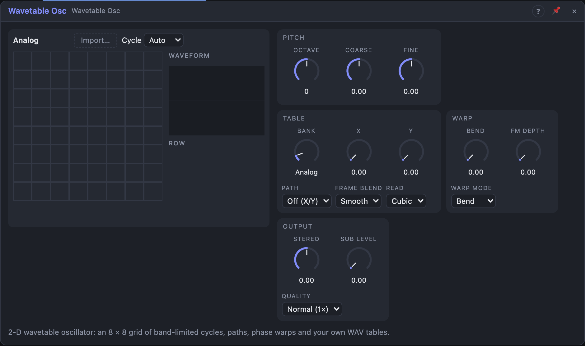

# Wavetable Osc

## Introduction

The Wavetable Osc plays single-cycle waveforms from a *bank*: a grid of up
to 8 × 8 cycles. *X* and *Y* pick a point on the grid and the oscillator
blends the four nearest waveforms, so sweeping X and Y with envelopes and
LFOs moves the timbre in two directions at once, for example brightness
along X and vowel along Y. *Warp* bends how each cycle is read for even more
motion. Eleven factory banks are built in, and you can drop in your own WAV
files. Every cycle is stored band-limited at several octaves, so the sound
stays clean from sub-bass to the top of the keyboard.

## How does it work?

**Pitch.** C4 × 2^(Octave + Coarse/12 + Fine/1200 + Pitch), then the *FM*
input: linear and through zero, ±4× at *FM Depth* 100 %.

**Banks.** *Bank* chooses the grid (it is a stepped knob, so it can be
modulated; changes crossfade over 10 ms):

| Bank | X | Y |
|---|---|---|
| Analog | sine → triangle → saw → square → 10 % pulse | rounder → brighter |
| Harmonic | odd → all harmonics | spectral centre low → high |
| Vowel | a → e → i → o → u | small → large formant shift |
| Pulse | width 50 % → 3 % | single → double pulse |
| Sync | synced saw ratio 1 → 8 | saw → triangle carrier |
| FM | modulation index 0 → 6 | ratio 1 … 8 |
| Fold | fold amount | symmetry |
| Organ | 8 drawbar registrations | third-harmonic percussion |
| Digital | bit depth 8 → 2 | sample-and-hold steps 64 → 4 |
| Spectra | seeded random spectra | rough → smooth |
| Bell | partials compressed → stretched | bright → dark |
| User | your imported cycles | |

**Position.** With *Path* Off, X and Y place the point directly. With a
path (*Rows*, *Snake*, *Columns*, *Diagonal*, *Spiral*) *Scan* moves along
the cells in that order instead and X and Y are hidden. *Smooth* blend mixes
the four nearest cycles; *Step* plays the nearest one (a stepped, digital
sound; each step is crossfaded over 2 ms). Position changes glide over 1 ms.

**Warp** (*Warp Mode*, amount by the *Warp* knob, which takes the mode's
name):

- **Bend:** squeezes the first half of the cycle and stretches the second:
  brighter, resonant tones.
- **Sync:** reads the cycle up to 8 times per period, like hard sync inside
  the table.
- **Mirror:** folds the reading back halfway: symmetric shapes, a new
  even/odd balance.
- **Squash:** plays the whole cycle in the first part of the period and holds
  for the rest: pulse-width modulation for any wave.
- **Steps:** quantises the reading into stairs (2048 → 2 steps): lo-fi.

At 0 % every warp is off. The read automatically uses fewer harmonics when a
warp speeds it up, and the jumps of *Sync*, *Steps* and the *Sync* input are
smoothed, so warping stays band-limited.

**Read.** *Cubic* (smoothest), *Linear*, or *Raw*: the full table, nearest
sample, no band-limiting: aliasing on purpose.

**Stereo.** *Stereo* moves Out R's position along X (or along the path)
from L's; both share the phase, so the sum never cancels the fundamental.
At 0 % L and R are identical.

**Sub.** A sine an octave below, in phase with the main cycle (also after
*Sync*). *Sub Level* mixes it into *Out*; the *Sub* output is always full
level.

### Your own tables

Drop a WAV file on *Import…* (or click it to choose one). Choose *Cycle*
first if you know your file's cycle length; *Auto* uses 2048 samples if the
file is a multiple of that, else the whole file is one cycle. Up to 64
cycles are taken (the view says when a file has more); each is resampled to
the table size, its DC removed and normalised. Fewer than 64 cycles fill the
grid row by row and the grid shrinks to the rows used; one cycle plays
everywhere. Dropping a WAV on one cell of the grid replaces just that cell
(its first cycle). Silent or unreadable files are rejected and the bank stays
as it was.

The file is kept in the Bleep Patch media folder; the board stores only its
id. Importing switches *Bank* to *User*. With nothing imported, *User* plays
a sine.

## How to use it?

- **Evolving pad:** *Analog* or *Harmonic*, slow LFOs on X and Y,
  *Stereo* 20 %.
- **Talking lead:** *Vowel*, an envelope on X, *Warp* Bend 20 %.
- **Scanning:** *Path* Snake, a slow ramp on *Scan*. Use *Pos X/Pos Y* to
  move a filter in step.
- **Sync sweep:** *Warp Mode* Sync, an envelope on *Warp*.
- **PWM anything:** *Warp Mode* Squash, an LFO on *Warp*.
- **Bass:** *Sub Level* 50 %.

## Demo patches

Five whole patches show what Wavetable Osc does. In the standalone app open **File → Presets…** (⌘P) and pick *Wavetable Osc* under *Demos by module*; loading one replaces the project and starts the transport.

| Patch | What it shows |
|---|---|
| **Wavetable Osc: Morphing Pad** | An LFO on *Scan* walks the *Analog* bank along the *Snake* path, with *Stereo* spread. |
| **Wavetable Osc: Vowel Talker** | The *Vowel* bank with *X* and *Y* moved by random generators: a tune that seems to speak. |
| **Wavetable Osc: Bell Garden** | The *Bell* bank with an envelope on *Y*: each note starts bright and fades to a plain tone. |
| **Wavetable Osc: Warp Bass** | *Warp* in *Sync* mode opened by an envelope on each note, plus *Sub Level* for weight. |
| **Wavetable Osc: Spiral Crawl** | *Scan* crawls the *Spiral* path in the *Spectra* bank while the *X* position output opens a filter. |

## Reference

### Knobs and settings

| Control | Range | Default |
|---|---|---|
| Octave | −4 … +4 (stepped) | 0 |
| Coarse | −12 … +12 st | 0 st |
| Fine | −100 … +100 ct | 0 ct |
| Bank | User, 11 factory banks (stepped) | Analog |
| X, Y | 0 – 100 % | 0 % |
| Scan | 0 – 100 % | 0 % |
| Warp | 0 – 100 % | 0 % |
| FM Depth | 0 – 100 % | 0 % |
| Stereo | −50 … +50 % | 0 % |
| Sub Level | 0 – 100 % | 0 % |
| Path | Off (X/Y), Rows, Snake, Columns, Diagonal, Spiral | Off |
| Frame Blend | Smooth, Step | Smooth |
| Read | Cubic, Linear, Raw | Cubic |
| Warp Mode | Bend, Sync, Mirror, Squash, Steps | Bend |
| Quality | Normal (1×), High (2×) | Normal |

All knobs, *Bank* included, are modulation destinations; the settings are
not.

### Inputs

| Input | Signal | What it does |
|---|---|---|
| Pitch | pitch, 1 V/oct | 0.0 = C4 |
| FM | audio | linear, through-zero FM, scaled by *FM Depth* |
| Sync | trigger | restarts the cycle (and the sub) |

### Outputs

| Output | Signal | What it does |
|---|---|---|
| Out L, Out R | audio | the oscillator; R offset by *Stereo* |
| Sub | audio | sine one octave below |
| Pos X, Pos Y | control, 0 … 1 | the position L actually plays, after path and smoothing |
