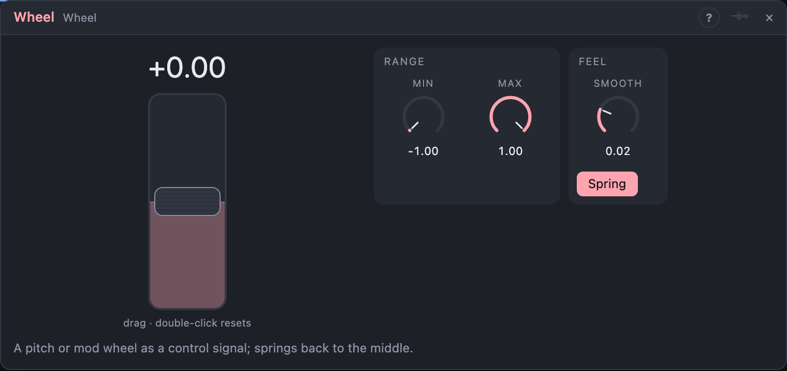

# Wheel

## Introduction

The Wheel is a **pitch or mod wheel** as a control signal. Drag it up and down
and *Out* follows; with **Spring** on it returns to the middle when you let
go, like the wheel on a keyboard. Patch *Out* onto an Oscillator's **Pitch** for
a pitch bend, or onto a filter's cutoff for a mod wheel.

## How does it work?

*Out* goes from **Min** at the bottom of the wheel to **Max** at the top. The
default range is −1 to +1 with the wheel centred, so at rest *Out* is 0. For a
mod wheel that rests at the bottom, set *Min* to 0 and turn *Spring* off.

**Spring** (on by default) moves the wheel back to the middle when you let go.
Off, it stays where you leave it.

**Smooth** glides *Out* to a new position instead of jumping.

A cable into *Value* moves the wheel like a hand would. In a panel, a Wheel
control drives this module.

## How to use it?

- **Pitch bend:** *Out* onto an Oscillator's **Pitch**, cable amount ±2 semitones.
- **Mod wheel:** *Min* 0, *Max* 1, *Spring* off, *Out* onto a filter's **Cutoff**.

## Reference

### Knobs

| Knob | Range | Default |
|---|---|---|
| Value | 0 – 100 % | 50 % |
| Min | −1 – +1 | −1 |
| Max | −1 – +1 | +1 |
| Smooth | 0 – 2 s | 20 ms |

Every knob is a modulation destination.

### Settings

| Setting | Values | Default |
|---|---|---|
| Spring | off, on | on |

### Outputs

| Output | Signal | What it does |
|---|---|---|
| Out | control | the wheel's position, scaled from *Min* to *Max* |
